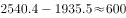
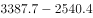
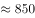
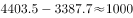
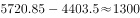
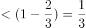
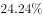
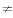
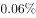
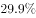

# 综合分析判断题（逐项验证-排除法），涉及增量趋势比较、增长贡献率与营收占比口径辨析

考点：[[20-考点/资料分析/综合/综合分析判断题（逐项验证-排除法），涉及增量趋势比较、增长贡献率与营收占比口径辨析|综合 / 综合分析判断题（逐项验证/排除法），涉及增量趋势比较、增长贡献率与营收占比口径辨析]]
材料：[[15-材料/资料分析/195079 2016年（含2012-2016年趋|195079 2016年（含2012-2016年趋]]

**问法模型**：题干为'从上述资料中可以得出'的综合分析问法 → 对A/B/C/D逐项验证（A用柱状图逐年增量、B用文字贡献率结论、C/D用表格占比直查），排除三个错误项锁定唯一正确项

## 推理链
1. 第1步：题干'从上述资料中可以得出'为综合分析题，四个选项分别对应：A增量趋势（柱状图）、B增长贡献率（文字段）、C/D占比比较（统计表）
2. 第2步：A项验证——由柱状图取数字出版营收2012-2016年为1935.5、2540.4、3387.7、4403.5、5720.85亿元，逐年增量=当年−上年
3. 第3步：计算增量为604.9、847.3、1015.8、1317.35亿元，逐年递增，'增量保持增长势头'成立，A正确
4. 第4步：B项验证——文字段指出数字出版对全行业营收增长贡献超三分之二；全行业2016年增量=23595.8−21655.9=1939.9亿元，数字出版增量1317.35÷1939.9≈67.9%＞2/3，故贡献最大者是数字出版而非印刷复制（表格53.87%是营收存量占比，非增量贡献率），B错误
5. 第5步：C项验证——统计表：数字出版营收占比24.24%（与柱状图互验5720.85÷23595.8≈24.24%），远小于三分之二≈66.7%，C错误
6. 第6步：D项验证——统计表：图书出版占比3.53%、电子出版物出版占比0.06%，同一基数（总营收23595.8亿元）下图书营收约为电子的3.53÷0.06≈59倍，并不'相当'，D错误
7. 第7步：仅A可由材料推出，对照选项锁定答案A

**最快解法**：⚡ 排除法优先+增量粗算：B用文字'数字出版对全行业增长贡献超三分之二'直接反杀（勿被表格53.87%迷惑）；C查表24.24%＜66.7%秒杀；D查表3.53% vs 0.06%相差近60倍秒杀；A只需对柱状图逐年作差粗验604.9→847.3→1015.8→1317.35单调递增即可锁定，无需精算

## 易错点
- ⚠ B项口径陷阱：53.87%是印刷复制的营收存量占比，题问'增长贡献'是增量贡献率（部分增量÷总增量1939.9亿元），两者不能混用；文字已给'数字出版贡献超三分之二'即锁定最大贡献者是数字出版
- ⚠ C项迁移陷阱：把文字'数字出版对营收增长贡献超三分之二'（增量贡献率）误迁移为'营收占比超三分之二'，实际营收占比仅24.24%
- ⚠ A项时间口径瑕疵：柱状图无2011年数据，2012年当年增量（对2011年）无法计算，严格只能验证2013-2016四个增量；官方解析备注已自认，因B/C/D存在明显错误仍按排除法选A

## 母题抽象
> 🧩 当综合分析题出现'可以得出/正确的是'时，先按选项类型分流：占比项直接查表对数排除、贡献率项用文字现成结论反证秒杀，最后仅对趋势/增量项用柱状图逐年作差粗验，锁定唯一正确项

**同类特征**：从上述资料中可以得出、综合分析判断题、增量保持增长势头、增长贡献最大、占比超过三分之二、营收相当

## 相关题
- [[10-真题/资料分析/增长/2385108 增长贡献比较（增长量比较之定性符号判断）|2385108]]（深圳市考 2019，相关度1）
- [[10-真题/资料分析/增长/2049334 增长贡献率比较（比部分增长量）|2049334]]（河南 2017，相关度1）
- [[10-真题/资料分析/综合/2274528 综合分析判断（同比增长率验证+峰值年份定位+平均每场面积比较+年均每天平均数）|2274528]]（北京 2019，相关度1）
- [[10-真题/资料分析/综合/2145034 综合分析判断题（核心为两期占比变化比较，辅以年均投资额、年均增长量、定性推断排除）|2145034]]（深圳市考 2017，相关度1）
- [[10-真题/资料分析/综合/2388033 综合分析判断题（基期量还原＋数据可得性判断＋份额估算）|2388033]]（河北 2019，相关度1）

---

### 题干
从上述资料中可以得出：

### 选项
- A. 2012-2016年间，我国数字出版业营收增量保持增长势头　✅
- B. 2016年，对我国新闻出版产业营收增长贡献最大的是印刷复制业
- C. 2016年，我国数字出版业营收占新闻出版产业营收的比例超过三分之二
- D. 2016年图书出版物营收与电子出版物营收相当

### 官方解析

A项：定位材料统计图，可知数字出版业营收增量为：2013年（）2014年（）2015年（）2016年（），可见增量保持增长势头，正确；

B项：定位材料第一段，可知2016年数字出版实现营业收入对全行业营业收入增长贡献（增长贡献率指部分增量在总体增量中所占的比例）超三分之二，则印刷复制业对全行业营业收入增长贡献，故印刷复制业对全行业营业收入增长贡献数字出版业对全行业营业收入增长贡献，错误；

C项：定位表格，可知2016年我国数字出版业营收占新闻出版产业营收的比例为，小于三分之二，错误；

D项：定位材料统计表，可知2016年图书出版物营收占比（）电子出版物营收占比（），故2016年图书出版物营收电子出版物营收，错误。

故正确答案为A。

备注：A项严格意义上来说需要用我国数字出版业2013年营收增量与2012年营收增量进行比较，虽无法求出2012年营收增量，但其他年份均满足，勉强符合“2012-2016年间，我国数字出版业营收增量保持增长势头”，加上其余三个选项均存在明显错误，综合考虑只能选择A项。

### 给定材料

根据下面资料回答101-105题：

        2017年7月24日，国家新闻出版广电总局发布的《2016年新闻出版产业分析报告》指出，2016年全国出版、印刷和发行服务实现营业收入23595.8亿元，较2015年增加1939.9亿元，增长。其中，数字出版实现营业收入5720.85亿元，比2015年增长，对全行业营业收入增长贡献超三分之二。

        2016年，全国共出版图书、期刊、报纸、音像制品和电子出版物512.53亿册（份、盒、张）。其中，出版图书49.99万种，重版、重印23.75万种。

> [!warning] 疑点（官方解析可能有误，待人工复核）
> 官方解析备注自认A项口径不严谨：材料柱状图始于2012年、无2011年数据，2012年当年增量（对2011年）无法计算，'2012-2016年间增量保持增长'严格只能验证2013-2016四个增量；因B/C/D存在明显错误，官方按排除法维持A为答案。此为命题口径问题，不影响官方答案A

<!-- CODEX-ANSWER-REVIEW:BEGIN -->
### 本次独立复核

**复核状态：** `resolved`（答案与解析已核定）

**计分答案：** A（可计分）

**复核解析：**

国家新闻出版广电总局2012年新闻出版产业分析报告图3补足题面缺失的2010—2013数字出版收入：约1051.8、1377.9、1935.5、2540.4亿元，2011、2012、2013年度增加额分别约326.1、557.6、604.9亿元。官方资料给出2014年收入3387.7亿元、2015年4403.9亿元、2016年5720.85亿元，后三年增加额约847.3、1016.2、1316.95亿元。因此2012—2016各年增量逐年增加，A成立。

**相关信息：**

资料分析—连续年度增量比较；先补齐各年收入，再作相邻年份差，不能用收入本身的排序替代增量趋势。

**题源依据：** [固定版本原题](https://github.com/Mentat-Uran/kaogongzhentizhengliu/blob/84ab93d4b64b61d897bece8a1c0a5bab06b4feb2/10-%E7%9C%9F%E9%A2%98/%E8%B5%84%E6%96%99%E5%88%86%E6%9E%90/%E7%BB%BC%E5%90%88/2187533%20%E7%BB%BC%E5%90%88%E5%88%86%E6%9E%90%E5%88%A4%E6%96%AD%E9%A2%98%EF%BC%88%E9%80%90%E9%A1%B9%E9%AA%8C%E8%AF%81-%E6%8E%92%E9%99%A4%E6%B3%95%EF%BC%89%EF%BC%8C%E6%B6%89%E5%8F%8A%E5%A2%9E%E9%87%8F%E8%B6%8B%E5%8A%BF%E6%AF%94%E8%BE%83%E3%80%81%E5%A2%9E%E9%95%BF%E8%B4%A1%E7%8C%AE%E7%8E%87%E4%B8%8E%E8%90%A5%E6%94%B6%E5%8D%A0%E6%AF%94%E5%8F%A3%E5%BE%84%E8%BE%A8%E6%9E%90.md)；固定内容 commit `84ab93d4b64b61d897bece8a1c0a5bab06b4feb2`，Markdown blob `db42ecba9b9c0c189a3a043051a1ab5303d30219`。
<!-- CODEX-ANSWER-REVIEW:END -->
