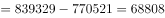
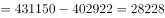
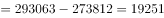
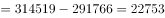
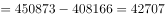

# 净资产额计算与多主体大小比较（净资产=总资产-总负债，综合判断选正确项）

考点：[[20-考点/资料分析/综合/净资产额计算与多主体大小比较（净资产=总资产-总负债，综合判断选正确项）|综合 / 净资产额计算与多主体大小比较（净资产=总资产-总负债，综合判断选正确项）]]
材料：[[15-材料/资料分析/195083 2017年5月我国境内银行业金融机构|195083 2017年5月我国境内银行业金融机构]]

**问法模型**：题干问'下列表述正确的是'且各选项均为'某类机构净资产额＞另一类机构净资产额' → 依据注释③净资产=总资产-总负债，对每个主体跨列相减后逐项验证不等式方向

## 推理链
1. 第1步：注释③给出净资产额=总资产额-总负债额，表中未直接给净资产，必须对各行跨列相减；题干四个选项均比较两类机构净资产大小，符号为'＞'
2. 第2步：计算大型商业银行净资产：839329-770521=68808亿元；股份制商业银行净资产：431150-402922=28228亿元
3. 第3步：计算其余主体净资产：城市商业银行293063-273812=19251亿元，农村金融机构314519-291766=22753亿元，其他类金融机构450873-408166=42707亿元
4. 第4步：按净资产排序：大型商业银行68808＞其他类42707＞股份制28228＞农村22753＞城市商业银行19251（亿元）
5. 第5步：逐项验证：A项城市19251＜农村22753，错误；B项城市19251＜股份制28228，错误；C项大型68808＞股份制28228，正确；D项农村22753＜其他类42707，错误
6. 第6步：只有C项不等式成立，与官方答案C一致

**最快解法**：⚡ 口算跨列相减+直接锁定C：C项大型净资产≈83.9万-77.1万≈6.9万亿（68808亿），股份制净资产≈431150-402922≈2.8万亿（28228亿），差距悬殊，C直接成立无需算全；亦可先算城商行净资产19251亿为五类中最小，秒杀排除A、B，再比较D（22753＜42707）即完成

## 易错点
- ⚠ 净资产不能直接从表中读出，必须依据注释③'净资产=总资产-总负债'跨列相减；若误用总资产或总负债单独比大小（如只看股份制总资产431150＞城商行293063），会误判B等选项
- ⚠ 第一行'银行业金融机构'为总计行，不是分项，不能纳入净资产比较或排序，否则口径错误
- ⚠ 四个选项涉及五类机构的两两组合，只算一两组不够，须算齐全部五类净资产再排序；且'其他类金融机构'为合并口径（含政策行、邮储等，注释②），勿按字面拆解

## 母题抽象
> 🧩 当题干出现'净资产额/净额'且选项为多主体两两比大小时，先套用材料注释公式'净资产=大数-小数（总资产-总负债）'逐行口算，再按数值排序逐项核对不等号方向，先做差距最悬殊的一项直接锁定答案

**同类特征**：下列表述正确的是、净资产额、总资产-总负债（注释③）、两类机构两两比较、统计表跨列相减、多主体排序验证

## 相关题
- [[10-真题/资料分析/综合/1758936 综合判断题（城镇化率过半判断、比重增量比较、跨行跨期数据比对）|1758936]]（上海 2016，相关度1）
- [[10-真题/资料分析/综合/2050982 综合判断题（两期比重升降比较＋增长量要素齐备性＋指标口径核对）|2050982]]（江西 2017，相关度1）
- [[10-真题/资料分析/综合/2188549 净资产额计算与大小比较（多选项判断）|2188549]]（湖北 2018，相关度1）

---

### 题干
根据所给资料，下列表述正确的是：

### 选项
- A. 
城市商业银行净资产额农村金融机构净资产额

- B. 
城市商业银行净资产额股份制商业银行净资产额

- C. 
大型商业银行净资产额股份制商业银行净资产额
　✅
- D. 
农村金融机构净资产额其他类金融机构净资产额

### 官方解析

定位统计表可得,大型商业银行净资产额亿元，股份制商业银行的净资产额亿元，城市商业银行的净资产额亿元，农村金融机构的净资产额亿元，其他金融机构的净资产额亿元，故大型商业银行的净资产额其他金融机构的净资产额股份制商业银行的净资产额农村金融机构的净资产额城市商业银行的净资产额。只有C项满足。 

故正确答案为C。

### 给定材料

根据以下资料，回答以下问题。

注：

1.农村金融机构包括农村商业银行、农村合作银行、农村信用社和新型农村金融机构。

2.其他类金融机构包括政策性银行及国家开发银行、民营银行、外资银行、非银行金融机构、资产管理公司和邮政储蓄银行。

3.净资产额等于总资产额减去总负债额。

