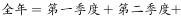
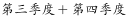
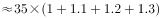

# 综合分析·可推出-可计算判断（时间与地域口径排除＋混合增长率方向判断＋环比等比数列求和）

考点：[[20-考点/资料分析/综合/综合分析·可推出-可计算判断（时间与地域口径排除＋混合增长率方向判断＋环比等比数列求和）|综合 / 综合分析·可推出/可计算判断（时间与地域口径排除＋混合增长率方向判断＋环比等比数列求和）]]
材料：[[15-材料/资料分析/195085 某省2017年第一季度农林牧渔业总产|195085 某省2017年第一季度农林牧渔业总产]]

**问法模型**：题干问'能够从上述资料中推出或计算出的是'→逐项核对主体/时间/地域/指标口径是否在材料给数范围内，先排除不可算项，剩余可算项用公式定量验证。

## 推理链
1. 第1步：A项问2017年（全年）该省农林牧渔服务业增加值，而材料第六段只给2017年第一季度服务业增加值21.87亿元，无全年或分季度数据，无法推出，排除。
2. 第2步：B项问2016年第一季度全国农林牧渔业增加值，材料通篇是'该省'口径（2017年一季度全省361.78亿元），既无全国数据也无2016年对应基数，无法推出，排除。
3. 第3步：C项中非养殖水产品=水产品总量7.68-养殖7.3=0.38万吨；水产品总产量与养殖水产品产量同比均为正增长，按混合增长率'整体增速大小居中'，非养殖水产品增速也为正，即2017年Q1高于2016年Q1，是'上升'而非'持平'，C错误。
4. 第4步：D项中林业2017年Q1增加值为34.84亿元；设每季度环比增长率不低于r，则全年增加值=34.84+34.84(1+r)+34.84(1+r)²+34.84(1+r)³=34.84×[1+(1+r)+(1+r)²+(1+r)³]。
5. 第5步：代入题给r（原图公式，本版文本未显示）计算四个季度合计，总和超过150亿元，D项结论成立，可以推出。
6. 第6步：A、B、C均已排除，故正确答案为D（官方注明：D项计算量较大，排除前三项后可直接选D）。

**最快解法**：⚡ 排除法（口径核对）：A卡时间口径——材料全部为'第一季度'当季数据，问'2017年全年'不可算；B卡地域口径——材料只有'该省'，问'全国'不可算；C卡方向判断——混合增长率居中得非养殖增速为正，'上升'与'持平'矛盾，三项秒排；D按官方注明计算量大，无需硬算直接选D；若需验证，用等比数列求和34.84×[1+(1+r)+(1+r)²+(1+r)³]与150比较。

## 易错点
- ⚠ 时间口径陷阱：本材料所有数值均为2017年第一季度（当季而非累计），A项问'2017年（全年）'，一季度21.87亿元不能外推全年，勿误判A可算。
- ⚠ 地域口径陷阱：材料只给'该省'数据（总计361.78亿元），B项问'全国'，省≠全国，勿因数字齐全而误选B。
- ⚠ D项环比≠同比：全年值需把Q1的34.84亿元本身计入，并按环比逐季等比累加共4项，勿只算后三季度或误用同比增速；C项勿把'增速为正（上升）'与'持平（增速为0）'混为一谈；另注意养殖7.3万吨⊂总量7.68万吨，非养殖用减法7.68-7.3=0.38万吨，不能相加。

## 母题抽象
> 🧩 当题干出现'能够从上述资料中推出或计算出的是'时，先用'时间-地域-指标'三重口径排除法清理不可算选项，再用混合增长率定方向（整体居中推分项增速正负）、等比数列求和模型（首项×[1+(1+r)+…+(1+r)ⁿ⁻¹]，n=4个季度）定量验证剩余项。

**同类特征**：能够从上述资料中推出或计算出的是、2017年（全年）与'第一季度'当季数据错位、'全国'与'该省'口径错位、非养殖水产品=总量-养殖（包含关系做减法）、每个季度的环比增长率不低于、全年增加值将超过150亿元（四个季度等比累加）

## 相关题
（暂无）

---

### 题干
能够从上述资料中推出或计算出的是：

### 选项
- A. 
2017年该省农林牧渔服务业增加值

- B. 
2016年第一季度全国农林牧渔业增加值

- C. 
2017年第一季度该省水产品产量中非养殖水产品产量与2016年第一季度持平

- D. 
若2017年该省林业增加值每个季度的环比增长率不低于，则2017年该省林业增加值将超过150亿元
　✅

### 官方解析

A项：定位材料第六段，给出的是2017年第一季度该省农林牧渔服务业增加值与增长率，没有与2017年全年相关的数据，故无法计算；

B项：定位材料第一段，给出的是2017年第一季度该省农林牧渔业增加值，没有与全国相关的数据，故无法计算；

C项：定位材料第五段可知，2017年第一季度全省水产品产量比上年同期增长，养殖水产品产量同比增长。根据混合增长率“整体增速大小居中”的结论，则非养殖水产品的增速也为。增速为正，说明2017年第一季度非养殖水产品产量比2016年第一季度上升了，错误；

D项：定位材料第三段可知，2017年第一季度该省林业增加值为34.84亿元，若每季度环比增长率不低于，则，正确。

故正确答案为D。

注：D项计算量较大，故A、B、C排除后直接选D即可。

### 给定材料

<b>根据以下资料，回答以下问题。</b>

        2017年第一季度，某省农林牧渔业增加值361.78亿元，比上年同期增长，高于上年同期0.2个百分点。具体情况如下：

        该省种植业增加值119.21亿元，比上年同期增长。其中蔬菜种植面积358.80万亩，比上年同期增加18.23万亩，蔬菜产量471.42万吨，增长；茶叶种植面积679.53万亩，比上年同期增加19.79万亩，茶叶产量2.30万吨，增长。

        该省林业增加值34.84亿元，比上年同期增长。

        该省畜牧业增加值176.64亿元，比上年同期增长，增速比上年同期加快2.1个百分点。其中生猪存栏增速由上年同期的下降转为增长，出栏增速由上年同期的下降转为增长；猪牛羊禽肉产量67.80万吨，比上年同期增长；禽蛋产量5.33万吨，增长；牛奶产量1.40万吨，增长。

        该省渔业增加值9.22亿元，比上年同期增长。全省水产品产量7.68万吨，比上年同期增长，其中，养殖水产品产量7.3万吨，增长。

        该省农林牧渔服务业增加值21.87亿元，比上年同期增长。

> [!warning] 疑点（官方解析可能有误，待人工复核）
> 本版本材料与官方解析中所有同比增速百分数及D项环比增长率公式（latex图片）均未显示，第3、5步的定量代入只能依据官方解析结论采信；官方解析逻辑本身无矛盾（C增速为正故非持平、D按等比求和超150亿元），不影响答案D的认定，故不构成对官方答案的质疑。

<!-- CODEX-ANSWER-REVIEW:BEGIN -->
### 本次独立复核

**复核状态：** `confirmed`（独立复算确认答案）

**计分答案：** D（可计分）

**复核解析：**

恢复公式图后核对四项：A缺全年该省农林牧渔服务业增加值所需数据；B的2017年第一季度数据属于该省，不能推出全国2016年第一季度值。C中全省水产品总量和养殖水产品同比增速相同且为正，混合增速相同则非养殖部分也同比增长，不可能与上年持平。D从第一季度林业增加值34.84亿元出发，若后续每季度环比至少增长10%，全年至少为34.84×(1+1.1+1.1²+1.1³)=34.84×4.641≈161.7亿元，超过150亿元。故选D。

**相关信息：**

资料分析—混合增长率与等比数列求和。等比增长逐季累加应按季度值求和；当总量和一个组成部分增长率相同，另一正权重组成部分的增速也必须相同。

**题源依据：** [固定版本原题](https://github.com/Mentat-Uran/kaogongzhentizhengliu/blob/84ab93d4b64b61d897bece8a1c0a5bab06b4feb2/10-%E7%9C%9F%E9%A2%98/%E8%B5%84%E6%96%99%E5%88%86%E6%9E%90/%E7%BB%BC%E5%90%88/2187824%20%E7%BB%BC%E5%90%88%E5%88%86%E6%9E%90%C2%B7%E5%8F%AF%E6%8E%A8%E5%87%BA-%E5%8F%AF%E8%AE%A1%E7%AE%97%E5%88%A4%E6%96%AD%EF%BC%88%E6%97%B6%E9%97%B4%E4%B8%8E%E5%9C%B0%E5%9F%9F%E5%8F%A3%E5%BE%84%E6%8E%92%E9%99%A4%EF%BC%8B%E6%B7%B7%E5%90%88%E5%A2%9E%E9%95%BF%E7%8E%87%E6%96%B9%E5%90%91%E5%88%A4%E6%96%AD%EF%BC%8B%E7%8E%AF%E6%AF%94%E7%AD%89%E6%AF%94%E6%95%B0%E5%88%97%E6%B1%82%E5%92%8C%EF%BC%89.md)；固定内容 commit `84ab93d4b64b61d897bece8a1c0a5bab06b4feb2`，Markdown blob `293b93419d57ffa54bac3e6a5b5421bdf7c6ddd5`。
<!-- CODEX-ANSWER-REVIEW:END -->
