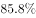

# 综合判断题（能够推出）——行业排名定位＋两期利用率（百分点）差＋比重求量混合验证

考点：[[20-考点/资料分析/综合/综合判断题（能够推出）——行业排名定位＋两期利用率（百分点）差＋比重求量混合验证|综合 / 综合判断题（能够推出）——行业排名定位＋两期利用率（百分点）差＋比重求量混合验证]]
材料：[[15-材料/资料分析/195088 J省2016年规模以上工业取水与用水|195088 J省2016年规模以上工业取水与用水]]

**问法模型**：题干问'能够从上述资料中推出的是'→ 综合判断题，对A~D逐项定位数据源（图1/图2/文字）做定量或定性核对，三假一真选真项

## 推理链
1. 第1步：A项定位图1（用新水量口径）：剔除'其他9.2'后排名为纺织5.5＞水生产供应4.0＞电力3.7＞化学原料3.6＞造纸2.3，故用新水量第4名的行业是化学原料行业
2. 第2步：A项定位文字第二段：化学原料行业的重复用水利用率数值小于选项所给界值，'不到'成立，A项可推出
3. 第3步：B项：文字给出2016年重复用水利用率比上年提高0.1个百分点，故2015年利用率＝2016年利用率−0.1个百分点，计算结果与B项所给数值不符，B错误
4. 第4步：C项：文字直接比较两个行业利用率，电力行业低于石油加工行业，与选项'高于'矛盾，C错误
5. 第5步：D项：图2其他水源占2%，总量为86.4亿立方米，86.4×2%＝1.728亿立方米＞1亿立方米，'不到1亿立方米'不成立，D错误
6. 第6步：三错一对，仅A项能从资料中推出，选A

**最快解法**：⚡ 综合判断按'先易后难'秒杀顺序：先做一步定量项D——截位乘法86.4×2%≈1.7亿立方米＞1，直接排除；再做定性比较项C——文字中电力与石油加工利用率直接比大小，排除；再做B——用'基期＝现期−提高的百分点'口算2015年利用率＝2016年利用率−0.1个百分点，排除；最后A项跨图1排名（必须剔除'其他'9.2）确定第4名为化学原料，回文字核对其利用率小于选项界值，确认选A

## 易错点
- ⚠ 把图1中'其他9.2'当作行业参与排名，会误判用新水量第4名；剔除'其他'后才是纺织5.5、水生产供应4.0、电力3.7、化学原料3.6，第4名为化学原料
- ⚠ 三个总量口径并存不可互换：取水量86.4（对应图2）、用新水量28.3（对应图1）、重复用水量168.4（文字），重复用水利用率只挂在'重复用水'口径下，跨口径套算即错
- ⚠ B项方向与单位陷阱：'比上年提高0.1个百分点'指2016比2015高，求2015应做减法且差值单位是百分点而非%，方向看反或按百分比差算即错；D项其他水源占比仅2%，需按86.4×2%≈1.7亿立方米估量级，误按1%≈0.86量级心算易误判'不到1亿'

## 母题抽象
> 🧩 当综合判断题出现'能够从上述资料中推出的是'时，先用'比重×总量'一步定量项和'文字直接比大小'定性项快速排除，再验'基期＝现期−（提高的）百分点'类两期差选项，最后做需跨图排名并剔除'其他'口径的复杂项

**同类特征**：能够从上述资料中推出的是、重复用水利用率、用新水量第4名的行业、从其他水源取水、比上年提高0.1个百分点、图1图2与文字联合定位

## 相关题
- [[10-真题/资料分析/综合/19283943 综合分析判断题（倍数比较+求和判断+隐含平均每场座位数反推）|19283943]]（国考 2025，相关度1）
- [[10-真题/资料分析/综合/1796162 综合判断（月均计算、平均运输距离、比重对比、增长量比较逐项验证）|1796162]]（贵州 2016，相关度1）
- [[10-真题/资料分析/综合/2133504 综合判断题（现期比重+现期平均数多项验证，一对三错）|2133504]]（国考 2018，相关度1）
- [[10-真题/资料分析/综合/2444706 综合判断题（增长量+比重+倍数逐项验证）|2444706]]（四川 2019，相关度1）
- [[10-真题/资料分析/综合/2571728 综合分析逐项判断（等差递推求和＋单位换算＋比值估算）|2571728]]（山东 2020，相关度1）

---

### 题干
能够从上述资料中推出的是：

### 选项
- A. 
用新水量第4名的行业，重复用水利用率不到
　✅
- B. 
2015年规模以上工业重复用水利用率为

- C. 
2016年电力行业重复用水利用率高于石油加工行业

- D. 
2016年规模以上工业从其他水源取水不到1亿立方米

### 官方解析
A项：定位饼状图1可得，2016年规模以上工业用新水量行业结构中用新水量第4名的行业为化学原料行业；定位文字材料第二段可得化学原料重复用水利用率为，不到，正确；
B项：定位文字材料第二段可得：2016年规模以上工业重复用水利用率为，比上年提高0.1个百分点。故2015年规模以上工业重复用水利用率，错误；
C项：定位文字材料第二段可得：2016年电力行业重复用水利用率为，石油加工行业为，电力行业低于石油加工行业，与选项描述不符，错误；
D项：定位饼状图2可得：2016年规模以上工业从其他水源取水占比为，定位文字材料第一段可得：2016年J省规模以上工业取水量为86.4亿立方米，故2016年规模以上工业从其他水源取水，错误。
故正确答案为A。

### 给定材料

        2016年，J省规模以上工业取水量为86.4亿立方米，比上年增长。其中，直接采自江、河、淡水湖、水库等的地表淡水68.1亿立方米，比上年增长，所占比重比上年下降0.4个百分点；自来水取水量15.9亿立方米，同比增长。 

        2016年，规模以上工业重复用水量168.4亿立方米，比上年增长；重复用水利用率，比上年提高0.1个百分点。其中，石油加工、黑色金属冶炼及压延加工、电力和化学原料等4个行业的重复用水总量占规模以上工业的，重复用水利用率分别为、、和。全年用新水量超过2亿立方米的5个行业用新水量合计19.1亿立方米，占总用新水量的，比重比上年下降0.9个百分点。

