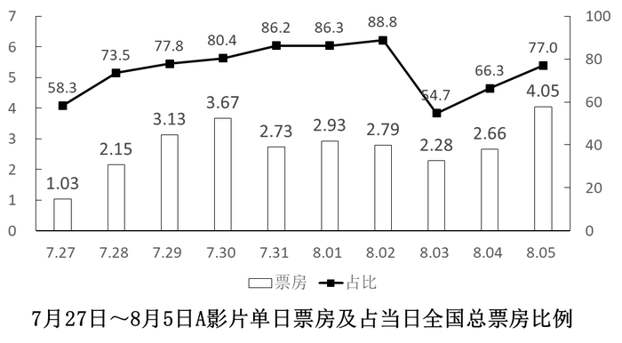

# 综合判断题（前后5日求和比较＋比重反推比较全国总票房＋比重反推求份额＋排片占比同口径倍数）

考点：[[20-考点/资料分析/综合/综合判断题（前后5日求和比较＋比重反推比较全国总票房＋比重反推求份额＋排片占比同口径倍数）|综合 / 综合判断题（前后5日求和比较＋比重反推比较全国总票房＋比重反推求份额＋排片占比同口径倍数）]]
材料：[[15-材料/资料分析/195089 某A影片上映后10天（7月27日～8|195089 某A影片上映后10天（7月27日～8]]

**问法模型**：'以下信息能够从资料中推出的有几条'→逐条独立核验型综合判断：和比较用直接加总、整体比较用'部分÷比重'反推、倍数用同口径指标相除，数出真命题个数对照选项

## 推理链
1. 第1步：①由图1取数——前5日（7.27~7.31）票房和=1.03+2.15+3.13+3.67+2.73=12.71亿元，后5日（8.01~8.05）=2.93+2.79+2.28+2.66+4.05=14.71亿元，14.71>12.71，①正确
2. 第2步：②按'整体=部分÷比重'反推——8月1日全国总票房=2.93÷86.3%≈3.40亿元，8月2日=2.79÷88.8%≈3.14亿元，3.14<3.40，②'高于'错误
3. 第3步：③先反推8月5日全国总票房=4.05÷77.0%≈5.26亿元，再求B片份额=0.87÷5.26≈16.5%，超过缺省阈值（题干'以上'前数字残缺，约15%档），③正确
4. 第4步：④排片占比为场次口径，同除'当日全国总场次'后可直接相比，A/E场次倍数=50.9%÷1.8%≈28.3倍，落在'20多倍'（20~30）区间，④正确
5. 第5步：真命题为①③④共3条，对照选项，选C

**最快解法**：⚡ 逐条速判：①两组各5个数直接加总比较（12.71 vs 14.71）；②用交叉比较秒杀——2.93/86.3%分子更大且分母更小，必大于2.79/88.8%，无需精算即判8.1>8.2、②错；③截位直除4.05/0.77≈5.26，0.87/5.26≈16.5%；④同口径相除50.9/1.8≈28倍属'20多倍'；①③④真共3条选C

## 易错点
- ⚠ 双轴错位与口径混淆：柱标签（1.03等）是票房亿元、线标签（58.3等）是占比%，反推整体时分子分母不可取错；④必须用表2排片占比（场次口径），误用图1票房占比或上座率则全错
- ⚠ ②凭柱子高低直接比大小：8.2柱（2.79）比8.1（2.93）矮但占比更高（88.8%>86.3%），问的是全国总票房必须反推整体，只比柱高或只比占比都会误判
- ⚠ ③题干'占当日全国总票房的（　）以上'中比例数字残缺，需按解析默认阈值（≈15%）处理；④'20多倍'指28.3倍落在20~30区间，勿因≈28误判为'近30倍'而错删该条

## 母题抽象
> 🧩 当题干出现'以下信息/说法能够推出的是（有几条）'时，逐条独立验证：和比较直接加总、整体比较用'部分÷比重=整体'反推、倍数用同口径两指标相除，最后数真命题个数对照选项

**同类特征**：能够从上述资料中推出的有几条、上映第6～10日票房之和高于前5日、全国总票房高于某日水平、占当日全国总票房的（　）以上、上映场次是…的20多倍、逐条判断真假后数条数

## 相关题
- [[10-真题/资料分析/综合/2377300 综合判断题（一成比重判定+基期差值计算+增速极值查找+两期比重变化方向）|2377300]]（选调 2019，相关度1）
- [[10-真题/资料分析/综合/5408643 信息可推性综合判断（基期量与基期平均数倒推）|5408643]]（四川 2022，相关度1）
- [[10-真题/资料分析/综合/2247343 综合判断题（多信息正误推断：混合增速推理＋两期利润率比较＋倍数表述＋增长量估算）|2247343]]（新疆 2018，相关度1）
- [[10-真题/资料分析/综合/3522689 综合判断（多断言真伪计数：基期利润、间隔增长率、两期基期量比较）|3522689]]（甘肃 2021，相关度1）

---

### 题干
以下信息中，能够从上述资料中推出的有几条？
①A影片上映第6～10日票房之和高于前5日票房之和
②8月2日全国总票房高于8月1日水平
③8月5日B影片票房占当日全国总票房的以上
④8月5日A影片的上映场次是E影片的20多倍

### 选项
- A. 1
- B. 2
- C. 3　✅
- D. 4

### 官方解析
①定位图形材料，A影片上映第6～10日票房之和为亿元，前5日票房之和为亿元，故A影片上映第6～10日票房之和高于前5日票房之和，正确；
②定位图形材料，8月2日全国总票房亿元，8月1日全国总票房亿元，故8月2日全国总票房低于8月1日水平，错误；
③定位图形材料，8月5日全国总票房 ，故B影片票房占全国总票房的比重约为，即8月5日B影片票房占当日全国总票房的以上，正确；
④定位表格材料及备注，A影片排片占比，故当日A影片上映场次，同理，当日E影片上映场次，则当日，即20多倍，正确。
综上所述①③④正确。
故正确答案为C。

### 给定材料

根据所给资料，回答111～115题。

注：该影片上映时间为7月27日。

排片占比=当日该影片上映场次÷当日全国所有影片上映场次×100%

上座率=（当日该影片上映场次数×当日该影片场均观影人数）÷（当日该影片上映场次数×放映厅平均座位数）×100%

> [!warning] 疑点（官方解析可能有误，待人工复核）
> 题干③'占当日全国总票房的以上'中具体比例缺失（信息残缺，官方解析数值亦留空）；按计算B片占比≈16.5%推断缺省阈值应为15%档，该残缺不影响答案C的判定，官方解析各条结论与独立计算（①12.71<14.71、②3.14<3.40、③16.5%、④28.3倍）一致，无实质错误
