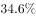
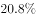
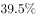

# 综合分析推断题（平均数计算+增长方向判断+增长率阈值+比重阈值四项逐一验证）

考点：[[20-考点/资料分析/综合/综合分析推断题（平均数计算+增长方向判断+增长率阈值+比重阈值四项逐一验证）|综合 / 综合分析推断题（平均数计算+增长方向判断+增长率阈值+比重阈值四项逐一验证）]]
材料：[[15-材料/资料分析/195255 2016年全国文化演艺事业发展情况的|195255 2016年全国文化演艺事业发展情况的]]

**问法模型**：'从上述资料可以推断'四选一综合判断 → 对每个选项先定口径再套模型：A为'总量÷份数'平均数与60场比较，B看'增长/减少'方向，C为'增长量÷基期量'增长率与阈值比较，D为'部分÷整体'比重与阈值比较

## 推理链
1. 第1步：A项条件——第四段'文化部门所属艺术表演团体共组织政府采购公益演出13.90万场'，第二段'文化部门所属的艺术表演团体2031个'，两处口径同为文化部门所属团体，可相除
2. 第2步：A项计算——13.90万场=139000场，139000÷2031≈68.4场/个，因2031×60=121860＜139000，故平均每团超过60场，A项成立
3. 第3步：B项——第三段'演出收入130.86亿元，增长'，材料明示为正增长，故演出收益较2015年增加而非减少；即便把'收益'理解为利润，材料也未给相关数据，同样无法推出'减少'
4. 第4步：C项——末段'美术馆从业人员4597人，增加502人'，增长率=502÷(4597−502)=502÷4095≈12.3%，小于选项所给增长率阈值（图片公式），'以上'说法不成立，C错误
5. 第5步：D项——第四段'赴老少边穷地区演出241场'÷'公益性演出共1335场'≈18.1%，大于选项所给比重阈值（图片公式），'低于'说法不成立，D错误
6. 第6步：四项中仅A可由材料推出，故正确答案为A

**最快解法**：⚡ 首验A项（整数放缩秒判平均数）：2031×60=121860＜139000（即13.90万场），一步锁定'超过60场'成立；再扫B项——材料原文'演出收入……增长'二字与'减少'直接矛盾，排除B；A为唯一正确项，C、D可免细算（或用502/4095≈12%、241/1335≈18%快速复核阈值方向）。

## 易错点
- ⚠ 因材料中'增长'后百分数留空而误以为B项无法判断：'增长'二字已表明正增长方向，B项'较2015年减少'与材料直接矛盾；且'收益'若理解为利润，材料无数据支撑，仍不能推出
- ⚠ 单位量级陷阱：A项必须把13.90万场换算为139000场再除以2031个，若直接用13.90÷2031会误判为远小于60场
- ⚠ 分母口径陷阱：C项增长率分母须用基期人数4597−502=4095人，勿误用现期4597；D项分母为公益性演出总场次1335场，分子仅取赴老少边穷地区的241场，勿与'面向老红军留守儿童132场'混算或把分母换成其他口径演出数据

## 母题抽象
> 🧩 当综合分析题选项呈现'平均每个…超过X'、'占比低于X'、'增长X%以上'、'较上年减少'等判断时，优先挑可整数放缩的一项（份数×阈值与总量直接比较）秒判，再用材料中'增长/增加'字样否决方向相反的说法，锁定唯一正确项后其余选项免算。

**同类特征**：从上述资料可以推断（四选一综合判断）、平均每个……超过60场（平均数与阈值比较）、较2015年减少（增长方向判断）、比上年增长……以上（增长率与阈值比较）、占比低于……（比重与阈值比较）

## 相关题
（暂无）

---

### 题干
从上述资料可以推断，在2016年：

### 选项
- A. 
平均每个文化部门所属艺术表演团体组织政府采购公益性演出场次超过60场
　✅
- B. 
我国艺术表演团体演出收益较2015年减少

- C. 
全国国有美术馆从业人数比上年增长以上

- D. 
中央直属院团开展的公益性演出中，赴老少边穷地区演出场次占比低于

### 官方解析
A项：定位文字材料第二段，“......其中各级文化部门所属的艺术表演团体2031个”，及第三段“全年全国各级文化部门所属艺术表演团体共组织政府采购公益演出13.9万场”，故平均每个文化部门所属艺术表演团体组织政府采购公益性演出场次约为,即超过60场，正确；
B项：定位文字材料第三段,“......其中演出收入130.86亿元，增长”，故我国艺术表演团体演出收益较2015年增加，并非减少，错误；
C项：定位文字材料最后一段，“年末全国国有美术馆从业人员4597人，增加502人”，故全国国有美术馆从业人数比上年增长，小于，错误；
D项：定位文字材料第四段，“中央直属院团全年开展公益性演出1335场，其中赴老少边穷地区演出241场”，故中央直属院团开展的公益性演出中，赴老少边穷地区演出场次占比约为，大于，错误。
故正确答案为A。
备注：B项，若把艺术表演团体演出收益理解为利润，材料中同样未出现相关数据，无法推出，错误。

### 给定材料

<b>根据以下资料，回答下列小题。</b>

        2016年，全年原创首演剧目1423个，扶持了100名京剧、地方戏表演艺术家向200名青年演员传授经典折子戏。第十一届中国艺术节共汇聚67台参评参演剧目和1000余件美术作品，观众达40万人次。国家艺术基金2016年共有966个项目获得立项资助，较2015年增长了，资助资金总额7.3亿元。

        2016年末全国共有艺术表演团体12301个，比上年末增加1514个，从业人员33.27万人，增加3.08万人。其中各级文化部门所属的艺术表演团体2031个，占；从业人员11.52万人，占。

        全年全国艺术表演团体共演出230.60万场，比上年增长，其中赴农村演出151.60万场，增长；国内观众11.81亿人次，增长，其中农村观众6.21亿人次，比上年增长；总收入311.23亿元，比上年增长，其中演出收入130.86亿元，增长。

        全年全国各级文化部门所属艺术表演团体共组织政府采购公益演出13.90万场，观众1.17亿人次。利用流动舞台车演出11.31万场次，观众10381万人次。中央直属院团全年开展公益性演出1335场，其中赴老少边穷地区演出241场，面向老红军、留守儿童等演出132场。

        年末全国共有艺术表演场馆2285个，观众坐席数168.93万个。全年馆内艺术演出19.09万场次，增长；艺术演出观众3098万人次，增长。其中各级文化部门所属艺术表演场馆1265个，全年共举行艺术演出6.81万场次，增长，艺术演出观众2589万人次，增长。

        年末全国国有美术馆462个，比上年末增加44个，从业人员4597人，增加502人。全国共举办展览6146次，比上年增长，参观人次3237万，增长。

