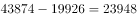
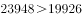
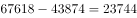
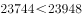

# 综合判断选非题——累计值相减还原单季值后判断环比增速正负

考点：[[20-考点/资料分析/综合/综合判断选非题——累计值相减还原单季值后判断环比增速正负|综合 / 综合判断选非题——累计值相减还原单季值后判断环比增速正负]]
材料：[[15-材料/资料分析/195128 2017年全国规模以上文化及相关产业|195128 2017年全国规模以上文化及相关产业]]

**问法模型**：题干以'下列说法不正确的一项'给出四个关于'环比增速'的断言 → 选非题先易后难：环比正负不必做除法，只需比较相邻单季值大小，优先验证计算量最小的合计行选项，证错即锁定答案

## 推理链
1. 第1步：材料只给累计值，合计行四期为19926、43874、67618、91950亿元，单季值须相邻累计相减（Q2=1-6月−1-3月，Q3=1-9月−1-6月，Q4=1-12月−1-9月）
2. 第2步：选非题先做计算量最小的D项（合计行仅3次减法）：2017年Q2合计=43874−19926=23948亿元＞2017年Q1的19926亿元，Q2环比为正
3. 第3步：2017年Q3合计=67618−43874=23744亿元＜23948亿元，故Q3环比增速为负值
4. 第4步：补验Q4=91950−67618=24332亿元＞23744亿元环比为正，但D项已被Q3为负推翻
5. 第5步：D项断言'2017年Q2至Q4环比增速均为正值'与Q3环比为负矛盾→D不正确
6. 第6步：A、B、C需还原2016年基期或逐行业验证（计算量大），选非题已证D错即收卷，不再逐一验算

**最快解法**：⚡ 选非题先易后难＋差值定号（免除法）：环比正负=当季值与前季值直接比大小。D项只做三个减法：Q2=43874−19926=23948、Q3=67618−43874=23744、Q4=91950−67618=24332；因23744＜23948（Q3环比为负），D的'均为正值'即被推翻，立即选D

## 易错点
- ⚠ 把表上累计值直接当单季值算环比：Q2环比必须用(43874−19926)=23948与Q1的19926比，而非43874与19926比
- ⚠ 把表头'比上年增长%'（同比口径，如合计11.4%）误当环比使用，两套增速混用必错
- ⚠ 选非题惯性去挑'正确'选项；同时大数减法进退位易错（67618−43874=23744、91950−67618=24332），一旦算错会把D误判为正确

## 母题抽象
> 🧩 当题干出现'累计值表格＋判断各季环比增速正负/大小'的选非题时，先用相邻累计列相减还原单季值，环比正负直接比较相邻单季值大小（免做除法），并优先验证计算量最小的合计行选项，证错即锁定答案

**同类特征**：选非题（不正确的一项）、环比增速正负判断、累计值表格需相减还原单季值、第二季度到第四季度逐季断言、合计行验证、四个选项计算量悬殊、先挑易验项

## 相关题
- [[10-真题/资料分析/综合/2188156 综合判断（选非）——单产（产量÷挂果面积）现期升降、最低值与2016年基期单产排序验证|2188156]]（陕西 2018，相关度1）

---

### 题干
根据上述资料，下列说法中不正确的一项是（  ）。

### 选项
- A. 
2016年第二季度所有产业的企业营业收入的环比增速都大于

- B. 
2017年第二季度所有产业的企业营业收入的环比增速都大于

- C. 
2016年第二季度到第四季度全国规模以上文化及相关产业企业营业收入合计数的环比增速均为正值

- D. 
2017年第二季度到第四季度全国规模以上文化及相关产业企业营业收入合计数的环比增速均为正值
　✅

### 官方解析

观察选项，发现A、B、C三项的计算量特别大，先看D项。

D项：2017年第二季度全国规模以上文化及相关产业企业营业收入合计数为亿元，第一季度营业收入合计数为19926亿元，，第二季度的环比增速为正值；第三季度营业收入合计数为亿元，，第三季度的环比增速为负值，并非均为正值，错误。

本题为选非题，故正确答案为D。

### 给定材料

根据以下资料，回答76—80题。

> [!warning] 疑点（官方解析可能有误，待人工复核）
> 官方解析中关键数值留空（'合计数为亿元'处缺2017年Q2=23948亿元、Q3=23744亿元），且以'计算量大'为由未实际验证A、B、C。另按增速列还原2016年基期估算：2016年Q3合计≈67618/1.114−43874/1.114≈21314亿元＜Q2≈43874/1.114−19926/1.11≈21433亿元，C项'2016年Q2至Q4环比均为正值'在此口径下亦疑似不成立（含舍入误差后仍偏负）；官方答案定为D，本笔记遵循官方答案不改，仅记录此口径疑点供教研复核。

<!-- CODEX-ANSWER-REVIEW:BEGIN -->
### 本次独立复核

**复核状态：** `confirmed`（独立复算确认答案）

**计分答案：** D（可计分）

**复核解析：**

本题问“不正确”。2017年累计营业收入：一季度19926亿元、上半年43874亿元、前三季度67618亿元；所以Q2=43874−19926=23948亿元，Q3=67618−43874=23744亿元，Q3比Q2减少，D所说Q2至Q4环比均为正显然错误。A、B用表中各行业2017累计额及同比增速还原2016各季后比较，最小的2016年Q2/Q1环比仍约为工艺美术品11.3%，2017各行业Q2/Q1也均高于10%；C用2016年基期累计额分别还原季度值，Q1约17951.4、Q2约21327.1、Q3约21420.0、Q4约22289.0亿元，Q2—Q4环比均为正。故唯一不正确项为D。

**相关信息：**

资料分析—累计值拆分单季与同比还原基期；季度值=本期累计−上期累计；两年单季值需分别用各累计同比率还原后再做差，不能把同一累计增速套用于所有累计期。

**题源依据：** [固定版本原题](https://github.com/Mentat-Uran/kaogongzhentizhengliu/blob/84ab93d4b64b61d897bece8a1c0a5bab06b4feb2/10-%E7%9C%9F%E9%A2%98/%E8%B5%84%E6%96%99%E5%88%86%E6%9E%90/%E7%BB%BC%E5%90%88/2188214%20%E7%BB%BC%E5%90%88%E5%88%A4%E6%96%AD%E9%80%89%E9%9D%9E%E9%A2%98%E2%80%94%E2%80%94%E7%B4%AF%E8%AE%A1%E5%80%BC%E7%9B%B8%E5%87%8F%E8%BF%98%E5%8E%9F%E5%8D%95%E5%AD%A3%E5%80%BC%E5%90%8E%E5%88%A4%E6%96%AD%E7%8E%AF%E6%AF%94%E5%A2%9E%E9%80%9F%E6%AD%A3%E8%B4%9F.md)；固定内容 commit `84ab93d4b64b61d897bece8a1c0a5bab06b4feb2`，Markdown blob `c9aceff184ef30b3d0f2ed63152f7f2688f10220`。
<!-- CODEX-ANSWER-REVIEW:END -->
