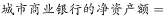
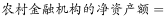
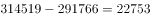
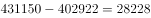
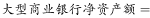
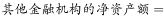

# 净资产额计算与大小比较（多选项判断）

考点：[[20-考点/资料分析/综合/净资产额计算与大小比较（多选项判断）|综合 / 净资产额计算与大小比较（多选项判断）]]
材料：[[15-材料/资料分析/195083 2017年5月我国境内银行业金融机构|195083 2017年5月我国境内银行业金融机构]]

**问法模型**：题干仅限定时间'2017年5月'，四个选项均为'某机构净资产额（＞）另一机构净资产额'的同构判断 → 依注释③净资产=总资产-总负债逐项作差后比大小，锁定唯一成立项

## 推理链
1. 第1步：题干为开放判断型，比较对象是'净资产额'，表中无现成数据，必须依据注释③'净资产额=总资产额-总负债额'跨列相减现算，且本题只用2017年5月现期值，与增速无关
2. 第2步：从统计表提取五组分项数据（亿元）：城市商业银行293063/273812、农村金融机构314519/291766、股份制商业银行431150/402922、大型商业银行839329/770521、其他类金融机构450873/408166
3. 第3步：逐项作差：城市商业银行=293063-273812=19251亿元，农村金融机构=314519-291766=22753亿元，股份制商业银行=431150-402922=28228亿元，大型商业银行=839329-770521=68808亿元，其他类金融机构=450873-408166=42707亿元
4. 第4步：按选项符号'＞'逐项核对：A项19251＞22753不成立，B项19251＞28228不成立，D项22753＞42707不成立
5. 第5步：C项68808＞28228成立，对照选项得出正确答案为C

**最快解法**：⚡ 截位减法+量级排序：净资产=总资产-总负债，各机构差值首三位约为——大型商业银行6.9万、其他类4.3万、股份制2.8万、农村2.3万、城市商行1.9万（亿元），五个净资产一次排定后按'＞'核对四个选项，量级悬殊的C项直接锁定，几乎零精算

## 易错点
- ⚠ '净资产'表中无现成列，必须由注释③'总资产-总负债'跨列相减构造，漏读注释会误用同比增速或无从下手
- ⚠ 多位数减法借位易错（如314519-291766=22753需连续借位），应只取前两位截位估算量级判号，不必精算到个位
- ⚠ 口径与符号陷阱：比较只在五个分项之间进行，勿混入总计行'银行业金融机构'；四个选项符号方向统一为'＞'，逐项代入时勿反向判断

## 母题抽象
> 🧩 当题干出现'选项均为A净资产额与B净资产额两两比较'的同构判断时，先用注释公式'总资产-总负债'逐项作差，再用截位法排量级，量级悬殊项优先验证即可快速锁定正确项

**同类特征**：净资产额、总资产额减去总负债额（注释③）、四个选项同构的两两比较、现期时点数据、不涉及增速、多选项判断选正确项、2017年5月时点限定

## 相关题
- [[10-真题/资料分析/综合/2187818 净资产额计算与多主体大小比较（净资产=总资产-总负债，综合判断选正确项）|2187818]]（天津 2018，相关度1）

---

### 题干
根据所给资料，2017年5月：

### 选项
- A. 
城市商业银行净资产额农村金融机构净资产额

- B. 
城市商业银行净资产额股份制商业银行净资产额

- C. 
大型商业银行净资产额股份制商业银行净资产额
　✅
- D. 
农村金融机构净资产额其他类金融机构净资产额

### 官方解析

定位统计表可得：

A项：亿元，亿元，故城市商业银行的净资产额农村金融机构的净资产额，错误；

B项：亿元，亿元，故城市商业银行的净资产额股份制商业银行的净资产额，错误；

C项：亿元，亿元，故大型商业银行的净资产额股份制商业银行的净资产额，正确；

D项：亿元，450873−408166=42707亿元，故农村金融机构的净资产额其他金融机构的净资产额，错误。

故正确答案为C。 

### 给定材料

根据以下资料，回答以下问题。

注：

1.农村金融机构包括农村商业银行、农村合作银行、农村信用社和新型农村金融机构。

2.其他类金融机构包括政策性银行及国家开发银行、民营银行、外资银行、非银行金融机构、资产管理公司和邮政储蓄银行。

3.净资产额等于总资产额减去总负债额。

<!-- CODEX-ANSWER-REVIEW:BEGIN -->
### 本次独立复核

**复核状态：** `resolved`（答案与解析已核定）

**计分答案：** C（可计分）

**复核解析：**

补全题干“根据所给资料，下列表述正确的是：”并恢复四个比较符号后，净资产额=总资产额−总负债额。城市商业银行为19251亿元，农村金融机构为22753亿元，股份制商业银行为28228亿元，大型商业银行为68808亿元，其他类金融机构为42707亿元。A：19251不大于22753；B：19251不大于28228；C：68808>28228，正确；D：22753不大于42707。唯一正确项为C。

**修订题干：**

根据所给资料，2017年5月，下列表述正确的是：

**修订材料：**

补回题干缺失部分：根据所给资料，2017年5月，下列表述正确的是：

**修订选项：**

A. 城市商业银行净资产额大于农村金融机构净资产额
B. 城市商业银行净资产额大于股份制商业银行净资产额
C. 大型商业银行净资产额大于股份制商业银行净资产额
D. 农村金融机构净资产额大于其他类金融机构净资产额

**相关信息：**

资料分析—净资产比较。先按净资产=总资产−总负债求各机构数值，再逐项核验不等号方向。

**题源依据：** [固定版本原题](https://github.com/Mentat-Uran/kaogongzhentizhengliu/blob/84ab93d4b64b61d897bece8a1c0a5bab06b4feb2/10-%E7%9C%9F%E9%A2%98/%E8%B5%84%E6%96%99%E5%88%86%E6%9E%90/%E7%BB%BC%E5%90%88/2188549%20%E5%87%80%E8%B5%84%E4%BA%A7%E9%A2%9D%E8%AE%A1%E7%AE%97%E4%B8%8E%E5%A4%A7%E5%B0%8F%E6%AF%94%E8%BE%83%EF%BC%88%E5%A4%9A%E9%80%89%E9%A1%B9%E5%88%A4%E6%96%AD%EF%BC%89.md)；固定内容 commit `84ab93d4b64b61d897bece8a1c0a5bab06b4feb2`，Markdown blob `0051b792afa9fcd79285e0c55e289f9c841b727a`。
<!-- CODEX-ANSWER-REVIEW:END -->
