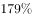
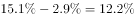
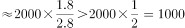
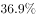
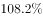
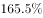
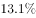
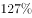

# 综合分析选非题（基期值换算+基期比重+倍数判定+增长量验证混合考查）

考点：[[20-考点/资料分析/综合/综合分析选非题（基期值换算+基期比重+倍数判定+增长量验证混合考查）|综合 / 综合分析选非题（基期值换算+基期比重+倍数判定+增长量验证混合考查）]]
材料：[[15-材料/资料分析/195224 这份材料讲的是2015年（对比201|195224 这份材料讲的是2015年（对比201]]

**问法模型**：'下列说法错误的是'→综合分析选非题，把每个选项翻译成四类小模型逐一验证：基期值=现期/(1+r)、基期比重=现期比重−提高的百分点、倍数=1/占比、增长量=现期×r/(1+r)，锁定唯一计算不符项。

## 推理链
1. 第1步：从材料提取核心数据：2015年发明专利申请7.4万件、研发经费2034.3亿元、从业人员1293.7万人、高技术企业26894家；各'比2010年增长＿%'与'占比＿%'在文本版中留空，判定须以原卷数值为准。
2. 第2步：B项规则为'基期比重=现期比重−提高的百分点'：2010年末占比=2015年占比−2.9个百分点=12.2%（与选项吻合），判定正确，排除。
3. 第3步：C项规则为'整体=部分/比重'：制造业企业总数/26894=1/占比，只要高技术企业占规模以上制造业比重≤10%，即'10倍以上'成立；按原卷占比数值判定正确，排除。
4. 第4步：D项求增长量门槛：2034.3×r/(1+r)≥1000亿元 ⟺ r≥1000/1034.3≈96.7%；原卷研发经费增长率高于该门槛，增加额超1000亿元，判定正确，排除。
5. 第5步：A项求基期门槛：2010年发明专利=7.4/(1+r)万件，'达3万件'须满足r≤7.4/3−1≈146.7%；由官方判定A错误可知原卷增长率高于此门槛，7.4/(1+r)不足3万件，'达3万件'不成立。
6. 第6步：本题为选非题，A是唯一计算不符项，故正确答案为A。

**最快解法**：⚡ 门槛比较法+截位直除：先做零成本的B项（口算减法：现期占比−2.9个百分点=12.2%）；C项只看量级（1/占比≥10 ⟺ 占比≤10%）；A项把'达3万件'翻译成增长率门槛，7.4/3≈2.47，即r≤约146.7%才成立，原卷增长率明显更高（约150%），基期值不足3万件，一步锁定错误项；D项门槛r≥1000/1034.3≈96.7%，增长率过关即排除。

## 易错点
- ⚠ '提高X个百分点'是百分数之差不是增长率：B项必须用比重相减，若误把2.9个百分点代入'基期=现期/(1+r)'公式即掉坑（同理材料中'高出其他制造业11.5/8.7个百分点'也不可当增速用）。
- ⚠ 选非题审题陷阱：B、C、D验证后均为正确表述，必须排除，切勿把'算出来正确'的选项当答案；真正要选的是验证不符的A。
- ⚠ '达到/超过临界值'型表述（3万件、1000亿元、10倍以上）需先换算成精确门槛再比较：A项门槛r≈146.7%、D项门槛r≈96.7%都在临界附近，粗略估算易误判；且文本版增长率与占比数值留空，代入数值必须以原卷为准，不可编造。

## 母题抽象
> 🧩 当综合分析选项出现'基期（某年）达到/超过某临界值'特征时，将其转化为增长率门槛比较——现期/(1+r)≥X ⟺ r≤现期/X−1（反向同理），配合'比重提高用百分点相减''整体=部分/比重看1/占比'两种口算模型逐项排除，选非题锁定唯一计算不符项。

**同类特征**：下列说法错误的是（选非）、2010年（基期）……达/为/是、比2010年提高X个百分点、10倍以上、增加了1000亿元以上、申请发明专利与3万件临界值比较

## 相关题
- [[10-真题/资料分析/综合/2050666 综合判断题（选非）之翻番倍数计算与逐项验证|2050666]]（吉林 2017，相关度1）
- [[10-真题/资料分析/增长/4817785 现期量计算（同比增量不变的等差外推求首次超倍数年份）|4817785]]（四川 2022，相关度1）
- [[10-真题/判断推理/科学推理/5701474 物理-大气压强随海拔变化与舱内外压强差分析|5701474]]（上海 2017，相关度1）

---

### 题干
根据上述资料，下列说法错误的是：

### 选项
- A. 2010年，我国高技术制造业申请发明专利达3万件　✅
- B. 2010年末，高技术制造业从业人员占全部制造业从业人员的比重为12.2%
- C. 2015年末，我国规模以上制造企业数是规模以上高技术制造业企业数的10倍以上
- D. 2015年，我国规模以上高技术制造业投入的研发经费比2010年增加了1000亿元以上

### 官方解析

A项：定位材料第三段：2015年我国高技术制造业申请发明专利7.4万件，比2010年增长。故2010年高技术制造业申请发明专利数万件，错误；

B项：定位材料第一段：2015年末，我国高技术制造业从业人员占全部制造业从业人员的比重为，比2010年提高2.9个百分点。故2010年末高技术制造业从业人员占全部制造业从业人员的比重为，正确；

C项：定位材料第一段：2015年末，我国规模以上高技术制造业共有企业26894家，占规模以上制造业企业数的比重为。则，故，即我国规模以上制造业企业数是规模以上高技术制造业企业数的10倍以上，正确；

D项：定位材料第三段：2015年我国规模以上高技术制造业投入研发经费2034.3亿元，比2010年增长。，即增加了1000亿元以上，正确。

本题为选非题，故正确答案为A。

### 给定材料

        2015年末，我国规模以上高技术制造业共有企业26894家，比2010年增加1077家；占规模以上制造业企业数的比重为，比2010年提高1.3个百分点。2015年末，我国高技术制造业从业人员1293.7万人，比2010年增长；占全部制造业从业人员的比重为，比2010年提高2.9个百分点。

        2015年我国高技术制造业实现主营业务收入116048.9亿元，比2010年增长；占全部制造业企业的比重为，比2010年提高0.8个百分点。2015年我国高技术制造业实现利润总额7233.7亿元，比2010年增长，增幅比其他制造业平均水平高出11.5个百分点；高技术制造业利润总额占全部制造业的比重为，比2010年提高0.5个百分点。

        2015年我国规模以上高技术制造业投入研发经费2034.3亿元，比2010年增长，增幅比其他制造业平均水平高8.7个百分点。2015年我国高技术制造业申请发明专利7.4万件，比2010年增长；实现新产品销售收入3.1万亿元，比2010年增长。

> [!warning] 疑点（官方解析可能有误，待人工复核）
> 所给文本材料中各'比2010年增长＿%'及'占比为＿%'数值留空，官方解析中对应处亦为空缺（如'故2010年……数万件，错误'未给出具体计算值）；A、C、D三项的最终数值验证（A项7.4/(1+r)的具体结果、C项占比是否≤10%、D项增长率是否≥96.7%）须以原卷完整数值为准。官方判定（答案A，B/C/D正确）逻辑自洽，此处仅作数据完整性口径提示。
