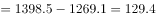
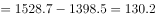
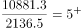

# 综合分析选非题（核心判据为倍数口径'是几倍-高几倍'辨析，兼查平均数、逐年增量、趋势判断）

考点：[[20-考点/资料分析/综合/综合分析选非题（核心判据为倍数口径'是几倍-高几倍'辨析，兼查平均数、逐年增量、趋势判断）|综合 / 综合分析选非题（核心判据为倍数口径'是几倍/高几倍'辨析，兼查平均数、逐年增量、趋势判断）]]
材料：[[15-材料/资料分析/195225 2012～2015年我国国内生产总值|195225 2012～2015年我国国内生产总值]]

**问法模型**：'下列选项错误的是'选非题 → 对A~D四个陈述逐项代入表格数据验证，找出与数据不符的那一项

## 推理链
1. 第1步：A项取基础研究行四年数据498.8、555.0、613.5、716.1，求年均支出=(498.8+555.0+613.5+716.1)÷4=2383.4÷4≈595.9亿元，不到600亿元，A表述正确
2. 第2步：B项对应用研究行逐年做差：2013年增量1269.1-1162.0=107.1，2014年增量1398.5-1269.1=129.4，2015年增量1528.7-1398.5=130.2，107.1＜129.4＜130.2逐年增大，B表述正确
3. 第3步：C项取2015年执行部门数据：企业经费10881.3亿元、政府属研究机构2136.5亿元，倍数=10881.3÷2136.5≈5.09倍
4. 第4步：口径换算：'高5倍多'意味着企业经费是政府机构的6倍多，而实际仅为5.09倍（即'是5倍多''高4倍多'），与选项'高5倍多'不符，C表述错误
5. 第5步：D项取高校行数据780.6→856.7→898.1→998.6，逐年递增，D表述正确
6. 第6步：本题为选非题，错误项为C，故正确答案选C

**最快解法**：⚡ 倍数口径换算+直除锁定：考场优先核查含倍数表述的选项（高频设错点），2136.5×6=12819＞10881.3，即企业经费不足政府的6倍，'高5倍多'必错，直接选C；其余三项粗验排除：A均值≈596＜600，B增量107→129→130递增，D高校数据单调增

## 易错点
- ⚠ '是n倍'与'高n倍'混淆：10881.3÷2136.5≈5.09，是5倍多但只'高4倍多'；'高5倍多'要求比值大于6，C项设错点正在此口径差
- ⚠ 选非题审题陷阱：题目问'错误的'，A、B、D均正确，误选任一正确项即失分
- ⚠ 取数串行与粗心：B项2014→2015年增量129.4→130.2增幅极小，做差易算错；'试验发展/企业/高校'等多行数据相邻，勿串行取数

## 母题抽象
> 🧩 当综合分析选项出现'甲比乙高n倍多/是n倍多'表述时，先用'高n倍=是(n+1)倍'换算口径再直除甲÷乙对照验证；选非题中倍数表述与'年均/年增量'表述的选项是优先核查的高频设错点

**同类特征**：下列选项错误的是（选非题）、高5倍多（倍数口径表述）、年均不到600亿元、年增量逐年增大、逐年递增趋势、一表五查逐项验证

## 相关题
（暂无）

---

### 题干
根据资料，下列选项错误的是：

### 选项
- A. 2012～2015年，基础研究经费支出年均不到600亿元
- B. 2013～2015年，应用研究经费支出年增量逐年增大
- C. 2015年，企业的研究与试验发展经费支出比政府属研究机构高5倍多　✅
- D. 2012～2015年，我国高校的研究与试验发展经费支出呈逐年递增趋势

### 官方解析

A项：定位表格材料可得：2012～2015年，基础研究经费年均支出亿元，不到600亿元，正确；

B项：定位表格材料可得：各年份应用研究经费支出年增量分别为 2013年增量亿元；2014年增量亿元；2015年增量亿元，因此2013～2015年应用研究经费支出年增量逐年增大，正确；

C项：定位表格材料可得：2015年企业的研究与试验发展经费为10881.3亿元；政府属研究机构为2136.5亿元；故所求倍数为倍，选项描述为企业的研究与试验发展经费比政府属研究机构高5倍多，即前者是后者的6倍多，与结果不符，错误；

D项：定位表格材料最后一行可得：2012～2015年，我国高校的研究与试验发展经费支出是逐年增加的，正确。

本题为选非题，故正确答案为C。

### 给定材料

