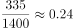
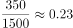

# 工资总额增长归因分析（排除法综合判断）

考点：[[20-考点/资料分析/综合/工资总额增长归因分析（排除法综合判断）|综合 / 工资总额增长归因分析（排除法综合判断）]]
材料：[[15-材料/资料分析/195254 某研究设计院按岗位级别（1级岗~6级|195254 某研究设计院按岗位级别（1级岗~6级]]

**问法模型**：题干问'报告期工资增长最主要得益于什么'→归因判断题：先定口径（工资总额=人数×人均工资），再对选项逐一验算事实真伪与作用方向，用排除法锁定答案

## 推理链
1. 第1步：定口径——'工资增长'指工资总额：图1合计报告期806万元、基期787万元，增长19万元（约+2.4%）
2. 第2步：图2合计报告期2474人、基期2584人，总人数减少110人；由'工资总额=人数×人均工资'可知人数减少对总额是负向贡献
3. 第3步：验证B——跨图算6级岗人均工资：基期335万元÷1400人≈0.239万/人，报告期350万元÷1500人≈0.233万/人，下降而非上升，'各级岗位工资均向上调整'不成立，排除B
4. 第4步：验证C——报告期总人数少于基期虽属实，但人数减少只会拉低工资总额，不能解释增长，排除C
5. 第5步：验证D——6级岗人数由1400增至1500，但人均工资由约0.24万/人降至约0.23万/人，并非'人数和工资双重增长'，排除D
6. 第6步：B、C、D均排除——工资总额在总人数减少、各级工资并非全升的背景下仍增长，只能归因于岗位职工结构的调整，选A

**最快解法**：⚡ 排除法+截位直除：先抓B、D的共同检验点——6级岗人均工资335/1400≈0.24、350/1500≈0.23（万/人），一降即同时否决B和D；再用人数合计2584→2474减少否决C；剩余锁定A，全程只需两次除法、两次加法

## 易错点
- ⚠ 口径陷阱：题干'工资增长'=工资总额（图1合计787→806万元）而非人均工资，归因前先定口径
- ⚠ 全称量词'均'字陷阱：除6级岗外其余各级岗人均工资确实都上升，但仅6级岗一处下降就使B整体错误，勿因'多数上升'误选B
- ⚠ '真事实≠原因'陷阱：报告期总人数2474<基期2584属实，但人数减少对工资总额是负向贡献，不能作为增长原因；且人均工资须跨图（图1工资额÷图2人数）计算，单看图1条形长短会误判

## 母题抽象
> 🧩 当题干出现'增长/变化最主要得益于…'的归因型设问且选项为定性说法时，逐项核对'事实真伪+作用方向'，先用最易算的反例（某级人均工资335/1400≈0.24→350/1500≈0.23下降）一票否决含'均/都'的选项，再排除方向相反项，剩余即为答案

**同类特征**：增长最主要得益于、归因/原因分析、报告期与基期对比、两图数据交叉计算（工资额÷人数）、适合排除法作答、选项含全称量词'均'

## 相关题
（暂无）

---

### 题干
从所给资料可以推出该研究设计院的报告期工资增长最主要得益于：

### 选项
- A. 岗位职工结构的调整　✅
- B. 各级岗位工资均向上调整
- C. 报告期总人数少于基期
- D. 6级岗的报告期职工人数和工资的双重增长

### 官方解析

B项：定位图1、图2，6级岗位工资基期工资为万/人，报告期工资为万/人，6级岗位工资向下调整，错误；

C项：工资总额人数人均工资。报告期人数减少，不能为工资增长带来正向影响，错误； 

D项：定位图1、图2，6级岗位职工人数由1400增长至1500，但工资由0.24万/人减少至0.23万/人，并非双重增长，错误。

故本题正确答案为A。

注：本题中A项较难理解，建议考生先看BCD三项，结合排除法锁定正确答案。

### 给定材料

<b>根据以下资料，回答下列问</b><b>题。</b>

        某研究设计院向不同岗位级别职工支付的工资额以及该院职工人员结构资料分别如图1和图2。根据资料回答问题。

> [!note] 复核版本状态
> 原题不可计分（official_self_contradiction；来源记录的答案键/竞争项：A）；仅当前明确标注的编辑版按答案C计分。
> 详细原题疑点、修订题面、解析和证据见下方独立复核记录。

<!-- CODEX-ANSWER-REVIEW:BEGIN -->
### 本次独立复核

**复核结论：** `resolved`（答案与解析已核定）

**原题计分状态：** 不计分（`official_self_contradiction`：题源答案或解析与数据复算冲突）。来源中记录的答案键/竞争项：A；这些记录不代表原题已核准答案。

**原题疑点与处理：**

河南 2018 〔20-考点/资料分析/综合/工资总额增长归因分析（排除法综合判断）〕 — 官方解析对A项未给正向论证，明确提示靠排除BCD锁定；且严格按两期分解验证：以基期工资率套报告期人数结构得总额约755万元<787万元，人数结构变动的贡献实为负…

**当前计分版本：** 明确标注的编辑版；未列出的题干、材料或选项沿用固定题源。答案不回填为原题答案。

**计分答案：** C（可计分）

**复核解析：**

固定图表给出工资总额787万元增至806万元、职工人数2584人降至2474人。基期人均工资为787/2584≈0.30457万元；先只改变工资总额，806/2584≈0.31192，增加约0.00735万元；再只改变人数，806/2474≈0.32579，再增加约0.01387万元。按题干明确的分解顺序，人数减少带来的人均工资增幅贡献更大，对应C。原题“工资增长”未说明总额还是人均口径，且“结构调整”没有被源解析严谨论证；本修订明确统计口径与分解方法。

**修订题干：**

【编辑修订版】以报告期职工人均工资=工资总额÷职工人数计算全院人均工资变化，并按“先固定基期人数计算工资总额变化、再固定报告期工资总额计算人数变化”的顺序分解，哪项变化对人均工资上升的贡献更大？

**修订/采用选项：**

A. 岗位职工结构的调整
B. 各级岗位工资均向上调整
C. 报告期总人数少于基期
D. 6级岗的报告期职工人数和工资的双重增长

**相关信息：**

人均工资是工资总额与职工人数的比值。分解比值变化时必须明确先后顺序；本题修订版按题干给出的顺序比较分子与分母贡献。

**核对依据与来源边界：**

- 固定题源：[原题文件](https://github.com/Mentat-Uran/kaogongzhentizhengliu/blob/84ab93d4b64b61d897bece8a1c0a5bab06b4feb2/10-%E7%9C%9F%E9%A2%98/%E8%B5%84%E6%96%99%E5%88%86%E6%9E%90/%E7%BB%BC%E5%90%88/2188886%20%E5%B7%A5%E8%B5%84%E6%80%BB%E9%A2%9D%E5%A2%9E%E9%95%BF%E5%BD%92%E5%9B%A0%E5%88%86%E6%9E%90%EF%BC%88%E6%8E%92%E9%99%A4%E6%B3%95%E7%BB%BC%E5%90%88%E5%88%A4%E6%96%AD%EF%BC%89.md)；内容版本 `84ab93d4b64b61d897bece8a1c0a5bab06b4feb2`，源 Markdown blob `fb2f4fd3cf0b9279261274d3b2c2081c69c486ce`.
- **核心依据：** 固定源图中的两期分岗位工资额及人数合计为787/806万元和2584/2474人。同期转载确认原卷问法存在总额/人均口径差异；本修订透明限定人均值及分解算法后复算唯一得到C。
- 固定题图/公式图：`90-图片/公式图/formula-d0e701f582240ecb.png`, `90-图片/公式图/formula-8eca9299f39560fc.png`, `90-图片/公式图/formula-0c793ae1bc0b6efa.png`, `90-图片/公式图/formula-4f95f34ef577bba4.png`, `90-图片/题目图/162e803172f8ac1.png`, `90-图片/题目图/162e804e01ec806.png`.

<!-- CODEX-ANSWER-REVIEW:END -->
