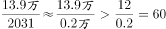

# 综合分析推断题（无中生有排除+平均每机构场次验证）

考点：[[20-考点/资料分析/综合/综合分析推断题（无中生有排除+平均每机构场次验证）|综合 / 综合分析推断题（无中生有排除+平均每机构场次验证）]]
材料：[[15-材料/资料分析/195255 2016年全国文化演艺事业发展情况的|195255 2016年全国文化演艺事业发展情况的]]

**问法模型**：“从上述资料可以推断”式综合判断 → 对A/B/C/D逐项回材料定位验证，无中生有、与材料方向矛盾的排除，唯一能由材料数据计算支撑的选项即为答案

## 推理链
1. 第1步：A项定位第一段，艺术节仅有67台剧目、1000余件美术作品、观众40万人次，无任何历史比较基准，“空前成功”无法推出
2. 第2步：B项“艺术创作演出的经济效益显著”，材料全篇未给出利润、效益类数据，属无中生有，排除
3. 第3步：C项定位第三段，演出收入130.86亿元且原文明确“增长”，说明较2015年增加而非减少，与选项方向矛盾，排除
4. 第4步：D项需两个口径拼接——第二段“各级文化部门所属的艺术表演团体2031个”（年末时点数）作分母，第四段“政府采购公益演出13.90万场”（全年时期数）作分子
5. 第5步：平均每团场次＝13.90万场÷2031个＝139000÷2031≈68.4场
6. 第6步：68.4场＞60场，D项可由材料直接计算验证成立，故正确答案为D

**最快解法**：⚡ 乘法反算+排除法：先排除A（无比较基准）、B（无效益数据）、C（原文“增长”与“减少”矛盾）；D项只需判断13.90万是否超过2031×60≈12.19万，13.90万＞12.19万，立判“超过60场”成立，锁定D

## 易错点
- ⚠ 主观评价词陷阱：A项“空前成功”、B项“效益显著”表述华丽但材料无支撑，易被误导误选，必须坚持“材料无数据即无法推断”
- ⚠ C项口径陷阱：把“演出收入130.86亿元”误当利润，或忽略原文“增长”二字而误判收益减少
- ⚠ D项单位与分母陷阱：13.90万场须换算为139000场再除，且分母必须用“其中”的2031个（文化部门所属），若误用整体12301个会算得约11.3场而错判D不成立

## 母题抽象
> 🧩 当题干出现“可以推断”且某选项为“平均每个……超过/达到某阈值”时，先用无中生有、与材料方向矛盾排除干扰项，再用总量÷份数的平均数模型，以“份数×阈值与总量比大小”的乘法反算快速验证

**同类特征**：从上述资料可以推断、综合分析四选一、平均每个……超过、无中生有选项排除、“其中”式整体—部分口径拼接、全年时期值÷年末机构数

## 相关题
- [[10-真题/资料分析/综合/2031178 综合分析题（逐项验证：增长量计算、基期量反推、比重阈值判断）|2031178]]（北京 2017，相关度1）
- [[10-真题/资料分析/综合/2051204 综合判断题（两期比重比较＋增速计数＋区间求和比较＋涨幅比较）|2051204]]（黑龙江 2017，相关度1）
- [[10-真题/资料分析/综合/13255455 综合分析题-逐项验证（基期量换算比较、增长率计算与比较）|13255455]]（选调 2023，相关度1）
- [[10-真题/资料分析/综合/1797646 综合分析（比重变化判断+月均数+读图增速比较+现期比重估算）|1797646]]（山东 2016，相关度1）
- [[10-真题/资料分析/综合/2028370 综合分析判断（同比升降年份计数+比重变化定性判断+基期量定性比较）|2028370]]（国考 2017，相关度1）

---

### 题干
从上述资料可以推断，在2016年：

### 选项
- A. 第十一届中国艺术节取得空前成功
- B. 我国艺术创作演出的经济效益显著
- C. 我国艺术表演团体演出收益较2015年减少
- D. 平均每个文化部门所属艺术表演团体组织政府采购公益性演出场次超过60场　✅

### 官方解析

A项：定位文字材料第一段，“第十一届中国艺术节共汇聚67台参评参演剧目和1000余件美术作品，观众达40万人次”，未出现其他数据，无法推出，错误；

B项：材料未出现艺术创作演出的相关数据，无法推出，错误；

C项：定位文字材料第三段，“全年全国艺术表演团体······其中演出收入130.86亿元，增长”，故我国艺术表演团体演出收益较2015年增加，并非减少，且若将艺术表演团体演出收益理解为利润，材料中同样未出现相关数据，无法推出，错误；

D项：定位文字材料第二段，“······其中各级文化部门所属的艺术表演团体2031个”，及第四段“全年全国各级文化部门所属艺术表演团体共组织政府采购公益演出13.90万场”，故平均每个文化部门所属艺术表演团体组织政府采购公益性演出场次约为，即超过60场，正确。

故正确答案为D。

### 给定材料

<b>根据以下资料，回答下列小题。</b>

        2016年，全年原创首演剧目1423个，扶持了100名京剧、地方戏表演艺术家向200名青年演员传授经典折子戏。第十一届中国艺术节共汇聚67台参评参演剧目和1000余件美术作品，观众达40万人次。国家艺术基金2016年共有966个项目获得立项资助，较2015年增长了，资助资金总额7.3亿元。

        2016年末全国共有艺术表演团体12301个，比上年末增加1514个，从业人员33.27万人，增加3.08万人。其中各级文化部门所属的艺术表演团体2031个，占；从业人员11.52万人，占。

        全年全国艺术表演团体共演出230.60万场，比上年增长，其中赴农村演出151.60万场，增长；国内观众11.81亿人次，增长，其中农村观众6.21亿人次，比上年增长；总收入311.23亿元，比上年增长，其中演出收入130.86亿元，增长。

        全年全国各级文化部门所属艺术表演团体共组织政府采购公益演出13.90万场，观众1.17亿人次。利用流动舞台车演出11.31万场次，观众10381万人次。中央直属院团全年开展公益性演出1335场，其中赴老少边穷地区演出241场，面向老红军、留守儿童等演出132场。

        年末全国共有艺术表演场馆2285个，观众坐席数168.93万个。全年馆内艺术演出19.09万场次，增长；艺术演出观众3098万人次，增长。其中各级文化部门所属艺术表演场馆1265个，全年共举行艺术演出6.81万场次，增长，艺术演出观众2589万人次，增长。

        年末全国国有美术馆462个，比上年末增加44个，从业人员4597人，增加502人。全国共举办展览6146次，比上年增长，参观人次3237万，增长。

