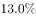
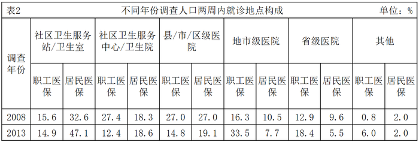

# 综合判断题（信息查找＋构成比对比＋'无法比较'项排除）

考点：[[20-考点/资料分析/综合/综合判断题（信息查找＋构成比对比＋'无法比较'项排除）|综合 / 综合判断题（信息查找＋构成比对比＋'无法比较'项排除）]]
材料：[[15-材料/资料分析/195309 第五次国家卫生服务调查（2013年）|195309 第五次国家卫生服务调查（2013年）]]

**问法模型**：“根据资料，下列说法正确的是”→ 逐项定位材料验证：材料未提供的指标（人数、缺失年份数据）直接判“无法比较”排除，能查到的用构成比排序与变化方向核对。

## 推理链
1. 第1步：A项需比较2008年居民医保与职工医保的“参保人数”；表2只给出就诊地点构成比（2008年职工医保六项15.6/27.4/27.0/16.3/12.9/0.8合计100%，居民医保32.6/18.3/27.0/10.5/9.6/2.0合计100%），全材料无任何参保人数数据，无法比较，A排除。
2. 第2步：B项定位表2“2008”行“居民医保”各列：社区卫生服务站/卫生室32.6%、社区卫生服务中心/卫生院18.3%、县/市/区级医院27.0%、地市级医院10.5%、省级医院9.6%、其他2.0%。
3. 第3步：按构成比排序，2008年居民医保前两大就诊去向是社区卫生服务站/卫生室（32.6%）和县/市/区级医院（27.0%），并非选项所称的“社区卫生服务中心/卫生院”（18.3%仅列第三），B排除。
4. 第4步：C项需对比2008与2013年两周就诊率，但材料只有2013年（第五次调查）就诊率且文字段数值空白缺失，表2是构成比而非就诊率，全材料无2008年就诊率，无法比较，C排除。
5. 第5步：D项核表2居民医保基层就医构成比变化：社区卫生服务站/卫生室由2008年32.6%升至2013年47.1%，社区卫生服务中心/卫生院由18.3%升至2013年18.6%，基层就诊占比明显增大。
6. 第6步：基层（社区）就医占比上升说明医疗资源不再只集中于省、市、县级医院，可推出2013年卫生医疗资源更丰富、分布更均衡，D正确。

**最快解法**：⚡ 定位排除法：先秒杀“材料未给”型选项——A缺参保人数、C缺2008年就诊率，均判“无法比较”排除；再核B，只需看2008年居民医保第二大数据是县/市/区级医院27.0%（而非中心的18.3%）即排除；剩余D由居民医保社区卫生服务站构成比32.6%→47.1%上升直接锁定。

## 易错点
- ⚠ 把表2构成比（每行合计100%）误当“人数/参保人数”使用——A项的陷阱根源：构成比高低不等于参保人数多少。
- ⚠ 表2职工医保/居民医保两列并排、2008与2013两行混排，极易串列串行；B项还易把“社区卫生服务中心/卫生院”（居民医保18.3%）与“县/市/区级医院”（27.0%）两列看混。
- ⚠ C项：表2是构成比不是就诊率，两表口径不同不能跨表比较；且材料文字段2013年就诊率数值缺失、无2008年数据，“就诊率明显提高”无从验证，不能凭主观感觉判对。

## 母题抽象
> 🧩 当综合判断题出现“比较人数/总量”或“跨年份比较某指标”而材料只给构成比、或只给单一年份数据时，直接判“无法比较”排除该项；剩余选项回构成比表格核对最大项排序或前后变化方向，注意并排列（职工/居民）与名称相近列（服务站/服务中心）的区分。

**同类特征**：下列说法正确的是、参保人数无法查找、就诊地点主要在、构成比对比、2008年与2013年对比、无法比较型排除项

## 相关题
- [[10-真题/资料分析/综合/2195856 综合判断题·增长倍数口径下的基期反推与定性表述可推性验证|2195856]]（黑龙江 2018，相关度1）
- [[10-真题/资料分析/综合/10204448 综合分析-逐项判断（历史极值确认、两期比重比较、多期累计求和、基期比重）|10204448]]（广东 2024，相关度1）
- [[10-真题/资料分析/综合/1772378 综合分析判断题（多选项直接查找与数据比较）|1772378]]（深圳市考 2016，相关度1）
- [[10-真题/资料分析/综合/2033342 综合分析题（增速逐年比较＋两期比重比较＋库存流量平衡式混合判断）|2033342]]（河南 2016，相关度1）
- [[10-真题/资料分析/综合/2060624 综合分析题（口径辨析+方向词核验+同比减少量计算的四选项正误判断）|2060624]]（深圳市考 2017，相关度1）

---

### 题干
根据资料，下列说法正确的是：

### 选项
- A. 在2008年，参加居民医保的人数多于参加职工医保的人数
- B. 在2008年，已参加居民医保的调查人口，其两周就诊地点主要在社区卫生服务站/卫生室和社区卫生服务中心/卫生院
- C. 较之2008年，2013年的调查人口的两周就诊率有明显提高
- D. 较之2008年，2013年的调查地区的卫生医疗资源更丰富，分布更均衡　✅

### 官方解析
A项：定位材料查找可知，材料只给出2008年调查人口两周内就诊地点和就诊率，并未给出参加居民医保和职工医保的人数，无法比较，错误；
B项：定位表2可知，2008年已参加居民医保的调查人口，其两周就诊地点主要在社区卫生服务站/卫生室（）和县/市/区级医院（），错误；
C项：定位材料查找可知，只给出2013年调查人口的两周就诊率，并未给出2008年的两周就诊率，无法比较，错误；
D项：若居民在社区卫生服务站、中心就医占比增多，说明医疗资源不仅分配在省、市、县级医院，体现出“卫生医疗资源更丰富，分布更均衡”。定位表2，居民在社区卫生服务站、中心就医的占比增多，由此可推出2013年卫生医疗资源更丰富，分布更均衡，正确。
故本题正确答案为D。

### 给定材料

根据以下资料，回答以下各题。

        两周就诊率被定义为每百人中两周内因病或身体不适寻求各级医疗机构治疗服务的人次数。第五次国家卫生服务调查结果显示，调查地区居民两周就诊率为，其中城市地区为，农村地区为。城市地区，东部、中部、西部两周就诊率分别为、、；农村地区，东部、中部、西部两周就诊率分别为、、。

