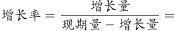
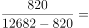
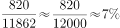
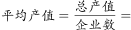
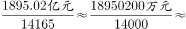
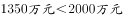
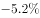
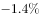

# 综合判断题（逐项验证：绝对增量直接读数＋平均产值计算＋增速正负核对）

考点：[[20-考点/资料分析/综合/综合判断题（逐项验证：绝对增量直接读数＋平均产值计算＋增速正负核对）|综合 / 综合判断题（逐项验证：绝对增量直接读数＋平均产值计算＋增速正负核对）]]
材料：[[15-材料/资料分析/198620 2016年某自治区农林牧渔业发展综述|198620 2016年某自治区农林牧渔业发展综述]]

**问法模型**：题干问'可以根据上述资料推出的是'（四选一综合判断）→ 逐项验证模型：A对材料给出的绝对增量直接读数、B比较牛肉/羊肉/猪肉产量的增速大小、C计算平均产值=总产值÷企业数、D核对三个指标的增速正负方向，唯一全部吻合者为答案

## 推理链
1. 第1步：判定题型为综合判断'可推出'题，逐项验证A—D；A项对应材料末段'拥有农业产业化经营组织12682家，比上年增加820家'，同比增量即820家，A项数值与原文一致（官方判定正确）。
2. 第2步：B项取第4段：牛肉42.48万吨、羊肉58.32万吨、猪肉33.90万吨均增长，据官方解析三者增速中羊肉最高，故'牛肉增速最高'不成立。
3. 第3步：C项取第6段：平均产值=1895.02亿元÷14165家≈0.1338亿元/家=1338万元/家＜2000万元，'超过2000万'不成立。
4. 第4步：D项核对增减方向词：棉花种植面积'下降'、年末猪牛羊存栏'下降'均为负，但化肥施用量（折纯）250.21万吨为'增长'（正），三项并非均为负值，不成立。
5. 第5步：仅A项可由材料直接推出，故正确答案为A。

**最快解法**：⚡ 综合判断排错法＋直接读数秒杀：先扫选项锁定与原文'比上年增加820家'直接对应的A项（增量读数即中）；C项用截位直除：1895.02亿÷14165≈0.134亿/家≈1340万元＜2000万元排除；B、D只需核对'增长/下降'字眼（羊肉增速最高、化肥施用量为'增长'）即可排除，全程无需精确增速数值。

## 易错点
- ⚠ '比上年增加820家'是绝对增量而非增速——A项问'同比增加约多少'正对应该增量，直接读数即可；若误把820当成增长率、或先倒推2015年基数11862家再绕去算增速，会浪费时间甚至选错。
- ⚠ C项单位换算陷阱：1895.02亿元÷14165家≈0.1338亿元/家，必须换算成1338万元/家再与2000万元比较，漏掉'亿→万'（×10^4）换算会误判该项。
- ⚠ D项跨第2、4、5段核对三个不同指标的增减方向：棉花面积与年末存栏为'下降'，化肥施用量为'增长'，勿因前两项为负就顺带认定第三项也为负；另注意本档案所录原文中各增速数值空缺，B项'羊肉最高'、D项方向核对须以原卷完整数据为准，不能凭空补数。

## 母题抽象
> 🧩 当题干出现'可以根据上述资料推出的是/以下说法正确的是'时，优先验证与材料绝对增量、绝对量表述直接对应的选项（如'比上年增加820家'→'同比增加约820家'，一步读数锁定），其余选项用'平均数=总量÷份数'和'增长/下降方向词核对'逐项排除。

**同类特征**：可以根据上述资料推出的是、四选一综合判断、纯文字材料跨段取数、绝对增量直接读数（比上年增加820家）、平均产值=总产值÷企业数、多指标增速正负与大小核对

## 相关题
- [[10-真题/资料分析/综合/1797644 综合判断——各选项数据可得性（分子-分母-基期齐备性）验证|1797644]]（山东 2016，相关度1）
- [[10-真题/资料分析/综合/1746812 综合判断题（逐项验证：比重计算、双指标排序比较、同比方向判断）|1746812]]（国考 2016，相关度1）
- [[10-真题/资料分析/综合/2049348 综合判断题（单产比较为主，兼含面积占比、产销读图、趋势外推多重验证）|2049348]]（河南 2017，相关度1）
- [[10-真题/资料分析/综合/2444708 综合判断题（容斥交集下界+分数性质比较+比重最值+跨图表反推总户数）|2444708]]（四川 2019，相关度1）
- [[10-真题/资料分析/综合/10942304 综合判断（增长量计算+单位换算；两期比重比较；下降速度比较）|10942304]]（山东 2024，相关度1）

---

### 题干
可以根据上述资料推出的是：

### 选项
- A. 
2016年，农业产业化经营组织数量同比增加约
　✅
- B. 
2016年，牛羊猪肉产量的同比增长率中，牛肉的最高

- C. 
2016年，农产品加工（流通）企业的平均产值超过2000万

- D. 
2016年，棉花种植面积、猪牛羊存栏量、化肥施用量的同比增长率均为负值

### 官方解析

A项：定位文字材料第六段可得，2016年农业产业化经营组织12682家，比上年增加820家，代入公式，正确。

B项：定位文字材料第四段可得，2016年牛肉产量增长、羊肉产量增长、猪肉产量增长，则羊肉产量增长率最高，错误。

C项：定位文字材料第六段可得，2016年农产品加工（流通）企业14165家，实现农产品加工（流通）业总产值1895.02亿元，，错误。

D项：定位文字材料第二段可得，2016年棉花种植面积增长率为；定位文字材料第四段可得，猪牛羊存栏量增长率为；定位文字材料第五段可得，化肥施用量（折纯）增长率为，错误。

故正确答案为A。

### 给定材料

        2016年，某自治区全年实现农林牧渔业总产值2969.70亿元，比上年增长，其中，农业产值2163.11亿元，增长；林业产值50.28亿元，增长；畜牧业产值653.15亿元，增长；渔业产值22.18亿元，增长；农林牧渔服务业产值80.98亿元，增长。

        全年农作物播种面积9348.42万亩，同比增长。其中，粮食（含薯类）3601.70万亩，增长；棉花3232.36万亩，下降；油料382.82万亩，增长；甜菜115.69万亩，增长；蔬菜489.84万亩，增长。特色林果2475.48万亩，增长，其中，园林水果1490.64万亩，增长。

        全年粮食产量（含薯类）1512.28万吨，下降。棉花420万吨，增长。油料75.89万吨，增长。甜菜554.99万吨，增长。蔬菜1966.45万吨，增长。特色林果产量1790.88万吨，增长，其中，园林水果1011.02万吨，增长。

        年末猪牛羊存栏4621.35万头（只），比上年下降。全年猪牛羊出栏4341.90万头（只），增长。猪牛羊肉总产量134.70万吨，增长，其中，牛肉产量42.48万吨，增长；羊肉产量58.32万吨，增长；猪肉产量33.90万吨，增长。禽肉产量15.92万吨，增长。禽蛋产量36.13万吨，增长。牛奶产量156.08万吨，增长。水产品产量16.16万吨，增长。

        年末农业机械总动力2581.96万千瓦，同比增长。拥有大中型拖拉机48.68万台，增长；小型拖拉机26.74万台，下降。农作物机耕率，农作物机播率。化肥施用量（折纯）250.21万吨，增长。农村用电量108.16亿千瓦时，增长。

        拥有农业产业化经营组织12682家，比上年增加820家。自治区级以上农业产业化重点龙头企业507家。农产品加工（流通）企业14165家（其中规模以上企业达到1030家），增加407家；实现农产品加工（流通）业总产值1895.02亿元，增长；自治区级以上休闲观光农业示范点达到183家，其中，国家级示范点达到19家。

