# 综合判断题（比重差比较为主，兼查间隔增长率、基期增速、公路密度定义式）

考点：[[20-考点/资料分析/综合/综合判断题（比重差比较为主，兼查间隔增长率、基期增速、公路密度定义式）|综合 / 综合判断题（比重差比较为主，兼查间隔增长率、基期增速、公路密度定义式）]]
材料：[[15-材料/资料分析/198621 X省2016年交通运输、仓储和邮政业|198621 X省2016年交通运输、仓储和邮政业]]

**问法模型**：题干为'能够从上述资料中推出的是'的综合判断题 → 对四个选项逐项套用对应公式验证（间隔增长率/基期+增量算增速/密度=里程÷面积/比重差），只需算出差异量级即可排除或确认

## 推理链
1. 第1步：先做计算量最小的D项——从图2提取村道54865公里、乡道48896公里，从文字段2取公路通车总量142065公里
2. 第2步：村道与乡道占比之差=(54865-48896)÷142065=5969÷142065≈4.2个百分点<5个百分点，D项表述成立
3. 第3步：验证B项——2015年高速通车里程=5265-236=5029公里（建成236公里为当年增量），增速=236÷5029≈4.7%，未达选项'以上'的阈值，排除
4. 第4步：验证C项——三级以上公路里程=高速5265+一级2576+二级15397+三级18891=42129公里；全省面积用本篇兄弟题2结果15.6万平方公里=1560百平方公里，密度≈42129÷1560≈27公里/百平方公里，未超30，排除
5. 第5步：验证A项——由'2016年增速比2015年加快0.4个百分点'得2015年增速，代入间隔增长率公式r1+r2+r1×r2，所得值不在选项给出的区间内，排除
6. 第6步：结论——仅D项能从资料中推出，选D

**最快解法**：⚡ D项秒判（量级比较/除法放缩）：村乡里程差5969，而总量142065×5%=7103>5969，故占比差必小于5个百分点，无需分别算比重即锁定D；其余三项按'基期=现期-增量'、'间隔增长率公式'、'密度=里程÷面积'粗算排除

## 易错点
- ⚠ B项三个'里程'口径易混：'建成公路里程236公里'是当年建成的增量，'通车里程5265公里'是年底存量，正确基期=5265-236=5029公里；误把236当作全部公路新增1106公里或直接用5265作基期都会算错
- ⚠ C项双重陷阱：一是'三级以上'须含高速、一级、二级、三级四类且不得计入等外公路；二是密度单位为'公里/百平方公里'，面积15.6万平方公里须换算成1560百平方公里（×100），若按'公里/平方公里'算得0.27会误判
- ⚠ D项须除以总量142065换算成'个百分点'，不能把里程差5969公里直接当作百分点；同时等外公路属技术等级（图1）、专用公路属行政等级（图2），两图是对同一总量的两种分类，跨图数据不可相加

## 母题抽象
> 🧩 当综合判断题出现'能够从上述资料中推出的是'时，先做只需'两数相减÷总量'的比重差项，用'总量×门槛值'与分子量级比较秒判（如5969<142065×5%即差不到5个百分点），再依次用基期+增量算增速、密度定义式（可借兄弟题面积）验密度项、间隔增长率公式验增长项逐项排除

**同类特征**：能够从上述资料中推出的是、四个选项对应四种不同考点（间隔增长/同比增速/公路密度/比重差）、较上年增长…以上、公路密度超过…公里/百平方公里、占比比…高不到5个百分点、需跨图取数并复用兄弟小题结论（面积1560百平方公里）

## 相关题
- [[10-真题/资料分析/综合/19283943 综合分析判断题（倍数比较+求和判断+隐含平均每场座位数反推）|19283943]]（国考 2025，相关度1）
- [[10-真题/资料分析/综合/1796162 综合判断（月均计算、平均运输距离、比重对比、增长量比较逐项验证）|1796162]]（贵州 2016，相关度1）
- [[10-真题/资料分析/综合/2133504 综合判断题（现期比重+现期平均数多项验证，一对三错）|2133504]]（国考 2018，相关度1）
- [[10-真题/资料分析/综合/2444706 综合判断题（增长量+比重+倍数逐项验证）|2444706]]（四川 2019，相关度1）
- [[10-真题/资料分析/综合/2571728 综合分析逐项判断（等差递推求和＋单位换算＋比值估算）|2571728]]（山东 2020，相关度1）

---

### 题干
关于X省2016年交通发展状况，能够从上述资料中推出的是：

### 选项
- A. 
交通运输、仓储和邮政业增加值较2014年增加了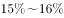之间

- B. 
高速公路通车里程较上年增长以上

- C. 
三级以上公路密度超过30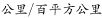

- D. 
公路里程中村道占比比乡道占比高不到5个百分点
　✅

### 官方解析

A项：定位材料文字第一段，2016年，X省交通运输、仓储和邮政业实现增加值增长，增速比2015年加快0.4个百分点，可知2015年交通运输、仓储和邮政业实现增加值同比增长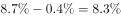。代入间隔增长率公式：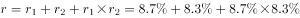，题目表述错误；

B项：定位材料文字第二段，2016年，X省建成高速公路里程236公里，通车里程达到5265公里。则2015年X省高速通车里程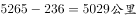，题目所求增速为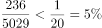，错误；

C项：根据图一，三级以上公路里程为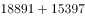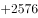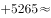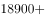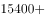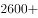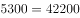，根据本篇材料第2题，X省面积约为1560百平方公里，则三级以上公路密度约为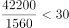公里/百平方公里，错误；

D项：定位材料文字第二段，2016年底X省公路通车里程达到142065公里；根据图二，公路里程中村道为54865公里，乡道为48896公里，题目所求为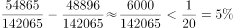，正确。

故正确答案为D。

### 给定材料

        2016年，X省交通运输、仓储和邮政业实现增加值930.8亿元，增长，增速比2015年加快0.4个百分点，快于全省经济增速4.2个百分点；占全省GDP比重，比2015年上升0.2个百分点；对GDP增长贡献率；占全省第三产业增加值比重为，第三产业增长贡献率为。

        2016年，X省高速公路完成投资118亿元，建成公路里程236公里。高速公路通车里程达到5265公里，其中：国家高速公路网（行政级别属于国道的高速公路）里程达到3193公里。全省119个县（市、区）有113个通了高速公路。2016年底X省公路通车里程达到142065公里，新增公路通车里程1106公里，公路密度为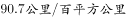。

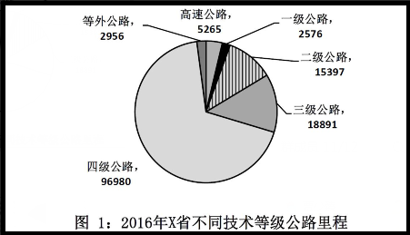

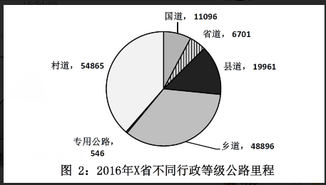

