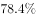
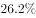
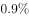
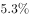
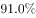
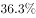

# 综合分析—选非题（不能推出），混合定性增速判断、基期值估算、率差与'占比×城市数'部分量验证

考点：[[20-考点/资料分析/综合/综合分析—选非题（不能推出），混合定性增速判断、基期值估算、率差与'占比×城市数'部分量验证|综合 / 综合分析—选非题（不能推出），混合定性增速判断、基期值估算、率差与'占比×城市数'部分量验证]]
材料：[[15-材料/资料分析/198930 2015年我国城市环境质量与环境基础|198930 2015年我国城市环境质量与环境基础]]

**问法模型**：'根据上述资料，不能推出的是'→选非题四项逐一验证：定性项（A、B）看'增长''提高0.7个百分点'的符号方向即可判定；定量项（C、D）先算临界值再比较：C用基期=64.2÷(1+r)对照60亿，D用321×'差'档占比对照5个。

## 推理链
1. 第1步：定位材料句3——2015年末城市污水处理厂日处理能力13784万立方米，'比上年末增长'（正增速）→2015年能力高于2014年，A项'比2014年有所提高'可推出，排除。
2. 第2步：定位材料句4——城市生活垃圾无害化处理率'提高0.7个百分点'，即2015年率−2014年率=0.7>0，处理水平较2014年稍有提高，B项按官方口径可推出，排除。
3. 第3步：定位材料句5——2015年末集中供热面积64.2亿平方米、比上年增长r，基期=64.2÷(1+r)；对照阈值60亿的临界增速=64.2÷60−1=7%，以原卷实际增速代入64.2÷(1+r)仍大于60亿，C项'超过60亿平方米'成立，排除。
4. 第4步：定位材料句2——声环境质量'差'的城市占比为p，对应城市数=321×p；判断'超过5个'的临界占比=5÷321≈1.56%。
5. 第5步：以原卷'差'档实际占比代入321×p，所得城市数不超过5个（占比未达1.56%临界线），'超过5个'不成立，D项不能推出。
6. 第6步：本题为选非题，'不能推出'的D项即为正确答案。

**最快解法**：⚡ 逐项排除+临界值法：先攻数字可算的C、D。C用基期公式64.2÷(1+r)对照60亿，临界增速64.2÷60−1=7%（截位口算64.2÷60≈1.07），原卷增速小于7%→C成立排除；D先算临界占比5÷321≈1.56%，再用'差'的占比×321验证城市数≤5个→D不成立，选非题直接锁定D；A、B凭'增长''提高0.7个百分点'的正向表述秒排除。

## 易错点
- ⚠ '提高0.7个百分点'是两个率之间的差值，不是增长率0.7%；B项由'率提高'对应'处理稍有提高'，勿因'率'与'能力'表述差异而误判B为偷换概念错选B（官方按可推出处理）。
- ⚠ D项必须用占比×321个城市再与5比较，临界占比5÷321≈1.56%；易漏乘城市数、或直接拿占比数值与'5个'比大小。
- ⚠ C项求基期须用64.2÷(1+r)，不能把增速百分点直接从64.2中减去；注意'亿平方米'量级，与'超过60亿'保持同一单位口径。

## 母题抽象
> 🧩 当综合分析题干出现'不能推出/无法判断'且选项混有定性增速判断与定量估算时，用逐项排除法：定性项看'增长/提高'符号即可排除，定量项先算临界值——基期与阈值比较算临界增速（现期÷阈值−1）、部分量与个数比较算临界占比（阈值÷总数），验证不成立者即答案。

**同类特征**：不能推出（选非题）、综合分析逐项判断、提高0.7个百分点（率差）、基期值=现期÷(1+增速)与阈值比较、占比×城市总数求部分量、临界值法

## 相关题
- [[10-真题/资料分析/综合/10204448 综合分析-逐项判断（历史极值确认、两期比重比较、多期累计求和、基期比重）|10204448]]（广东 2024，相关度1）
- [[10-真题/资料分析/综合/2172123 综合分析（当期值加总比较+负增长判基期高低+当月值序列判趋势+基期还原超阈值判断）|2172123]]（广州市考 2018，相关度1）
- [[10-真题/资料分析/综合/2393970 综合分析-逐项判断（基期量计算-增速方向比较-混合增长率-两数差值）|2393970]]（青海 2019，相关度1）
- [[10-真题/资料分析/综合/2578808 综合分析题·逐项验证（核心为同比增长率比较，辅以计数-比重判断与排名对应）|2578808]]（四川 2020，相关度1）
- [[10-真题/资料分析/综合/2776163 综合分析·逐项判断（比重判断-整体推算-倍数辨析-构成占比加和）|2776163]]（浙江 2021，相关度1）

---

### 题干
根据上述资料，不能推出的是：

### 选项
- A. 2015年城市污水处理厂日处理能力比2014年有所提高
- B. 2015城市生活垃圾无害化处理能力比2014年稍有提高
- C. 2014年城市集中供热面积超过60亿平方米
- D. 2015年在监测的321个城市中，城市区域声环境质量差的超过5个　✅

### 官方解析
A项：定位文字材料第三段可得，2015年末，城市污水处理厂日处理能力比上年末增长，正确，排除；
B项：定位文字材料第三段可得，2015年末，城市生活垃圾无害处理率比2014年提高0.7个百分点，正确，排除；
C项：定位文字材料第三段可得，2015年末，城市集中供热面积64.2亿平方米，增长，2014年城市集中供热面积超过了60，正确，排除；
D项：定位文字材料第二段可得，2015年，在监测的321个城市中，城市区域声环境质量差的占，根据公式，可推出公式，错误，当选。
本题为选非题，故正确答案为D。

### 给定材料

        2015年，在监测的我国338个城市中，城市空气质量达标的城市占，未达标的城市占。

        在监测的321个城市中，城市区域声环境质量好的城市占，较好的占，一般的占，较差的占，差的占。

        2015年末，城市污水处理厂日处理能力达到13784万立方米，比上年末增长；城市污水处理率达到。城市生活垃圾无害处理率达到，提高0.7个百分点。城市集中供热面积64.2亿平方米，增长。城市建成区绿地面积189万公顷，增长；建成区绿地率达到；人均公园绿地面积13.16平方米，增加0.08平方米。

> [!warning] 疑点（官方解析可能有误，待人工复核）
> ①所提供材料文本中各占比与增速数值均空缺，C项（需增速<7%）与D项（需'差'档占比≤5/321≈1.56%）的定量验证依赖原卷数值，本笔记按官方结论（C可推出、D不能推出）回推临界条件；②B项材料原文为'无害化处理率提高0.7个百分点'，官方解析将其对应为'处理能力稍有提高'，'率'与'能力'存在口径转换，属官方口径认定，不影响本题答案D。
