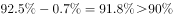

# 综合分析判断题（①②③逐条判定可推出性：基期率还原+无中生有识别）

考点：[[20-考点/资料分析/综合/综合分析判断题（①②③逐条判定可推出性：基期率还原+无中生有识别）|综合 / 综合分析判断题（①②③逐条判定可推出性：基期率还原+无中生有识别）]]
材料：[[15-材料/资料分析/198930 2015年我国城市环境质量与环境基础|198930 2015年我国城市环境质量与环境基础]]

**问法模型**：题干出现'根据上述资料，可以推出'+①②③组合判断 → 逐条定位数据链模型：凡材料给出'现期值+提高X个百分点'的可用减法还原基期判真，凡只给现期值而无增幅/变化量的判'无中生有'不能推出

## 推理链
1. 第1步：定位①——材料只给2015年建成区绿地率的现期值及'绿地面积189万公顷及其增速'，绿地率本身未给变化量，也无建成区面积数据，基期绿地率无法求出→①不能推出
2. 第2步：定位②——选项称2015年污水处理率比2014年'提高0.8个百分点'，材料中污水处理率仅给出现期值、未给提高幅度（所供原文该处数值空缺），'0.8个百分点'无从核实→②属无中生有，错误
3. 第3步：定位③——材料明确给出'2015年城市生活垃圾无害化处理率达到（原卷数值），提高0.7个百分点'
4. 第4步：规则——'提高X个百分点'是两个率之差，基期率=现期率−X个百分点
5. 第5步：代入计算——2014年无害化处理率=2015年率−0.7个百分点，所得具体值与③中比较值对照，满足'高于'关系→③可以推出
6. 第6步：综合判定——①②不能推出、仅③能推出，与选项对照选D

**最快解法**：⚡ 数据链排除法+百分点减法：①②材料均只有现期值、无相应增幅，秒判'无中生有'，直接排除含①②的A、B、C；③套'基期率=现期率−0.7个百分点'还原后即可确认为真，秒选D

## 易错点
- ⚠ ①误把绿地面积的'增长X%'当成绿地率的变化量，用现期绿地率÷(1+X%)倒推基期——绿地率=绿地面积/建成区面积，缺建成区面积变化时两期比重不可这样还原
- ⚠ ②误以为材料出现'提高X个百分点'字样就默认等于选项的'0.8个百分点'，必须逐字核对原卷数值，选项数值可能属无中生有
- ⚠ ③'提高0.7个百分点'是率与率的差值：求2014年率用减法（现期率−0.7个百分点），误当增长率除以(1+0.7%)或把'个百分点'当'%'口径都会算错

## 母题抽象
> 🧩 组合判断题中，凡陈述含'现期值+提高X个百分点'的用'基期值=现期值−X个百分点'减法验证判真；凡只给现期值而无增幅/变化量的判'无中生有'为假，先排除含假项的选项快速锁定答案

**同类特征**：根据上述资料，可以推出、①②③组合判断选项、基期率还原：现期率−提高的百分点、无中生有（信息不足不能推出）、个百分点与增长率口径辨析、纯文字材料综合分析

## 相关题
（暂无）

---

### 题干

根据上述资料，可以推出：

①2014年城市建成区绿地率为

②2015年城市污水处理率比2014年提高0.8个百分点

③2014年城市生活垃圾无害化处理率高于

### 选项
- A. ①
- B. ①②
- C. ②③
- D. ③　✅

### 官方解析

①：定位文字材料第三段可得，2015年末，建成区绿地率达到，只给出现期未给出增长量，无法求出基期，无中生有，错误。

②：定位文字材料第三段可得，2015年末，城市污水处理率达到，只给出现期未给出增长量，无法求出基期，无中生有，错误。

③：定位文字材料第三段可得，2015年末，城市生活垃圾无害处理率达到，提高0.7个自分点，则2014年城市生活垃圾无害化处理率为，正确。

故正确答案为D。

### 给定材料

        2015年，在监测的我国338个城市中，城市空气质量达标的城市占，未达标的城市占。

        在监测的321个城市中，城市区域声环境质量好的城市占，较好的占，一般的占，较差的占，差的占。

        2015年末，城市污水处理厂日处理能力达到13784万立方米，比上年末增长；城市污水处理率达到。城市生活垃圾无害处理率达到，提高0.7个百分点。城市集中供热面积64.2亿平方米，增长。城市建成区绿地面积189万公顷，增长；建成区绿地率达到；人均公园绿地面积13.16平方米，增加0.08平方米。

> [!warning] 疑点（官方解析可能有误，待人工复核）
> 所供材料文本中各占比/率的数值全部空缺，官方解析按原卷实际数值作答；另材料导读提示原文句3污水处理率'附较2014年提高的百分点数'，而官方解析按'仅给现期、无增幅'判②为无中生有，两种口径下②均为错误，不影响答案D的判定
