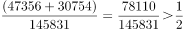
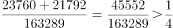
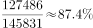
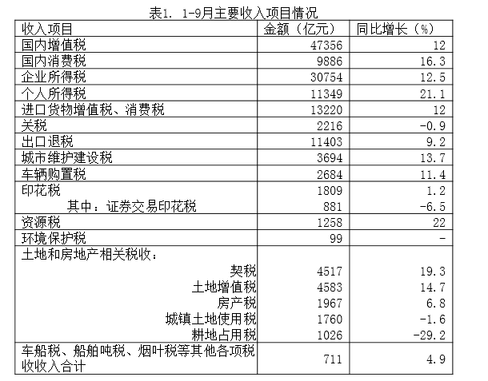
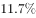
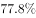
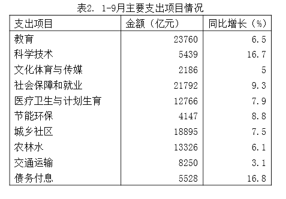

# 综合判断（选非题）：比重验证＋数据可取性甄别

考点：[[20-考点/资料分析/综合/综合判断（选非题）：比重验证＋数据可取性甄别|综合 / 综合判断（选非题）：比重验证＋数据可取性甄别]]
材料：[[15-材料/资料分析/198982 全国一般公共预算收支执行情况：按'9|198982 全国一般公共预算收支执行情况：按'9]]

**问法模型**：题干为'以下说法中，错误的是'的选非综合判断 → 逐项验证'加总后与总盘分数基准比较'及'细项占比'，并甄别'材料未单列细项、无法推出'的选项

## 推理链
1. 第1步：题干要求找出错误说法，四个选项均为1-9月累计口径，分子取表1、表2或正文分项，分母取正文总盘（收入145831亿元、支出163289亿元）
2. 第2步：验证A项：表1国内增值税47356亿元＋企业所得税30734亿元=78090亿元，收入总盘的一半=145831÷2=72915.5亿元，78090>72915.5（约53.5%），A说法成立
3. 第3步：验证B项：表2教育23760亿元＋社会保障和就业21792亿元=45552亿元，支出总盘的四分之一=163289÷4=40822.25亿元，45552>40822.25（约27.9%），B说法成立
4. 第4步：验证C项：正文1-9月税收收入127486亿元÷全国一般公共预算收入145831亿元≈87.4%，与官方解析判定一致，C说法成立
5. 第5步：验证D项：表1中烟叶税仅包含在'车船税、船舶吨税、烟叶税等其他各项税收'合计711亿元中，材料未单列烟叶税数值，其占收入总盘的比重无法计算，D说法不成立
6. 第6步：本题为选非题，错误说法为D，故选D

**最快解法**：⚡ '未单列数据'秒杀法——综合判断题先扫含'其他/等'合并项的选项：D项烟叶税被并入'车船税、船舶吨税、烟叶税等其他各项税收'711亿元，材料无烟叶税单列值，占比必然无法验证，直接锁定D；如需复核A、B只需各一次加总＋一次与基准（72915.5、40822.25）的比较

## 易错点
- ⚠ 把合并项711亿元误当烟叶税数值，或误以为可从'其他各项税收'中拆出烟叶税——材料未单列的细项属于'无法推出'型错误，而非数值算错
- ⚠ A、B的分母必须用正文总盘145831/163289亿元，若误用表1、表2'主要项目'加总作分母即口径错误（表内项目之和小于总盘）
- ⚠ 选非题惯性陷阱：易错选'说法正确'的项；'超过一半/四分之一'须先算出72915.5和40822.25两个基准再比较，勿凭大小感觉判断

## 母题抽象
> 🧩 当综合判断（选非）题某选项要求计算某细项占比，而该细项在材料中只以'××、××等'合并合计项形式出现、未单列数值时，判定数据不可得，该选项即为错误项

**同类特征**：以下说法中，错误的是、选非题/综合判断、1-9月累计口径、两项之和超过一半/四分之一、细项占比（烟叶税）、其他各项税收合并项

## 相关题
- [[10-真题/资料分析/综合/5893736 综合判断·选非题（环比增量比较＋峰谷倍数＋渠道比重比较＋跨层级加总）|5893736]]（国考 2024，相关度1）

---

### 题干
以下说法中，错误的是（    ）。

### 选项
- A. 
1-9月累计，“国内增值税”与“企业所得税”之和超过全国一般公共预算收入的一半

- B. 
1-9月累计，“教育”与“社会保障和就业”两项支出之和超过全国一般公共预算支出的四分之一

- C. 
1-9月累计，税收收入约占全国一般公共预算收入的

- D. 
1-9月累计，烟叶税收入约占全国一般公共预算收入的
　✅

### 官方解析

A项，定位材料表格一可得：1-9月累计，国内增值税为47356亿元，企业所得税为30754亿元。定位文字材料第二段可得：1-9月，全国一般公共预算收入为145831亿元。，正确；

B项，定位材料表格二可得：1-9月累计，教育支出为23760亿元，社会保障和就业支出为21792亿元。定位文字材料第四段可得：1-9月，全国一般公共预算支出为163289亿元。，正确；

C项，定位文字材料第二段可得：1-9月累计，税收收入为127486亿元，全国一般公共预算收入为145831亿元。故占比为，正确；

D项，材料中只给出车船税、船舶吨税、烟叶税等其他各项税收收入合计值，并未单独给出烟叶税的相关数值，故无法得知，错误。

本题为选非题，故正确答案为D。

### 给定材料

一、根据以下资料，回答106-110题。

        9月份，全国一般公共预算收入12963亿元，同比增长。其中，中央一般公共预算收入5919亿元，同比增长；地方一般公共预算本级收入7044亿元，同比增长。全国一般公共预算收入中的税收收入10269亿元，同比增长；非税收入2694亿元，同比下降。

        1-9月累计，全国一般公共预算收入145831亿元，同比增长。其中，中央一般公共预算收入69582亿元，同比增长；地方一般公共预算本级收入76249亿元，同比增长。全国一般公共预算收入中的税收收入127486亿元，同比增长；非税收入18345亿元，同比下降。

        9月份，全国一般公共预算支出22616亿元，同比增长，其中，中央一般公共预算本级支出2533亿元，同比增长；地方一般公共预算支出20083亿元，同比增长。

        1-9月累计，全国一般公共预算支出163289亿元，同比增长，为年初预算的，比序时进度快2.8个百分点。其中，中央一般公共预算本级支出22959亿元，同比增长；地方一般公共预算支出140330亿元，同比增长。

> [!warning] 疑点（官方解析可能有误，待人工复核）
> 官方解析A项将企业所得税写为'30754亿元'，与表1实际数值30734亿元不符（笔误），但47356＋30734=78090仍大于145831的一半72915.5，不影响结论；C、D选项中的具体百分比以图片公式呈现未能读取数值，按官方解析判定C对应127486/145831≈87.4%成立、D因数据未单列而错误

<!-- CODEX-ANSWER-REVIEW:BEGIN -->
### 本次独立复核

**复核状态：** `resolved`（答案与解析已核定）

**计分答案：** D（可计分）

**复核解析：**

1. 第1步：题干要求找出错误说法，四个选项均为1-9月累计口径，分子取表1、表2或正文分项，分母取正文总盘（收入145831亿元、支出163289亿元）
2. 第2步：验证A项：表1国内增值税47356亿元＋企业所得税30734亿元=78090亿元，收入总盘的一半=145831÷2=72915.5亿元，78090>72915.5（约53.5%），A说法成立
3. 第3步：验证B项：表2教育23760亿元＋社会保障和就业21792亿元=45552亿元，支出总盘的四分之一=163289÷4=40822.25亿元，45552>40822.25（约27.9%），B说法成立
4. 第4步：验证C项：正文1-9月税收收入127486亿元÷全国一般公共预算收入145831亿元≈87.4%，与官方解析判定一致，C说法成立
5. 第5步：验证D项：表1中烟叶税仅包含在'车船税、船舶吨税、烟叶税等其他各项税收'合计711亿元中，材料未单列烟叶税数值，其占收入总盘的比重无法计算，D说法不成立
6. 第6步：本题为选非题，错误说法为D，故选D

**最快解法**：⚡ '未单列数据'秒杀法——综合判断题先扫含'其他/等'合并项的选项：D项烟叶税被并入'车船税、船舶吨税、烟叶税等其他各项税收'711亿元，材料无烟叶税单列值，占比必然无法验证，直接锁定D；如需复核A、B只需各一次加总＋一次与基准（72915.5、40822.25）的比较

**相关信息：**

考點：综合判断（选非题）：比重验证＋数据可取性甄别。來源：江西省2018年市县两级法院、检察院统一考录公务员笔试《行测》题（网友回忆版）；2018年。> 🧩 当综合判断（选非）题某选项要求计算某细项占比，而该细项在材料中只以'××、××等'合并合计项形式出现、未单列数值时，判定数据不可得，该选项即为错误项

**同类特征**：以下说法中，错误的是、选非题/综合判断、1-9月累计口径、两项之和超过一半/四分之一、细项占比（烟叶税）、其他各项税收合并项

**题源依据：** [固定版本原题](https://github.com/Mentat-Uran/kaogongzhentizhengliu/blob/84ab93d4b64b61d897bece8a1c0a5bab06b4feb2/10-%E7%9C%9F%E9%A2%98/%E8%B5%84%E6%96%99%E5%88%86%E6%9E%90/%E7%BB%BC%E5%90%88/2256390%20%E7%BB%BC%E5%90%88%E5%88%A4%E6%96%AD%EF%BC%88%E9%80%89%E9%9D%9E%E9%A2%98%EF%BC%89%EF%BC%9A%E6%AF%94%E9%87%8D%E9%AA%8C%E8%AF%81%EF%BC%8B%E6%95%B0%E6%8D%AE%E5%8F%AF%E5%8F%96%E6%80%A7%E7%94%84%E5%88%AB.md)；固定内容 commit `84ab93d4b64b61d897bece8a1c0a5bab06b4feb2`，Markdown blob `1e0dcfb3ccc84b3f891af575488db6fb79ab6ebf`。
<!-- CODEX-ANSWER-REVIEW:END -->
