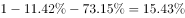
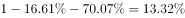
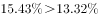
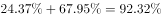
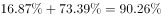
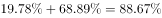
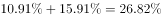

# 综合推断选非题（隐藏列补算+占比与绝对量口径判断）

考点：[[20-考点/资料分析/综合/综合推断选非题（隐藏列补算+占比与绝对量口径判断）|综合 / 综合推断选非题（隐藏列补算+占比与绝对量口径判断）]]
材料：[[15-材料/资料分析/199267 2010年部分省（区、市）人口年龄构|199267 2010年部分省（区、市）人口年龄构]]

**问法模型**：'根据资料不能推出的是'→选非题，先用100%减法补算'60岁及以上'占比空列、用加法补算'总抚养比'空列，再逐项验证A-D能否由表推出，锁定唯一口径错误的选项

## 推理链
1. 第1步：题干为选非题；表内'60岁及以上'占比列全空，凡涉及该项先用 100%−0-14岁占比−15-59岁占比 现算
2. 第2步：验证A——辽宁60+占比=100−11.42−73.15=15.43%，全国=100−16.61−70.07=13.32%，15.43%>13.32%且高出约2个百分点，'明显高于'成立，A能推出
3. 第3步：验证B——60+占比最低等价于(0-14+15-59)之和最高；西藏=24.37+67.95=92.32%为最大（次大广东=16.87+73.39=90.26%，海南=19.78+68.89=88.67%），故西藏60+=100−92.32=7.68%最低，B能推出
4. 第4步：验证C——总抚养比=少儿+老年，北京=10.91+15.91=26.82%为全表最低（次低天津=12.69+16.87=29.56%）；北京0-14岁占比8.60%为最小（上海8.61%次之），少儿抚养比10.91%远低于其他地区，'主要是0-14岁比重小'成立，C能推出
5. 第5步：验证D——重庆60+=100−17.00−65.58=17.42%确为最高（次高辽宁15.43%），但表中只有比重没有各地区总人口，占比高≠老年人口绝对数多，D不能推出
6. 第6步：选非题，选不能推出的D项

**最快解法**：⚡ 秒杀D：材料通篇只有百分比、无任何地区人口绝对数，凡出现'占比最高→人口最多'的'比重推绝对量'判断必缺基数，直接判不能推出；再用隐藏列补算法确认A（15.43%>13.32%）、B（西藏两比重之和92.32%最大）、C（北京总抚养比10.91+15.91=26.82%最低且0-14占比8.60%最小）均可推出，双保险锁定D

## 易错点
- ⚠ 比重与绝对量混淆：D项陷阱是'占比最高所以老年人口最多'，占比是相对数，各地区总人口未知时不能比较绝对量，这正是本题正确选项的设错点
- ⚠ 表中'60岁及以上'列和'总抚养比'列均为空，直接在表中找数找不到，必须用100%减法、分项加法现算，误以为'数据缺失即不能推出'会错选B或A
- ⚠ 选非题审题：题干问'不能推出'，A、B、C均为能推出的正确陈述，惯性选'正确项'会掉坑；另注意抚养比（分母为15-59岁人口）与占总人口比重（分母为总人口）两套口径不可混比
- ⚠ 13行数据结构相似，逐行查找易串行：上海8.61%与北京8.60%、广东90.26%与西藏92.32%等相近数值需精确到行核对

## 母题抽象
> 🧩 当题干出现'不能推出/无法判断'的选非特征且表格留有空列时，先补齐隐藏列（占比列用100%减法、总抚养比用分项加法），再逐项验证；凡由'某比重最高/最低'直接推断'绝对量最多/最少'而材料未给总量的选项，必为不能推出项

**同类特征**：选非题（不能推出的是）、60岁及以上占比列空缺需100%减法补算、总抚养比=少儿抚养比+老年抚养比补算、占比高≠绝对数多（缺总人口基数）、逐选项验证型综合判断、同一隐藏列多角度提取

## 相关题
- [[10-真题/资料分析/综合/13255492 综合判断选非题（同比增速逐年比较+分类指数对总指数增长贡献率趋势验证）|13255492]]（选调 2023，相关度1）
- [[10-真题/资料分析/综合/17467565 综合判断选非题（平均数比较+趋势判断+抚养比公式逆推）|17467565]]（湖北 2026，相关度1）
- [[10-真题/资料分析/综合/5509478 综合分析选非题：PMI加权合成＋逆指数反例构造＋环比差值读数|5509478]]（甘肃 2023，相关度1）

---

### 题干
根据资料不能推出的是：

### 选项
- A. 辽宁的60岁及以上人口占比明显高于全国
- B. 西藏的60岁及以上人口占比最低
- C. 北京的总抚养比最低，主要是0～14岁人口比重小
- D. 重庆的60岁及以上人口占比最高，所以重庆的老年人口最多　✅

### 官方解析

A项：定位表格，辽宁的60岁及以上人口占比：，全国60岁及以上人口占比：，，正确。

B项：定位表格，要找出60岁及以上占比最低的地区，反之找到0-14岁和15-59岁之和最大的地区即可。西藏地区：，观察其他地区，两者之和在90%附近的还有广东和海南地区，广东地区：，海南地区：，因此西藏地区60岁及以上占比的人最少，正确。

C项：定位表格，北京的总抚养比为，是总抚养比最低的地区，而且0-14岁的比重最小，正确。

D项：定位表格，重庆市60岁以上人口占比最高，但总人口数未知，因此不能推出重庆老年人口最多，错误。

本题为选非题，故正确答案为D项。

### 给定材料

        其中“少儿抚养比”为0～14岁人口数和15～59岁人口数的比值；“老年抚养比”为60岁及以上人口数和15～59岁人口数的比值；“总抚养比”为“少儿抚养比”和“老年抚养比”之和。

