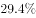

# 综合分析判断题（选非）——现期倍数+基期比重+区域加和比较

考点：[[20-考点/资料分析/综合/综合分析判断题（选非）——现期倍数+基期比重+区域加和比较|综合 / 综合分析判断题（选非）——现期倍数+基期比重+区域加和比较]]
材料：[[15-材料/资料分析/199274 2018年上半年全国规模以上文化及相|199274 2018年上半年全国规模以上文化及相]]

**问法模型**：“以下说法不正确的是”选非判断 → 对四项逐一定量验证（A加和比较、B/D基期比重、C现期倍数），锁定唯一错误项

## 推理链
1. 第1步：从材料提取现期值：东部32443亿元、中部5828亿元、西部3509亿元、东北447亿元；新闻信息服务3744亿元、全国总量42227亿元；文化装备生产3313亿元、文化投资运营349亿元（均为2018年上半年）
2. 第2步：A项用加和比较：中部+西部+东北=5828+3509+447=9784亿元，32443＞9784，东部超过三者之和，A正确
3. 第3步：C项用现期倍数（只需现期值，无需增速）：3313÷349，因349×10=3490＞3313，商首两位只能到9（约9.5倍）
4. 第4步：故2018年上半年文化装备生产营业收入不足文化投资运营收入的10倍，“达到10倍”不成立，C错误
5. 第5步：B、D项代入基期比重公式 (A/(1+a))÷(B/(1+b))=A/B×(1+b)/(1+a)：B项代入新闻信息服务3744亿元及其增速与总量42227亿元及总增速，算得2017年上半年占比不到一成，B正确；D项代入东部32443亿元及其增速与总量及总增速，算得2017年上半年东部占比在七成以上，D正确
6. 第6步：本题为选非题，A、B、D均正确，仅C错误，故答案为C

**最快解法**：⚡ 临界值判定+截位直除：先扫选项，C项只含现期值（材料增速空白也能算），349×10=3490＞3313，一步锁定3313/349≈9.5＜10倍，C即“不正确”项，直接作答；A项心算9784＜32443复核即可，B/D的基期比重计算在本题中可跳过

## 易错点
- ⚠ 选非题惯性陷阱：逐项验证后习惯性选“正确”项，必须看清问的是“不正确的是”
- ⚠ C项临界陷阱：3313与10倍临界值349×10=3490仅差177，粗略估算易误判“达到10倍”，须用“除数×10与被除数比大小”严格判定
- ⚠ B、D为基期比重，依赖材料中被空白化的同比增速，须先补齐增速再算；而C项只用现期值即可判定，应优先验证（增速缺失时C是唯一可完整验证的数值型选项）

## 母题抽象
> 🧩 当题干出现“以下说法不正确/正确的是”且四选项跨考点时，优先验证只需现期值的选项（加和比较、现期倍数，用‘分母×临界倍数’与分子比大小），再处理需增速的基期比重选项

**同类特征**：以下说法不正确的是、选非/综合判断、现期倍数（10倍）、基期比重（占……比重）、区域加和比较、超过/不到/达到/七成以上等临界表述

## 相关题
（暂无）

---

### 题干
以下说法不正确的是（  ）。

### 选项
- A. 2018年上半年，东部地区规模以上文化及相关文化产业企业营业收入总额超过中部、西部、东北地区的总和
- B. 2017年上半年，新闻信息服务营业收入占我国规模以上文化及相关产业总营业收入不到一成
- C. 2018年上半年，文化装备生产营业收入达到文化投资运营收入的10倍　✅
- D. 2017年上半年，东部地区规模以上文化及相关文化产业企业营业收入占全国比重七成以上

### 官方解析
A项：定位文字材料第三段，“东部地区规模以上文化及相关产业企业实现营业收入32443亿元；中部、西部和东北地区分别为5828亿元、3509亿元和447亿元”。5828+3509+447=9784，32443＞9784，故东部地区营业收入超过中、西、东北地区之和，正确；
B项：定位文字材料第一段和第二段，“2018年上半年，上述企业实现营业收入42227亿元，比上年同期增长 ”“新闻信息服务营业收3744亿元，比上年同期增长”。根据基期比重公式，2017年上半年新闻信息服务营业收入占我国规模以上文化及相关产业总营业收入的比重为：，故不到一成，正确；
 C项：定位文字材料第二段，“文化投资运营349亿元，增长；文化装备生产3313亿元，增长”。2018年上半年，文化装备生产营业收入是文化投资运营收入的：，不到10倍，错误；
D项：定位文字材料第一段和第三段，“2018年上半年，上述企业实现营业收入42227亿元，比上年同期增长”，“东部地区规模以上文化及相关产业企业实现营业收入32443亿元······东部地区增长”。根据基期比重公式：，可得2017年上半年，东部地区规模以上文化及相关文化产业企业营业收入占全国比重为，在七成以上，正确。
本题为选非题，故正确答案为C。

### 给定材料

        对全国规模以上文化及相关产业5.9万家企业的调查显示，2018年上半年，上述企业实现营业收入42227亿元，比上年同期增长，继续保持较快增长。

        文化及相关产业9个行业的营业收入均实现增长。其中，新闻信息服务营业收入3744亿元，比上年同期增长；创意设计服务5143亿元，增长；内容创作生产8820亿元，增长；文化传播渠道4501亿元，增长；文化辅助生产和中介服务7783亿元，增长；文化消费终端生产7911亿元，增长；文化投资运营349亿元，增长；文化装备生产3313亿元，增长；文化休闲娱乐服务663亿元，增长。

        分区域看，东部地区规模以上文化及相关产业企业实现营业收入32443亿元；中部、西部和东北地区分别为5828亿元、3509亿元和447亿元。从增长速度看，西部地区比上年同期增长；东部地区增长；中部地区增长；东北地区增长，与上年同期下降相比，实现了正增长。

