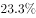
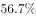
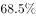

# 综合判断选非题（现期比重+两期比重趋势+跨期增长率混合验证）

考点：[[20-考点/资料分析/综合/综合判断选非题（现期比重+两期比重趋势+跨期增长率混合验证）|综合 / 综合判断选非题（现期比重+两期比重趋势+跨期增长率混合验证）]]
材料：[[15-材料/资料分析/199276 以2017年末为现期、辅以2013—|199276 以2017年末为现期、辅以2013—]]

**问法模型**：'以下说法不正确的是'为选非型综合判断题 → 对四个选项分别套用比重比较（A、D）、两期比重逐年趋势（B）、增长率公式（C）逐一验真，锁定错误项。

## 推理链
1. 第1步：选非题需逐项验证；柱状图给出2013—2017营业/复线/电气化里程（2013年10.3、4.8、5.6；2014年11.2、5.7、6.5；2015年12.1、6.4、7.4；2016年12.4、6.8、8.0；2017年12.7、7.2、8.7），文字给出2017年高铁2.5万公里、营业里程12.7万公里。
2. 第2步：A项套比重比较：2013年复线率=4.8/10.3≈46.6%<50%，'不到一半'表述正确。
3. 第3步：B项套两期比重逐年作商：电化率2014年6.5/11.2≈58.0%→2015年7.4/12.1≈61.2%→2016年8.0/12.4≈64.5%→2017年8.7/12.7≈68.5%，逐年上升，表述正确。
4. 第4步：C项套增长率公式：(12.7−10.3)/10.3=2.4/10.3≈23.3%，与选项'约增加了23.3%'一致，表述正确。
5. 第5步：D项套现期比重：高铁占营业里程比重=2.5/12.7≈19.7%，而'三成'=30%，19.7%<30%，'三成以上'表述错误。
6. 第6步：选非题选错误项，故正确答案为D。

**最快解法**：⚡ 选非题优先口算最简选项：D项比重2.5/12.7，放缩为2.5/12.5=20%得分母缩小比重放大的上限，实际比重略低于20%（约两成），远小于三成(30%)，'三成以上'必错，直接锁定D，A/B/C无需精算。

## 易错点
- ⚠ 选非陷阱：题干问'不正确的是'，A/B/C均为正确表述，若按'找正确项'惯性会误选A或C。
- ⚠ '三成'=30%的成数换算：2.5/12.7≈19.7%（约两成），勿把比重与增速混淆，或凭'2.5万公里感觉不小'误判为超过三成。
- ⚠ B项电化率必须逐年取图中相邻两柱作商（6.5/11.2→8.7/12.7）验证，不能因电气化里程与营业里程同增就直觉认定比率上升；2016年基期数据文字中没有，必须跨图取数（8.0/12.4）。

## 母题抽象
> 🧩 当题干出现'以下说法不正确/正确的是'且选项含'X占Y几成/几分之几'的现期比重表述时，优先用分母取整放缩口算验证该选项，一旦确认对错即锁定答案，其余选项不精算。

**同类特征**：选非题（不正确的是）、综合判断多选项混合验证、三成以上（比重与成数对比）、电化率逐年增加（两期比重趋势）、比2013年约增加（跨期增长率）、柱状图取数与文字取数混用

## 相关题
- [[10-真题/资料分析/综合/2136632 综合分析·选非题（比重差值+五年年均值+占比判定+平均每件金额混合验证）|2136632]]（河南 2017，相关度1）
- [[10-真题/资料分析/综合/2374723 综合分析选非题（柱状图单调性直读＋增速关系换算＋表1逐项比较＋差值定性判断）|2374723]]（广东 2019，相关度1）
- [[10-真题/资料分析/综合/2776161 综合分析选非题·大小排序比较（占比大小与客源国名次）|2776161]]（浙江 2021，相关度1）
- [[10-真题/资料分析/综合/19452627 综合分析选非题（比重+部分值+平均数+倍数混合验证）|19452627]]（上海 2026，相关度1）
- [[10-真题/资料分析/综合/18643960 综合分析·选非题（文字+图表逐项验证）|18643960]]（浙江 2026，相关度1）

---

### 题干
以下说法不正确的是（  ）。

### 选项
- A. 
2013年，我国铁路复线里程不到铁路营业里程一半

- B. 
2014—2017年，我国铁路电化率逐年增加 

- C. 
2017年，我国铁路营业里程比2013年约增加了

- D. 
2017年，我国高铁营业里程占全国铁路营业里程三成以上
　✅

### 官方解析
A项，定位柱状图可知2013年我国铁路复线里程为4.8万公里，铁路营业里程为10.3万公里，则，不到一半，正确；
B项，定位柱状图可知2014—2017年我国每一年的铁路电气化里程和铁路营业里程，可得2014年铁路电化率，2015年铁路电化率，2016年铁路电化率，2017年铁路电化率为，可见，我国铁路电化率逐年增加，正确；
C项，定位柱状图可知我国铁路营业里程2013年为10.3万公里，2017年为12.7万公里，根据增长率计算公式：，可得2017年我国铁路营业里程比2013年约增加了，正确；
D项，定位文字材料“2017年末，全国铁路营业里程达到12.7万公里，比上年增长，其中高铁营业里程2.5万公里”，可得，而非三成（）以上，错误。
本题为选非题，故正确答案为D。

### 给定材料

        2017年末，全国铁路营业里程达到12.7万公里，比上年增长，其中高铁营业里程2.5万公里。全国铁路路网密度132.2公里/万平方公里，比上年增加3.0公里/万平方公里。其中复线里程7.2万公里，复线率（铁路复线里程占铁路营业里程的比重），电气化里程8.7万公里，电化率（铁路电气化里程占铁路营业里程的比重）。西部地区铁路营业里程5.2万公里，比上年增长。

> [!warning] 疑点（官方解析可能有误，待人工复核）
> 官方解析中A、B、C、D各项的算式数值因LaTeX/图片缺失未显示，但按图中数据复算结论与官方答案D完全一致（A:4.8/10.3≈46.6%<50%；B电化率逐年升；C≈23.3%；D:2.5/12.7≈19.7%<30%），无实质矛盾。
