# 综合分析选非题（增速比较+两期比重升降判定+下降类基期量+现期比重）

考点：[[20-考点/资料分析/综合/综合分析选非题（增速比较+两期比重升降判定+下降类基期量+现期比重）|综合 / 综合分析选非题（增速比较+两期比重升降判定+下降类基期量+现期比重）]]
材料：[[15-材料/资料分析/199302 2014年A市规模以上工业经济运行情|199302 2014年A市规模以上工业经济运行情]]

**问法模型**：题干为'下列表述不正确的是'选非题 → 对A~D四项逐一定位验证，每项套用对应模型（增速排序、两期比重方向规则、基期=现期÷(1−r)、比重=部分÷整体），找出唯一错误项

## 推理链
1. 第1步：读统计表，六大主导产业合计951.60亿元、增速15.9%；分项增速为汽车3.2%、装备制造19.7%、家用电器12.5%、食品及农副产品加工20.2%、新型平板显示44.2%、新能源及光伏41.3%（比较时排除合计行）
2. 第2步（验A）：与平均增速15.9%逐一比较，高于它的有装备制造19.7%、食品及农副产品加工20.2%、新型平板显示44.2%、新能源及光伏41.3%，共4个，A表述正确
3. 第3步（验B）：两期比重方向规则——当产业增速a<合计增速b=15.9%时占比下降；只有汽车3.2%、家用电器12.5%低于15.9%，共2个（与A互补：6−4=2），B表述正确
4. 第4步（验C）：文字第三段'出口交货值419.79亿元，比上年下降'，基期=419.79÷(1−r)，因分母小于1，基期必大于419.79亿元；而选项说约412亿元<419.79亿元，方向矛盾，C表述错误
5. 第5步（验D）：现期比重=11个行业累计利润÷利润总额=285.26÷358.55≈79.6%，与选项所给百分比接近，D表述正确
6. 第6步：本题为选非题，C为唯一错误表述，故正确答案为C

**最快解法**：⚡ C项方向秒杀法：见'比上年下降'即知基期>现期（基期=现期÷(1−r)>现期），选项412亿元<419.79亿元直接判错，无需知道被挖空的具体降幅；A、B项只需对表格增速与15.9%比大小（高于4个、低于2个互补验证）；D项截位直除285.26÷358.55≈79.6%

## 易错点
- ⚠ 选非题设问'不正确的是'，惯性思维去找正确项而误选A/B/D
- ⚠ C项出口降幅在文字材料中被挖空，考生误以为必须硬算而陷入僵局；实际利用'下降→基期大于现期'的方向校验即可秒判412亿元错误
- ⚠ B项两期比重升降规则易写反：应为部分增速a大于整体增速b时占比上升、a<b时占比下降；且须先在表格中排除'六大主导产业'合计行再比较
- ⚠ '36个工业增加值全部实现增长'实指36个工业行业，口径易误读；材料中增加值/产值/收入/利润等口径混排，D项必须用利润÷利润总额而非主营业务收入

## 母题抽象
> 🧩 当综合分析题中出现'下降类指标的基期值'选项时，先用方向校验（下降则基期>现期，选项小于现期直接判错），再用两期比重方向规则（a与b比大小）和增速排序快速核验其余选项

**同类特征**：选非题·不正确的是、六大主导产业平均增速15.9%比较、两期比重升降判断（a与b）、下降类指标基期量折算、现期比重=285.26÷358.55、排除统计表合计行

## 相关题
- [[10-真题/资料分析/综合/2776091 综合分析选非题：多段定位定性核对＋单位换算（万吨↔亿立方米）量级比较|2776091]]（浙江 2021，相关度1）
- [[10-真题/资料分析/综合/5521216 综合分析选非题（比重趋势+倍数+增长量比较+增长率比较四项混合验证）|5521216]]（深圳市考 2023，相关度1）

---

### 题干
根据上述资料，下列表述不正确的是：

### 选项
- A. 
2014年，A市六大主导产业中，增加值同比增速高于六大主导产业平均增速的有4个

- B. 
2014年，A市六大主导产业中，增加值占比较上年同期有所下降的有2个

- C. 
2013年，A市规模以上工业出口交货值约为412亿元
　✅
- D. 
2014年，A市11个利润均超过10亿元的行业，其利润额占规模以上工业企业利润总额的比重接近

### 官方解析

A项：定位表格可得，2014年，A市六大主导产业平均增速为，那么六大主导产业中，增加值同比增速高于的有装备制造（）、食品及农副产品加工（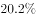）、新型平板显示（）、新能源及光伏（），共4个，正确。

B项：根据两期比重比较规律可得，可知当a（六大主导产业中的某一产业的增长率）b（六大主导产业的增长率）时，增加值占比较上年同期有所下降。定位表格，只有汽车增长率（）和家用电器增长率（）小于六大主导产业增长率（），正确（或者根据A项判断有4个高于的，剩余2个低于，判断B项正确）。

C项：定位文字材料第三段可得，全年规模以上工业出口交货值419.79亿元，比上年下降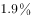”,代入公式，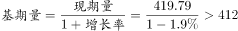亿元，错误。

D项：定位文字材料第二段可得，规模以上工业企业主营业务收入6002.74亿元，利润总额358.55亿元，······电气机械和器材制造业、通用设备制造业、专用设备制造业、金属制品业、汽车制造业等11个行业利润均超过10亿元，累计实现利润285.26亿元”。那么2014年，A市11个利润均超过10亿元的行业，其利润额占规模以上工业企业利润总额的比重为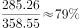，接近，正确。

本题为选非题，故正确答案为C。

### 给定材料

        2014年年末，A市规模以上工业企业2087户，全年实现工业增加值1653.54亿元，比上年增长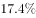。其中，轻工业增加值653.28亿元，增长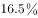；重工业增加值1000.26亿元，增长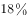。战略性新兴产业完成产值1598.74亿元，比上年增长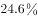。

        规模以上工业企业主营业务收入6002.74亿元，比上年增长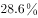；利润总额358.55亿元，增长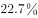；亏损企业亏损额15.46亿元，下降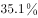。电气机械和器材制造业、通用设备制造业、专用设备制造业、金属制品业、汽车制造业等11个行业利润均超过10亿元，累计实现利润285.26亿元。

        A市36个工业增加值全部实现增长，六大主导产业实现增加值951.60亿元，比上年增长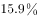。全年规模以上工业出口交货值419.79亿元.比上年下降。

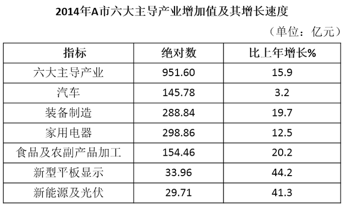

> [!warning] 疑点（官方解析可能有误，待人工复核）
> 材料正文中出口交货值降幅及D项所给比重数值在本文呈现中被挖空（D选项公式图片无法读取数值），官方解析也以'代入公式'带过未给出具体数；但C项判错仅依赖'下降则基期>419.79亿元'的方向校验，不依赖具体降幅，与官方答案C一致，无实质矛盾
