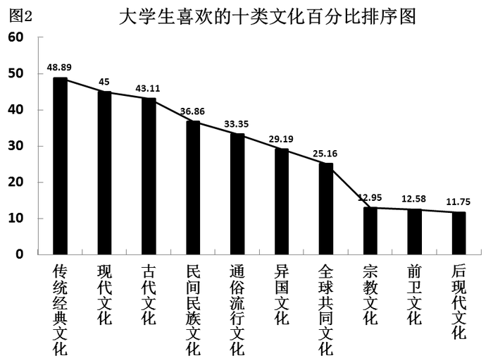
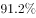
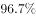
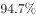
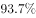
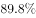
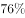
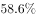
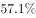

# 综合分析判断（文字材料定性结论对比）

考点：[[20-考点/资料分析/综合/综合分析判断（文字材料定性结论对比）|综合 / 综合分析判断（文字材料定性结论对比）]]

**问法模型**：题干问'可考察出大学生的文化生活趋向是'→ 定位材料中关于趋向/态势的总结性表述，逐项对比选项与原文表述的完整性和一致性

## 推理链
1. 第1步：题干要求判断大学生的文化生活趋向，定位文字材料第一段文化价值观部分
2. 第2步：原文总括句明确表述'大学生作为一个高知群体，在文化价值取向上展现出传统与现代交织的态势'
3. 第3步：原文支撑句为'既热衷于现代文化，也保持对传统经典文化最浓厚的兴趣'，即A、C各取一半，均属以偏概全
4. 第4步：D项对应原文'只有小部分的大学生自认比较喜欢前卫文化和后现代文化'，'小部分'不能代表整体趋向
5. 第5步：只有B项'传统与现代交织的态势'与原文总括句完全一致，故选B

**最快解法**：⚡ 关键词定位法——题干问'文化生活趋向'，直接到第一段找结论性语句'传统与现代交织的态势'，与选项B逐字匹配即可锁定；再用'既…也…'并列结构快速排除只取一半的A、C

## 易错点
- ⚠ A、C项分别截取'既热衷于现代文化'和'保持对传统经典文化最浓厚的兴趣'的一半，以偏概全，极易误选
- ⚠ D项'一批人'与原文'只有小部分'程度不符，局部偏好不等于整体趋向
- ⚠ 注意'趋向/态势'类问法要找总括性结论句，而非某一具体文化类型的描述

## 母题抽象
> 🧩 当题干出现'可考察出/可以看出/能够得出…趋向、态势、特点'特征时，用原文结论句定位法，优先匹配材料中的总括性表述，并警惕选项只截取并列结构（'既…也…'）的一半造成以偏概全

**同类特征**：可考察出、文化生活趋向、根据材料信息判断结论、态势/趋向类表述、选项为原文语句的同义复现或片面截取

## 相关题
（暂无）

---

### 题干
根据上图提供的信息可考察出大学生的文化生活趋向是：

### 选项
- A. 对现代文化有浓厚的学习兴趣
- B. 传统与现代交织的态势　✅
- C. 热衷于传统经典文化
- D. 一批人比较喜欢前卫和后现代文化

### 官方解析
A项：定位文字材料第一段“大学生既热衷于现代文化，也保持对传统经典文化最浓厚的兴趣”可知，现代文化并非大学生的文化生活趋向，错误；
B项：定位文字材料第一段“大学生作为一个高知群体，在文化价值取向上展现出传统与现代交织的态势”可知，大学生的文化生活趋向是传统与现代交织的态势，正确；
C项：定位文字材料第一段“大学生既热衷于现代文化，也保持对传统经典文化最浓厚的兴趣”可知，大学生也热衷于现代文化，传统经典文化并非大学生的文化生活趋向，错误；
D项：定位文字材料第一段“只有小部分的大学生自认比较喜欢前卫文化和后现代文化”可知，只有小部分人比较喜欢前卫和后现代文化，错误。
故正确答案为B。

### 给定材料

        在大学生文化和生活价值观上，问卷通过多选题型考察大学生的文化生活趋向，大学生喜欢的十类文化排序分别是：传统经典文化、现代文化、古代文化、民间民族文化、通俗流行文化、异国文化、全球共同文化、宗教文化、前卫（超前）文化和后现代文化。大学生作为一个高知群体，在文化价值取向上展现出传统与现代交织的态势，大学生既热衷于现代文化，也保持对传统经典文化最浓厚的兴趣，只有小部分的大学生自认比较喜欢前卫文化和后现代文化。

        在考察法律意识方面，问卷主要通过考察公民解决纠纷的途径来反映公民的法律意识。问卷设定了三种纠纷解决途径，即法律途径（“遵循法律和政策规定解决”）、行政途径（“找单位和领导帮助解决”）和武力途径（“通过恐吓、武力或其他施压方式解决”）三种，大学生在纠纷解决方面的选择情况分别为，，。应该说，只有极少部分大学生采取武力途径解决纠纷。在法律常识方面，大学生对法律性质的正确认识高达，在对我国已经颁布的部门法的了解上，选择“宪法”、“合同法”、“民事诉讼法”、“继承法”、“婚姻法”的分别为：、、、、，几乎都在以上。在调查中，我们还发现，大学生也以自己的实际行动来践行和维护法律。

        在知识产权方面，的被调查者知道“世界知识产权日”，的被调查者明确“我国国家知识产权战略现在是从‘制定’转入‘实施’”，的被调查者关注过“北京市高级人民法院2007年受理的《十大知识产权典型案例》”。

        大学生在科学意识方面，大学生自认在日常工作和学习中，选择“按他人意志办事”的仅占，选择“据自己兴趣办事”和“按客观规律办事”的占、。而对“科学发展观”，表示“明确知道”的占，表示“知道一些，不太明确”的占，而表示“不知道”的占。

        在科学行为方面，大学生发现、思考和解决问题的能力作为考察的重点。大学生自认“很少遇到问题”的仅占，而认为“经常遇到问题”、“善于发现问题的原因”、“善于提出解决问题的办法”、“善于解决问题”四项的选择比例分别为：、、和。

> [!warning] 疑点（官方解析可能有误，待人工复核）
> 题干表述为'根据上图提供的信息'，但官方解析定位于文字材料第一段的总括句，图文口径略有出入（图中排序仅为支撑），不影响答案B的正确性
