# 综合判断题（间隔增长率+混合增速+增量求和比较+比重计算逐项核对）

考点：[[20-考点/资料分析/综合/综合判断题（间隔增长率+混合增速+增量求和比较+比重计算逐项核对）|综合 / 综合判断题（间隔增长率+混合增速+增量求和比较+比重计算逐项核对）]]
材料：[[15-材料/资料分析/199307 2013年全国林产品进出口概况（出口|199307 2013年全国林产品进出口概况（出口]]

**问法模型**：“下列说法中与上述资料相符的是”→四项断言逐项验证、只取为真一项；分别对应间隔增长率推2011年、混合增速判木质出口增速、增量正负抵消判总量升降、先拆分母再算比重四个模型

## 推理链
1. 第1步：A项——文字给出2013年出口644.55亿美元“增幅比上年增加3.18个百分点”、进口640.88亿美元“增幅比上年增加8.58个百分点”，故2012年增速=2013年增速−3.18pp（出口）、−8.58pp（进口）
2. 第2步：A项——按间隔增长率r=r2013+r2012+r2013×r2012推2013年较2011年的总增速，再以644.55、640.88回推2011年出口、进口量，官方判定出口小于进口（逆差），A错误
3. 第3步：B项——木质林产品出口=644.55−162.3=482.25亿美元，用混合增速口诀“混合居中但不中、偏向基数较大一方”，木质出口增速应介于林产品总出口增速与非木质出口增速之间且偏向基数大者，官方判定未超过选项阈值，B错误
4. 第4步：C项——读表：胶合板出口1026.34万立方米(+2.31%)、纤维板306.87万立方米(−14.97%)、刨花板27.13万立方米(+25.20%)，三者同为万立方米量纲、可直接合并
5. 第5步：C项——增量=现期×r/(1+r)：胶合板≈1026.34×2.31%/103.31%≈+23.2、纤维板≈−306.87×14.97%/85.03%≈−54.0、刨花板≈27.13×25.20%/125.20%≈+5.5万立方米，合计≈−25.4<0（2013年合计1360.34＜2012年约1385.8），故出口总量低于上年，C正确
6. 第6步：D项——木质林产品进口=640.88−288.80=352.08亿美元，比重=7.08÷352.08≈2.0%，官方判定未超过选项阈值，D错误

**最快解法**：⚡ 放缩估算+增量抵消（先攻C项）：负增量下限=306.87×14.97%≈45.9万立方米，正增量上限=1026.34×2.32%+27.13×25.2%≈23.8+6.8=30.6万立方米，因45.9＞30.6，三项增量合计必为负，即2013年总量必低于上年，无需精算即可锁定C。

## 易错点
- ⚠ 量纲混用：C项只可对胶合板/纤维板/刨花板（同为万立方米）加总比较，若误把木家具（亿美元）或纸和纸制品（万吨）并入总量判断即掉入材料导读点名的混合单位陷阱
- ⚠ “增速为正”≠“总量上升”：胶合板+2.31%、刨花板+25.20%虽为正增，但纤维板−14.97%作用在大基数306.87上，减量约54万立方米，大于两项正增量之和，必须把增速折算成增量再正负抵消，凭增速正负直接判断必错
- ⚠ “增幅比上年增加3.18/8.58个百分点”是增速之差不是增速本身，回推2012年增速须做减法；A项还需再做间隔增长率复合，不能只用2013年单段增速；D项分母须先拆出木质进口352.08，不能错用林产品总进口640.88

## 母题抽象
> 🧩 当综合判断题出现“几类产品合计总量低于/高于上年”的断言时，将各项折算为增量（现期×r/(1+r)），并用放缩界定（正增量上限≈现期×r、负减量下限≈|现期×r|）比较正负总量，抵消后与0比大小即得结论。

**同类特征**：与上述资料相符的是（综合判断逐项验证）、增幅比上年增加X个百分点（间隔增长率标志词）、木质=总量−非木质（混合增速“居中不中、偏向基数大”）、出口总量低于上年（增量正负抵消）、同比增速列含负值（−14.97%、−4.50%等）、占……比重超过阈值（7.08/352.08）

## 相关题
（暂无）

---

### 题干
下列说法中与上述资料相符的是：

### 选项
- A. 
2011年我国林产品进出口实现贸易顺差

- B. 
2013年木质林产品出口额同比增速超过

- C. 
2013年胶合板、纤维板和刨花板的出口总量低于上年
　✅
- D. 
2013年木家具进口额占木质林产品进口额的比重超过

### 官方解析

A项：定位文字材料可得，2013年全国林产品出口644.55亿美元，同比增长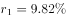，增幅比上年增加3.18个百分点，则2012年增长率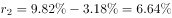。林产品进口640.88亿美元，同比增加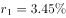，增幅比上年增加8.58个百分点，则2012年增长率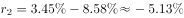。根据间隔增长率公式可得，2013年相较于2011年，林产品出口增长率为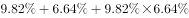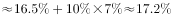。进口增长率为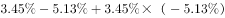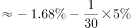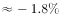。则2011年出口量为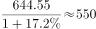，进口量为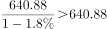，出口小于进口为逆差，错误；

B项：定位文字材料可得，2013年全国林产品出口644.55亿美元，同比增长，其中非木质林产品出口162.3亿美元，同比增加。根据混合口诀“混合居中但不中，偏向基数较大的”可知，2013年木质林产品出口额同比增速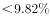，错误；

C项：定位表格可得，2013年胶合板出口1026.34万立方米，同比增长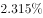，纤维板出口306.87万立方米，同比增长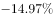，刨花板出口27.13万立方米，同比增长。三者同比增长量分别为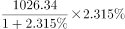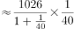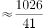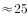万立方米、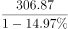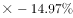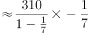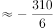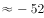万立方米、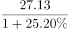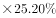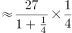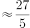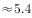万立方米。根据可得，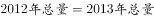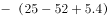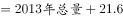，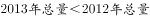，正确；

D项：定位文字材料可得，2013年全国林产品进口640.88亿美元，其中，非木质林产品进口288.80亿美元。则木质林产品进口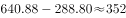亿美元。定位表格可得，2013年木家具进口额7.08亿美元，则2013年木家具进口额占木质林产品进口额的比重为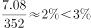，错误。

故正确答案为C。

### 给定材料

        2013年，全国林产品出口644.55亿美元，同比增长，增幅比上年增加3.18个百分点，占全国商品出口额的。林产品进口640.88亿美元，同比增加，增幅比上年增加8.58个百分点，占全国商品进口额的。其中，非木质林产品出口162.3亿美元，同比增加，进口288.80亿美元，同比下降。

> [!warning] 疑点（官方解析可能有误，待人工复核）
> 本版本材料文字中各同比增速、占比及B/D选项中的阈值公式均因原题公式图片未渲染而显示空缺，官方解析中的对应数值也缺失，故A项“2011年为逆差”、B项“未超阈值”无法在现有文本中做数值级复核（只能采信官方定性结论）；另表中胶合板出口增速显示为2.315%（疑为2.31%），按两值计算C项增量分别约23.2/23.3万立方米，对“合计为负”的结论无影响。官方答案C照录不改。

<!-- CODEX-ANSWER-REVIEW:BEGIN -->
### 本次独立复核

**复核状态：** `resolved`（答案与解析已核定）

**计分答案：** C（可计分）

**复核解析：**

1. 第1步：A项——文字给出2013年出口644.55亿美元“增幅比上年增加3.18个百分点”、进口640.88亿美元“增幅比上年增加8.58个百分点”，故2012年增速=2013年增速−3.18pp（出口）、−8.58pp（进口）
2. 第2步：A项——按间隔增长率r=r2013+r2012+r2013×r2012推2013年较2011年的总增速，再以644.55、640.88回推2011年出口、进口量，官方判定出口小于进口（逆差），A错误
3. 第3步：B项——木质林产品出口=644.55−162.3=482.25亿美元，用混合增速口诀“混合居中但不中、偏向基数较大一方”，木质出口增速应介于林产品总出口增速与非木质出口增速之间且偏向基数大者，官方判定未超过选项阈值，B错误
4. 第4步：C项——读表：胶合板出口1026.34万立方米(+2.31%)、纤维板306.87万立方米(−14.97%)、刨花板27.13万立方米(+25.20%)，三者同为万立方米量纲、可直接合并
5. 第5步：C项——增量=现期×r/(1+r)：胶合板≈1026.34×2.31%/103.31%≈+23.2、纤维板≈−306.87×14.97%/85.03%≈−54.0、刨花板≈27.13×25.20%/125.20%≈+5.5万立方米，合计≈−25.4<0（2013年合计1360.34＜2012年约1385.8），故出口总量低于上年，C正确
6. 第6步：D项——木质林产品进口=640.88−288.80=352.08亿美元，比重=7.08÷352.08≈2.0%，官方判定未超过选项阈值，D错误

**最快解法**：⚡ 放缩估算+增量抵消（先攻C项）：负增量下限=306.87×14.97%≈45.9万立方米，正增量上限=1026.34×2.32%+27.13×25.2%≈23.8+6.8=30.6万立方米，因45.9＞30.6，三项增量合计必为负，即2013年总量必低于上年，无需精算即可锁定C。

**相关信息：**

考點：综合判断题（间隔增长率+混合增速+增量求和比较+比重计算逐项核对）。來源：2016年3月四川省选调优秀大学生到基层工作考试 行政职业能力测验试卷（精选）；2016年。> 🧩 当综合判断题出现“几类产品合计总量低于/高于上年”的断言时，将各项折算为增量（现期×r/(1+r)），并用放缩界定（正增量上限≈现期×r、负减量下限≈|现期×r|）比较正负总量，抵消后与0比大小即得结论。

**同类特征**：与上述资料相符的是（综合判断逐项验证）、增幅比上年增加X个百分点（间隔增长率标志词）、木质=总量−非木质（混合增速“居中不中、偏向基数大”）、出口总量低于上年（增量正负抵消）、同比增速列含负值（−14.97%、−4.50%等）、占……比重超过阈值（7.08/352.08）

**题源依据：** [固定版本原题](https://github.com/Mentat-Uran/kaogongzhentizhengliu/blob/84ab93d4b64b61d897bece8a1c0a5bab06b4feb2/10-%E7%9C%9F%E9%A2%98/%E8%B5%84%E6%96%99%E5%88%86%E6%9E%90/%E7%BB%BC%E5%90%88/2263120%20%E7%BB%BC%E5%90%88%E5%88%A4%E6%96%AD%E9%A2%98%EF%BC%88%E9%97%B4%E9%9A%94%E5%A2%9E%E9%95%BF%E7%8E%87%2B%E6%B7%B7%E5%90%88%E5%A2%9E%E9%80%9F%2B%E5%A2%9E%E9%87%8F%E6%B1%82%E5%92%8C%E6%AF%94%E8%BE%83%2B%E6%AF%94%E9%87%8D%E8%AE%A1%E7%AE%97%E9%80%90%E9%A1%B9%E6%A0%B8%E5%AF%B9%EF%BC%89.md)；固定内容 commit `84ab93d4b64b61d897bece8a1c0a5bab06b4feb2`，Markdown blob `3cbcb96fee018a59e3f12751e6ecd9a25e3195e3`。
<!-- CODEX-ANSWER-REVIEW:END -->
