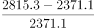
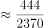
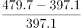
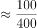
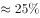
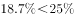
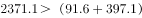

# 综合分析四选一（变化趋势比较+最值年份定位+两期增幅比较+倍数全称判断）

考点：[[20-考点/资料分析/综合/综合分析四选一（变化趋势比较+最值年份定位+两期增幅比较+倍数全称判断）|综合 / 综合分析四选一（变化趋势比较+最值年份定位+两期增幅比较+倍数全称判断）]]
材料：[[15-材料/资料分析/199309 2006-2013年四川省部分农产品|199309 2006-2013年四川省部分农产品]]

**问法模型**：题干为'关于2006-2013年间…下列说法正确的是'的综合分析型四选一 → 逐项定位表格数据验证排除，含'始终/均'的全称判断项用极值放缩一次性覆盖所有年份。

## 推理链
1. 第1步：从表格提取两条轨迹：棉花1.57→1.67→1.55→1.49→1.42→1.46→1.33→1.31万吨（2007年见顶后总体下滑，但2011年1.42→1.46回升），甘蔗124.6→127.9→116.3→93.9→93.4→76.7→61.3→56.9万吨（2008年起逐年下降）。
2. 第2步：A项按'趋势相同须逐年同向'规则验证：2011年棉花升（1.42→1.46）而甘蔗降（93.4→76.7），二者趋势不同，排除A。
3. 第3步：B项定位最值年份：薯类最高483.7万吨在2012年，油料最高290.4万吨在2013年，两年不重合，排除B。
4. 第4步：C项比较2006→2013增幅：先剔除豆类（92.1/91.6≈+0.5%基本持平）与负增长的棉花（1.57→1.31）、甘蔗（124.6→56.9），余三项谷物(2815.3-2371.1)/2371.1≈18.7%、薯类(479.7-397.1)/397.1≈20.8%、油料(290.4-217.3)/217.3≈33.6%，增幅最大为油料而非谷物，排除C。
5. 第5步：D项用极值放缩覆盖'始终'：全表谷物最小值为2371.1（2006年），豆类+薯类之和最大值在2012年（109.0+483.7=592.7），其4倍=2370.8。
6. 第6步：因2371.1＞2370.8，故任意一年谷物均大于当年豆类+薯类之和的4倍（如2006年2371.1＞4×(91.6+397.1)=1954.8），D成立。
7. 第7步：与选项对照：A、B、C均被表格数据推翻，正确答案为D。

**最快解法**：⚡ 排除法+极值放缩（夹逼法）：A、B直接定位表格单年数据即可否决；C先剔除负增长与持平项再截位直除比较三个增长率；D不逐年验算，只比较'谷物最小值2371.1（2006年）'与'豆+薯之和最大值592.7（2012年）的4倍2370.8'，一次不等式2371.1＞2370.8即覆盖全部8年。

## 易错点
- ⚠ '变化趋势相同'是全称判断，须逐年对比，只看首尾整体升降会误判A——2011年棉花回升与甘蔗下降出现单年背离
- ⚠ '增幅最大'比较的是增长率（相对幅度）而非增长量；应先剔除负增长项（棉花、甘蔗）与持平项（豆类）再比较，小量级指标不能因数值小而忽略其增长率
- ⚠ D项'始终'要求8年全部满足，逐年算4倍耗时长且易漏；最不利组合在2012年（豆类峰值109.0与薯类峰值483.7恰为同年），漏查该年易误判

## 母题抽象
> 🧩 当综合分析题出现'始终/均/趋势相同'类全称表述时，先找'最不利年份'（分子最小、分母最大）做一次放缩验证全称项，其余选项用定位数据+增长率口径快速排除。

**同类特征**：下列说法正确的是（综合分析四选一）、变化趋势相同、产量最高年份是否一致、2013年比2006年增幅最大、始终是……的4倍以上、跨全表8年逐年判断

## 相关题
- [[10-真题/资料分析/综合/2097270 综合分析判断（折线图读数+环比变化比较+跨省图文拼数据）|2097270]]（四川 2017，相关度1）

---

### 题干
关于2006-2013年间四川省部分农产品产量情况，下列说法正确的是：

### 选项
- A. 棉花和甘蔗产量的变化趋势相同
- B. 薯类产量最高的年份油料产量也最高
- C. 2013年比2006年产量增幅最大的是谷物
- D. 谷物产量始终是豆类和薯类产量之和的4倍以上　✅

### 官方解析

A项：定位表格可得，2011年棉花产量同比上升，甘蔗产量同比下降，两者变化趋势不同，错误；

B项：定位表格可得，薯类产量最高的年份为2012年，油料产量最高的年份为2013年，并不相同，错误；

C项：定位表格可得，2006年谷物产量2371.1万吨，豆类产量91.6万吨，薯类产量397.1万吨，油料产量217.3万吨，棉花产量1.57万吨，甘蔗产量124.6万吨。2013年谷物产量2815.3万吨，豆类产量92.1万吨，薯类产量479.7万吨，油料产量290.4万吨，棉花产量1.31万吨，甘蔗产量56.9万吨。其中豆类产量近乎相等，棉花、甘蔗为负增长，因此只需比较剩余三者。根据可得，谷物增长率为；薯类增长率为，，可知谷物增幅不是最大的，错误；

D项：定位表格可得，2006年谷物产量2371.1万吨，豆类产量91.6万吨，薯类产量397.1万吨。，同理可得，每年谷物产量均高于豆类和薯类产量之和的4倍，正确。

故正确答案为D。

### 给定材料

