# 综合判定题（多条信息可推出性判断）

考点：[[20-考点/资料分析/综合/综合判定题（多条信息可推出性判断）|综合 / 综合判定题（多条信息可推出性判断）]]
材料：[[15-材料/资料分析/199338 2017年A省邮电业务（电信-邮政-|199338 2017年A省邮电业务（电信-邮政-]]

**问法模型**：题干出现'能够直接从资料中推出的有几条'→ 对①②③④逐条检验'材料数据+基本公式'能否复原目标量，数出可推条数

## 推理链
1. 第1步：①定位第2段：2017年末移动电话用户1.48亿户、4G用户1.18亿户及各自'比上年末增长'的增速（原卷有数值），移动全年增量=1.48−1.48/(1+g移动)，4G全年增量=1.18−1.18/(1+g4G)，非4G增量=移动增量−4G增量，公式配齐，可推
2. 第2步：②定位第2段：移动互联网期末用户1.31亿户及增速g，全年增量=1.31−1.31/(1+g)，日均增量=全年增量÷365（2017年为平年365天），公式配齐，可推
3. 第3步：③定位第4段：2017年客运总量148339万人次、同比增长r，且'比上年提高0.5个百分点'→2016年增速=r−0.5%；由间隔增长率公式r间隔=r+(r−0.5%)+r×(r−0.5%)，2015年客运总量=148339÷(1+r间隔)，可推
4. 第4步：④定位第4、5段：2017年客运总量148339万人次；高铁客运量17872万人次、占铁路旅客运输总量P%（占比数值原卷给出）→2017年铁路旅客运输总量=17872÷P%万人次，所求比重=(17872÷P%)÷148339，可推
5. 第5步：四条均只需本材料数据加基本公式（增量模型、间隔增长、分量÷占比=总量）即可复原，无需任何外部信息，可推条数=4，对照选项选D

**最快解法**：⚡ 综合判定'找数—配公式—看能否复原'三问法逐条过：①增量模型'现期×g/(1+g)'两条相减；②全年增量÷365；③间隔增长r1+r2+r1r2连环倒推至2015；④高铁17872万÷占比拼出铁路总量再除以148339万求比重；四条公式均能配齐→4条，选D

## 易错点
- ⚠ ①'非4G'=移动电话−4G，但所求为'全年增量'，须用两条'现期−现期/(1+g)'的增量相减，误拿1.48−1.18=0.30亿户当增量会把2017年非4G存量错当增量
- ⚠ ②'日均增量'须先由期末值求全年增量再÷365（2017年为平年），直接用1.31亿÷365或漏除365都会出错
- ⚠ ③'比上年提高0.5个百分点'是增速之差，2016年增速=2017年增速−0.5个百分点，须用间隔增长率连环倒推（2017→2016→2015），勿把'提高0.5个百分点'误当增速本身或漏乘积项r1×r2
- ⚠ ④铁路总量未直接给出，须用'高铁量÷占比'跨段拼装，且所给文本中占比与各处增速数值显示缺失，具体计算须回原卷核对

## 母题抽象
> 🧩 当题干出现'能够直接从资料中推出的有几条'的多条判定时，逐条检验目标量能否仅用材料数据加基本公式（增量=现期−现期/(1+g)、间隔增长r1+r2+r1r2、总量=分量÷占比）复原，能配齐公式即记'可推'，最后数条数定答案

**同类特征**：能够直接从资料中推出的有几条、①②③④多条信息逐条判定、非4G移动电话用户全年增量、日均增量、间隔倒推基期（2015年）、占铁路旅客运输总量比重拼装

## 相关题
（暂无）

---

### 题干
在以下4条关于A省的信息中，能够直接从资料中推出的有几条？
①2017年非4G移动电话用户全年增量
②2017年移动互联网用户日均增量
③2015年客运总量
④2017年铁路旅客运输总量占客运总量比重

### 选项
- A. 1
- B. 2
- C. 3
- D. 4　✅

### 官方解析

①定位文字材料第二段可得：“2017年，A省移动电话期末用户1.48亿户，比上年末增长。其中，4G期末用户达1.18亿户，比上年末增长”，可推知2017年A省移动电话用户全年增长量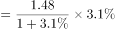亿户，4G用户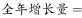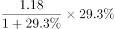亿户，故，可求；

②定位文字材料第二段可得：“2017年，移动互联网期末用户1.31亿户，比上年末增长”，可推知2017年移动互联网用户全年增长量亿户，2017年共365天，故，可求；

③定位文字材料第四段可得：“2017年，A省完成客运总量148339万人次，同比增长···，比上年提高0.5个百分点”，可推知2016年增长率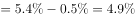，根据间隔增长率公式，可得2017年相对于2015年客运总量的间隔，故2015年客运总量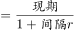，可求；

④定位文字材料第四段可得：“2017年，A省完成客运总量148339万人次”，定位文字材料第五段可得：“2017年A省完成高铁客运量17872万人次，······占铁路旅客运输总量的”，可推知2017年A省铁路旅客运输总量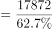万人次，故2017年铁路旅客运输总量占客运总量比重为，可求。

能够直接从资料中推出的有4条。

故正确答案为D。

### 给定材料

        2017年，A省完成邮电业务总量6065.71亿元。其中，电信业务总量3575.86亿元，同比增长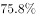；邮政业务总量2489.85亿元，增长。

        2017年，A省移动电话期末用户1.48亿户，比上年末增长。其中，4G期末用户达1.18亿户，比上年末增长。互联网宽带接入期末用户3128万户，比上年末增长。移动互联网期末用户1.31亿户，比上年末增长，移动互联网接入流量同比增长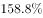。

        2017年，全省全年完成快递业务量100.51亿件，同比增长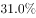。其中，同城快递业务量增长，异地快递业务量增长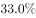，国际和港澳台地区快递业务量增长。

        2017年，A省完成客运总量148339万人次，同比增长，增幅比前三季度提高0.2个百分点，比上年提高0.5个百分点；完成旅客周转总量4143.84亿人公里，增长，增幅比前三季度提高0.7个百分点，比上年提高1.8个百分点。

        2017年，A省完成高铁客运量17872万人次，旅客周转量474.64亿人公里，同比分别增长和。高铁客运量和旅客周转量分别占铁路旅客运输总量的和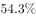，比重比上年分别提高4.3个和3.9个百分点。

> [!warning] 疑点（官方解析可能有误，待人工复核）
> 所给文本中全部增速百分比、高铁占比及'分别增长'后数值均显示缺失（疑为原卷公式/图片丢失）；本题判定仅依赖'公式可复原性'故不影响答案D，但复现①②③④的具体数值须回原卷补齐各增速与占比

<!-- CODEX-ANSWER-REVIEW:BEGIN -->
### 本次独立复核

**复核状态：** `resolved`（答案与解析已核定）

**计分答案：** D（可计分）

**复核解析：**

恢复公式图后四条陈述均可推出。①移动用户现期1.48亿、增速3.1%，4G现期1.18亿、增速29.3%；两类年度增量分别约0.0444亿、0.2673亿，非4G因此减少约0.2229亿（2229万人）。②2017年一季度销量合计475.57+434.56+523.67=1433.80万台；按−2.7%、+31.1%、+5.8%还原上年同期，合计约1315.20万台，增幅约9.02%。③2017客运量148339万人次，同比增长5.4%，且增速比2016提高0.5个百分点；2015基数=148339÷1.054÷1.049≈134165万人次。④高铁客运量17872万人次，占铁路客运62.7%，铁路客运总量≈28504万人次，占总客运148339的19.22%。四项均可由题图公式直接推出，选D（4条）。

**相关信息：**

资料分析—信息可推出性与基期量；判断条件是否齐全时，要把缺失的显示公式恢复，不应把文字抽取空白误判为题源缺数。

**题源依据：** [固定版本原题](https://github.com/Mentat-Uran/kaogongzhentizhengliu/blob/84ab93d4b64b61d897bece8a1c0a5bab06b4feb2/10-%E7%9C%9F%E9%A2%98/%E8%B5%84%E6%96%99%E5%88%86%E6%9E%90/%E7%BB%BC%E5%90%88/2264437%20%E7%BB%BC%E5%90%88%E5%88%A4%E5%AE%9A%E9%A2%98%EF%BC%88%E5%A4%9A%E6%9D%A1%E4%BF%A1%E6%81%AF%E5%8F%AF%E6%8E%A8%E5%87%BA%E6%80%A7%E5%88%A4%E6%96%AD%EF%BC%89.md)；固定内容 commit `84ab93d4b64b61d897bece8a1c0a5bab06b4feb2`，Markdown blob `4dd0674068e3b935e50d1294805cd53d1b1eb319`。
<!-- CODEX-ANSWER-REVIEW:END -->
