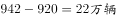
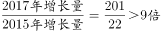

# 综合判断：增长量计算与比较（含基期反推）+增速排序+混合平均价格核验

考点：[[20-考点/资料分析/综合/综合判断：增长量计算与比较（含基期反推）+增速排序+混合平均价格核验|综合 / 综合判断：增长量计算与比较（含基期反推）+增速排序+混合平均价格核验]]
材料：[[15-材料/资料分析/199340 2011～2017年全国二手车市场交|199340 2011～2017年全国二手车市场交]]

**问法模型**：'能够从上述资料中推出的是'→逐项验证型综合判断：对四个选项分别用图1柱差（2011年须以增速12.4%反推基期）、图1折线增速排序、图1×图2混合均价核验，锁定唯一正确项。

## 推理链
1. 第1步：从图1提取2011~2017年交易量682、794、847、920、942、1039、1240万辆及同比增速12.4%、16.4%、6.7%、8.6%、2.4%、10.3%、19.3%，从图2提取2013~2017年均价5.6、6.1、5.9、5.8、6.5万元/辆
2. 第2步：验证C项用增长量模型：2012~2017年直接作相邻柱差得112、53、73、22、97、201万辆；2011年无2010年数据，须以增速12.4%反推基期682÷1.124≈607万辆，增长量682−607≈75万辆
3. 第3步：增长量最高为2017年201万辆、最低为2015年22万辆，201÷22≈9.14倍，属'9倍多'，C正确
4. 第4步：验证A项用加权平均：2016~2017年总额1039×5.8+1240×6.5=6026.2+8060=14086.2亿元，除以总量1039+1240=2279万辆得混合均价≈6.18万元；且2017年交易量更大，均价偏向6.5一侧、大于(5.8+6.5)/2=6.15万元，不在6.1~6.15之间，A错
5. 第5步：验证B项用增速排序：19.3%(2017)>16.4%(2012)>12.4%(2011)>10.3%(2016)>8.6%(2014)>6.7%(2013)>2.4%(2015)，第4高为2016年，其均价5.8万元<6万元，B错
6. 第6步：验证D项数个数：增速低于10%的年份仅2013(6.7%)、2014(8.6%)、2015(2.4%)共3个，D说4个，错；综上选C

**最快解法**：⚡ 排除法+截位直除：主体验证C——柱差法得2017年增长量1240−1039=201万辆、2015年942−920=22万辆，201÷22截位直除≈9.1，'9倍多'成立直接锁定C；B、D只查图1折线（排序第4为2016年、增速<10%仅3个），A用'量大偏向大'定性判均价偏向6.5一侧即>6.15，均可快速排除。

## 易错点
- ⚠ 2011年增长量陷阱：图1无2010年柱值，不能直接用柱差，须以增速12.4%反推基期682÷1.124≈607万辆，否则可能漏算2011年或误判最低年份
- ⚠ 双轴图混读：19.3、10.3等是右轴折线增速(%)而非左轴柱值(万辆)，勿把折线数值当交易量
- ⚠ D项边界与计数：2016年增速10.3%高于10%不计入，误把10.3%当低于10%会数出4个；B项排序须含2011年12.4%，漏掉会错定'第4高'年份；A项混合均价不能简单取(5.8+6.5)/2=6.15，须按交易量加权并偏向2017年一侧

## 母题抽象
> 🧩 当题干出现'能够推出的是'且选项含'增长量最高年份是最低年份的几倍'时，用柱差法列各年增长量（首年无前值则用增速反推基期），对最高/最低两值截位直除验证倍数，其余选项按各自口径快速排除。

**同类特征**：能够从上述资料中推出的是、同比增长量最高/最低、9倍多、同比增速第4高的年份、平均交易价格在……之间、同比增速低于10%的年份个数

## 相关题
- [[10-真题/资料分析/综合/19283943 综合分析判断题（倍数比较+求和判断+隐含平均每场座位数反推）|19283943]]（国考 2025，相关度1）
- [[10-真题/资料分析/综合/1796162 综合判断（月均计算、平均运输距离、比重对比、增长量比较逐项验证）|1796162]]（贵州 2016，相关度1）
- [[10-真题/资料分析/综合/2133504 综合判断题（现期比重+现期平均数多项验证，一对三错）|2133504]]（国考 2018，相关度1）
- [[10-真题/资料分析/综合/2444706 综合判断题（增长量+比重+倍数逐项验证）|2444706]]（四川 2019，相关度1）
- [[10-真题/资料分析/综合/2571728 综合分析逐项判断（等差递推求和＋单位换算＋比值估算）|2571728]]（山东 2020，相关度1）

---

### 题干
能够从上述资料中推出的是：

### 选项
- A. 
2016～2017年，全国二手车平均交易价格在6.1～6.15万元之间

- B. 
2011～2017年，全国二手车交易量同比增速第4高的年份，当年二手车平均交易价格高于6万元

- C. 
2011～2017年，全国二手车交易量同比增长量最高的年份其增长量是最低年份的9倍多
　✅
- D. 
2011～2017年，全国二手车交易量同比增速低于的年份有4个

### 官方解析

A项：定位图1和图2，可知2016和2017年二手车交易量分别为1039万辆和1240万辆，平均交易价格分别为5.8万元/辆和6.5万元/辆，故2016~2017年全国二手车平均交易价格应在5.8~6.5万元/辆之间。由于，故2016~2017年，全国二手车平均交易价格应更偏向于2017年的平均交易价格，即应大于 ，即在6.15~6.5万元/辆之间，不在6.1~6.15万元之间，错误；

B项：定位图1，可知全国二手车交易量同比增速第4高的是2016年，对应图2平均交易价格为5.8万元，低于6万元，错误；

C项：定位图1，全国二手车交易量同比增长量最高的年份为2017年，其增长量为，同比增长量最低的年份为2015年，其增长量为，则，正确；

D项：定位图1，全国二手车交易量同比增速低于的年份有2013年()、2014年（）、2015年（），共3个年份符合，错误。

故正确答案为C。

### 给定材料

        2017年全国二手车累计交易量为1240万辆，同比增长；二手车交易额为8092.7亿元，同比增长。2017年12月，全国二手车市场交易量为123万辆，交易量环比上升，上年同期交易量为108万辆。

