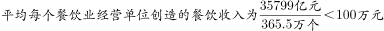
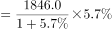
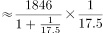
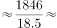
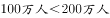
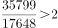
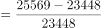
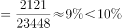

# 综合分析判断题（平均数计算+增长量计算+翻番倍数+同比增长率多考点混合验证）

考点：[[20-考点/资料分析/综合/综合分析判断题（平均数计算+增长量计算+翻番倍数+同比增长率多考点混合验证）|综合 / 综合分析判断题（平均数计算+增长量计算+翻番倍数+同比增长率多考点混合验证）]]
材料：[[15-材料/资料分析/200306 2010～2016年全国餐饮收入规模|200306 2010～2016年全国餐饮收入规模]]

**问法模型**：题干为'能够从上述资料中推出的是'的四选一综合判断 → 对A/B/C/D逐项验证真伪，优先验证数据直读、计算量最小的选项

## 推理链
1. 第1步：A项，从文字段提取2016年餐饮收入35799亿元、经营单位365.5万个，平均每单位收入=35799亿元÷365.5万个
2. 第2步：35799÷365.5≈97.9（万元/个）（或放缩：365.5万个×100万元/个=36550亿元>35799亿元），未超过100万元，A错误
3. 第3步：B项，从官方解析还原文字段数据：2016年从业人数1846.0万人、同比增长5.7%，增长量=1846.0×5.7%÷(1+5.7%)≈105÷1.057≈99.5万人
4. 第4步：99.5万人<200万人，B错误
5. 第5步：C项，从柱状图提取2016年35799亿元、2010年17648亿元，'翻一番'=变为2倍，17648×2=35296亿元<35799亿元（即35799÷17648≈2.03>2），翻了一番以上成立，C正确
6. 第6步：D项，从柱状图提取2013年25569亿元、2012年23448亿元，同比增速=(25569−23448)÷23448=2121÷23448≈9.0%
7. 第7步：9.0%未超过题干阈值10%，D错误
8. 第8步：四项中仅C可由资料推出，故选C

**最快解法**：⚡ 放缩比较法+截位直除：综合分析题先扫计算量最小的C项——'翻一番'只需基期×2，17648×2=35296<35799，一步锁定正确答案；其余用截位直除快速排除（A：35799/365.5≈98万元<100万元；B：1846×5.7%≈105万，折基期后≈99.5万人<200万人；D：2121/23448≈9.0%<10%）

## 易错点
- ⚠ '翻一番'=变为2倍（=增长100%）、'翻两番'=变为4倍，倍数表述易混，C项必须用17648×2=35296与35799比较，两者仅差503亿元，不能凭感觉估算
- ⚠ A项量级陷阱：'亿元÷万个'中'亿'与'万'两层单位换算，35799亿元÷365.5万个≈97.9万元/个，量级搞错易误判A正确
- ⚠ D项基期误用：增速=(2013年−2012年)÷2012年，分母是基期23448而非现期25569；B项增长量需乘r/(1+r)折算，且本版本材料中增速被挖空（5.7%来自官方解析），须以完整原卷数值为准

## 母题抽象
> 🧩 当题干出现'能够从上述资料中推出的是/可以推出'时，为综合分析题，逐项验证并优先做数据直读、计算量最小的选项（如'翻一番'只需基期×2与现期比较），用放缩或截位直除快速排除其余三项

**同类特征**：能够从上述资料中推出的是、四选一综合判断、平均每个经营单位、同比增长了…以上（增长量判断）、翻了一番、同比增速超过…

## 相关题
- [[10-真题/资料分析/综合/5101658 综合判断题——同比增速计算与比较（辅以倍数判断与增长量比较）|5101658]]（云南 2022，相关度2）
- [[10-真题/资料分析/综合/1746812 综合判断题（逐项验证：比重计算、双指标排序比较、同比方向判断）|1746812]]（国考 2016，相关度2）
- [[10-真题/资料分析/综合/10942304 综合判断（增长量计算+单位换算；两期比重比较；下降速度比较）|10942304]]（山东 2024，相关度2）
- [[10-真题/资料分析/综合/12536418 综合判断题（基期量计算+增长量计算+差额变化比较+两期比重比较混合考查）|12536418]]（四川 2024，相关度2）
- [[10-真题/资料分析/综合/15833800 综合判断（年均平均数+同比增量递增+最值查找+增长率多模型混合验证）|15833800]]（贵州 2026，相关度2）

---

### 题干
能够从上述资料中推出的是

### 选项
- A. 
2016年平均每个餐饮业经营单位创造的餐饮收入超过100万元

- B. 
2016年餐饮业经营单位从业人员同比增长了200万人以上

- C. 
2016年全国餐饮收入比2010年翻了一番以上
　✅
- D. 
2013年全国餐饮收入同比增速超过

### 官方解析

A项：定位文字材料可得，2016年全国餐饮收入35799亿元，全社会餐饮业经营单位为365.5万个，则，错误；

B项：定位文字材料可得，2016年全社会餐饮从业人数为1846.0万人，同比增长5.7%。，错误；

C项：定位柱状图可得，2016年全国餐饮收入为35799亿元，2010年为17648亿元。，可知2016年全国餐饮收入比2010年翻了一番以上，正确； 

D项：定位柱状图可得，2013年全国餐饮收入25569亿元，2012年为23448亿元，增长率，错误。

故正确答案为C。 

### 给定材料

<b>根据下列统计资料回答问题</b>

        2016年全国餐饮收入35799亿元，同比增长，餐饮收入占社会消费品零售总额的比重为。2016年全社会餐饮业经营单位为365.5万个，同比下降；从业人数为1846.0万人，同比增长。

> [!warning] 疑点（官方解析可能有误，待人工复核）
> 官方解析A、B、D项的具体算式因排版缺失（仅存'错误'结论），经复核与数据核算一致；D项阈值以图片显示（按解析结论应为10%，2121/23448≈9.0%未超过，与答案C自洽）；B项所需'同比增长5.7%'在本版本材料原文中被挖空，做题须以完整原卷百分数为准，均不影响C项由柱状图独立验证成立

<!-- CODEX-ANSWER-REVIEW:BEGIN -->
### 本次独立复核

**复核状态：** `confirmed`（独立复算确认答案）

**计分答案：** C（可计分）

**复核解析：**

原图167b5baec9fadf3.jpg：2016餐饮35799亿元，2010为17648亿元；35799/17648≈2.028>2，C成立。平均每经营单位=35799亿元/365.5万≈97.8万元，不超过100万；从业人数同比增加约1846−1846/1.057≈99.6万人；2013增速=(25569/23448−1)≈9.0%。

**相关信息：**

独立复核：资料分析综合判断；对图表数据重算，并区分可推出与未被反例否定。

**题源依据：** [固定版本原题](https://github.com/Mentat-Uran/kaogongzhentizhengliu/blob/84ab93d4b64b61d897bece8a1c0a5bab06b4feb2/10-%E7%9C%9F%E9%A2%98/%E8%B5%84%E6%96%99%E5%88%86%E6%9E%90/%E7%BB%BC%E5%90%88/2274545%20%E7%BB%BC%E5%90%88%E5%88%86%E6%9E%90%E5%88%A4%E6%96%AD%E9%A2%98%EF%BC%88%E5%B9%B3%E5%9D%87%E6%95%B0%E8%AE%A1%E7%AE%97%2B%E5%A2%9E%E9%95%BF%E9%87%8F%E8%AE%A1%E7%AE%97%2B%E7%BF%BB%E7%95%AA%E5%80%8D%E6%95%B0%2B%E5%90%8C%E6%AF%94%E5%A2%9E%E9%95%BF%E7%8E%87%E5%A4%9A%E8%80%83%E7%82%B9%E6%B7%B7%E5%90%88%E9%AA%8C%E8%AF%81%EF%BC%89.md)；固定内容 commit `84ab93d4b64b61d897bece8a1c0a5bab06b4feb2`，Markdown blob `036648629bf5609e5d4cf4b0da83f70f94427a29`。
<!-- CODEX-ANSWER-REVIEW:END -->
