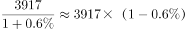
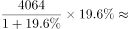

# 综合分析（基期反推+季度合计比较+增长量估算+双指标极值定位）

考点：[[20-考点/资料分析/综合/综合分析（基期反推+季度合计比较+增长量估算+双指标极值定位）|综合 / 综合分析（基期反推+季度合计比较+增长量估算+双指标极值定位）]]
材料：[[15-材料/资料分析/210316 2017年4月～2018年4月我国煤|210316 2017年4月～2018年4月我国煤]]

**问法模型**：'能够从上述资料中推出的是'→综合判断题，对四个选项逐项验证：A用基期=现期/(1+g)反推图外'上月'值，B用季度加总比较，C用增长量=现期×g/(1+g)，D分别定位'进口量最高月'与'增速最高月'后对照是否同月

## 推理链
1. 第1步：A项——图中只有2017年4月起的数据，无2017年3月；取图2中2018年3月原油进口量3917万吨、同比增速0.6%，按基期=现期/(1+g)反推2017年3月≈3917/1.006≈3894万吨
2. 第2步：2017年4月原油进口量3439万吨<3894万吨（2017年3月），'低于上月水平'成立，A正确
3. 第3步：B项——图1煤炭：2017年3季度（7-9月）=1946+2527+2708=7181万吨，4季度（10-12月）=2128+2205+2274=6607万吨，4季度低于3季度，B错误
4. 第4步：C项——图2：2018年1月原油4064万吨、同比+19.6%，增长量=4064×19.6%/(1+19.6%)≈666万吨<700万吨，C错误
5. 第5步：D项——图1：2017年4-12月煤炭进口量最高为9月的2708万吨（对应增速10.8%），而期间增速最高为5月的16.6%，两者不在同一月，D错误
6. 第6步：仅A项可以推出，对照选项确定答案为A

**最快解法**：⚡ 排除法+百化分：先做纯读数的B（3季度7181>4季度6607，排除）和D（最高量月=9月2708、最高增速月=5月16.6%，不同月，排除）；C用百化分——19.6%≈1/5，增长量≈4064/6≈677<700，排除；三错锁定A（验证：3917/1.006≈3894>3439，'低于上月'成立）

## 易错点
- ⚠ 图外基期陷阱：2017年3月不在图中（图仅从17年4月开始），A项'上月'必须借2018年3月（3917万吨、+0.6%）反推基期≈3894万吨，误判'图中无3月数据、A无法判断'就会漏掉正确答案
- ⚠ 看串图：两图完全同构且量级相近（煤炭约1946~2781、原油约3103~4064万吨），A/C看图2原油、B/D看图1煤炭，必须先确认图表再读数
- ⚠ 增长量误算：C项若直接用4064×19.6%≈797万吨会误判'超过700'，正确公式须除以(1+g)，实为约666万吨；D项注意'进口量最高月'与'增速最高月'是两个不同指标，不能默认同月

## 母题抽象
> 🧩 当综合判断题出现'比较某月与上月/上年同月'而目标时点不在图中时，用现期/(1+g)反推基期再比较；其余选项按'时段加总比较、增长量=现期×g/(1+g)、双指标极值是否同月'逐一口算排除

**同类特征**：能够从上述资料中推出的是、低于上月水平（图外时点）、高于上季度水平（季度加总）、同比增长700万吨以上（增长量估算）、最高的月份……增速也最高（双指标定位）、煤炭与原油双图数据共用

## 相关题
- [[10-真题/资料分析/综合/19283943 综合分析判断题（倍数比较+求和判断+隐含平均每场座位数反推）|19283943]]（国考 2025，相关度1）
- [[10-真题/资料分析/综合/1796162 综合判断（月均计算、平均运输距离、比重对比、增长量比较逐项验证）|1796162]]（贵州 2016，相关度1）
- [[10-真题/资料分析/综合/2133504 综合判断题（现期比重+现期平均数多项验证，一对三错）|2133504]]（国考 2018，相关度1）
- [[10-真题/资料分析/综合/2444706 综合判断题（增长量+比重+倍数逐项验证）|2444706]]（四川 2019，相关度1）
- [[10-真题/资料分析/综合/2571728 综合分析逐项判断（等差递推求和＋单位换算＋比值估算）|2571728]]（山东 2020，相关度1）

---

### 题干
能够从上述资料中推出的是：

### 选项
- A. 2017年4月，我国原油进口量低于上月水平　✅
- B. 2017年4季度，我国煤炭进口量高于上季度水平
- C. 2018年1月，我国原油进口量同比增长700万吨以上
- D. 2017年2～4季度我国煤炭进口量最高的月份，进口量同比增速也最高

### 官方解析

A项：定位统计图2可知，2018年3月我国原油进口量为3917万吨，同比增速为，根据，2017年3月我国原油进口量为万吨。2017年4月原油进口量为3439万吨，低于上月水平，正确；

B项：定位统计图1可知，2017年3季度（7-9月）煤炭进口量为万吨，2017年4季度（10-12月）煤炭进口量为万吨，则4季度低于上季度水平，错误；

C项：定位统计图2可知，2018年1月原油进口量4064万吨，同比增速，根据，2018年1月原油进口量同比增量为万吨，错误；

D项：定位统计图1可知，2017年2～4季度（4-12月）煤炭进口量最高的月份为2017年9月，而同比增速最高的月份是2017年5月，错误。

故正确答案为A。

### 给定材料

 

