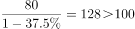
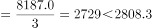
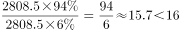

# 综合判断题（多信息点真伪验证：基期回推＋月均比较＋占比倍数＋差值比重）

考点：[[20-考点/资料分析/综合/综合判断题（多信息点真伪验证：基期回推＋月均比较＋占比倍数＋差值比重）|综合 / 综合判断题（多信息点真伪验证：基期回推＋月均比较＋占比倍数＋差值比重）]]
材料：[[15-材料/资料分析/210318 2018年3月及2018年1～3月国|210318 2018年3月及2018年1～3月国]]

**问法模型**：题干问'能从资料中推出的有几条'→对①②③④逐条翻译间接指标（上年基期、月均、非全网通、不支持安卓款数）回材料口径，套基期/月均/比重公式逐条判真伪后数条数

## 推理链
1. 第1步：①用第一段'2018年3月上市新机型80款，同比下降'，套基期=现期/(1+r)，代入原卷同比降幅回推2017年3月款数，官方解析确认结果为100多款，①正确
2. 第2步：②用第四段数据，2018年1～3月智能手机月均出货量=8187.0÷3=2729.0万部，3月当月2808.3万部＞2729.0万部，高于月均水平，②正确
3. 第3步：③用第二段'3月4G手机出货2808.5万部、其中4G全网通占比'，非全网通占比=1-全网通占比，倍数=全网通占比÷非全网通占比，官方代入原卷占比数值后计算结果不足16倍，③错误
4. 第4步：④用第四段'1～3月智能手机新机型158款、其中支持安卓152款'，不支持安卓=158-152=6款，占比=6/158≈3.8%，未达到题干所给比例（原卷数值），④错误
5. 第5步：正确的为①②共2条，对照选项B（2）

**最快解法**：⚡ 综合判断逐条秒杀：②截位直除8187.0÷3≈2729万部＜2808.3万部，一步判对；④差值法158-152=6款，6/158≈3.8%直除与题干比例比对判错；①基期公式80/(1+r)（需原卷增速）判对、③'1-占比'后作比（需原卷占比）判不足16倍，共2条对，选B

## 易错点
- ⚠ ②的'月均'=1～3月累计8187.0÷3，切勿拿3月当月值直接与累计值或其他单月口径比较；本材料'3月当月'与'1～3月累计'双口径混排，逐句读数易串行
- ⚠ 占比分母口径：③全网通占比的分母是4G手机出货量2808.5万部而非全部手机，须先用'非全网通=1-全网通占比'；④分子用差值158-152=6款、分母用智能手机新机型158款，勿误用3月的68款/67款
- ⚠ 本文字版所有同比增速与4G全网通占比数值均缺失，①③④只有依托原卷完整数值才能独立求解；另2808.5万部（4G）与2808.3万部（智能手机）仅差0.2，抄数勿看错一位

## 母题抽象
> 🧩 当题干出现'以下信息能从资料中推出/判断正确的有几条'时，把每条中的间接指标（上年同期、月均、非全网通、不支持某系统的款数）先翻译回材料口径，再分别套'基期=现期/(1+r)'、'月均=累计÷3'、'差值÷分母或占比作比'三类公式逐条验证真伪，数对错条数定选项

**同类特征**：能从上述资料中推出、有几条、①②③④多信息点逐条验证、上年同期基期回推、高于平均水平（月均=累计÷3）、全网通/非全网通倍数与不支持安卓款数差值

## 相关题
（暂无）

---

### 题干

以下信息中，能够从上述资料中推出的有几条？

①2017年3月，国内手机市场上市新机型100多款

②2018年3月，智能手机出货量高于1～3月平均水平

③2018年3月，4G全网通手机出货量是4G非全网通手机的16倍多

④2018年1～3月上市的智能手机新机型中，以上不支持安卓操作系统

### 选项
- A. 1
- B. 2　✅
- C. 3
- D. 4

### 官方解析

①：定位文字材料第一段，“3月，国内上市新机型80款，同比下降”，代入基期计算公式：可得2017年3月，国内手机市场上市新机型，正确；

②：定位文字材料第四段，“2018年3月，智能手机出货量为2808.3万部，1~3月，智能手机出货量为8187.0万部”，则2018年1~3月智能手机平均每月出货量，正确；

③：定位文字材料第二段，“2018年3月，国内4G手机出货量2808.5万部，其中4G全网通手机占比”，可得国内4G非全网通手机占国内4G手机出货量比重为，则4G全网通手机出货量是4G非全网通手机的倍，错误；

④：定位文字材料第四段，“2018年1~3月，上市智能手机新机型158款，其中支持安卓操作系统的手机152款”，代入公式：可得，不支持安卓操作系统的智能手机新机型占上市智能手机新机型的比重为，错误。

正确的为①②，共2个。

故正确答案为B。

### 给定材料

        2018年3月，国内手机市场出货量3018.5万部，同比下降，2018年1～3月，国内手机市场出货量8737.0万部，同比下降。3月，国内上市新机型80款，同比下降，2018年1～3月，上市新机型206款，同比下降。

        2018年3月，国内4G手机出货量2808.5万部，同比下降，其中4G全网通手机占比；4G上市新机型67款，同比下降，其中4G全网通手机占比。1～3月，4G手机出货量8195.6万部，同比下降，其中4G全网通手机占比；4G上市新机型156款，同比下降，其中4G全网通手机占比。

        2018年3月，国产品牌手机出货量2699.5万部，同比下降；上市新机型78款，同比下降。1～3月，国产品牌手机出货量7586.4万部，同比下降；上市新机型190款，同比下降。

        2018年3月，智能手机出货量为2808.3万部，同比下降。1～3月，智能手机出货量为8187.0万部，同比下降。3月，上市智能手机新机型68款，同比下降，其中支持安卓操作系统的手机67款。2018年1～3月，上市智能手机新机型158款，同比下降,其中支持安卓操作系统的手机152款。

