# 汇率折算与跨期支付方案经济性比较

考点：[[20-考点/资料分析/综合/汇率折算与跨期支付方案经济性比较|综合 / 汇率折算与跨期支付方案经济性比较]]
材料：[[15-材料/资料分析/215726 AK制造公司2018年4月五家客户（|215726 AK制造公司2018年4月五家客户（]]

**问法模型**：已知2018年9月1日磨床现价较订单价405英镑有所下降 → 用'英镑单价×对应日期汇率=外币单价'把'12月31日按订单价'与'9月1日按现价'折成同一币种后比较大小，逐一判断四个说法

## 推理链
1. 第1步：从表1提取Reassair磨床订单单价405英镑（各选项均为单价口径，购买台数因子相消，与1722台无关）；设9月1日现价P=405×(1-降幅)，降幅数值在题干中留空，按官方解析代入
2. 第2步：从表2提取汇率（1英镑=若干外币，英镑×汇率=外币）：欧元9月1日1.47、12月31日1.11；日元179.01、139.89；美元1.35、1.26
3. 第3步：规则：外币支付单价=英镑单价×对应日期汇率，先算订单价405英镑的三个锚点：405×1.11=449.55欧元、405×139.89=56655.45日元、405×1.26=510.3美元
4. 第4步：A项：12月31日按订单价405×1.11=449.55欧元 < 9月1日现价P×1.47（官方解析判定12月31日按订单价更经济），A正确
5. 第5步：B项与A项互为反命题，A成立则B必错
6. 第6步：C项：9月1日现价P×179.01 < 405×139.89=56655.45日元，即现价支付额比12月31日按订单价低，C'更高'的说法错误
7. 第7步：D项：9月1日现价P×1.35 < 405×1.26=510.3美元，即9月1日按现价支付更经济，D'12月31日按订单价更经济'的说法错误
8. 第8步：四项对照仅A正确，与官方答案一致

**最快解法**：⚡ 锚点折算法+反命题排除：先用订单价405英镑算三个锚点（欧元405×1.11=449.55、日元405×139.89≈5.67万、美元405×1.26=510.3，截位直除速算），再各乘9月1日汇率与现价乘积比大小；A、B互为反命题只需判定一次，C、D与A同构，现价折算一次即可全判。

## 易错点
- ⚠ 汇率方向陷阱：表给'1英镑=若干外币'，须用英镑×汇率，误用除法则方向全反
- ⚠ 日期—汇率错配：欧元9月1日(1.47)高于12月31日(1.11)，而日元(179.01→139.89)、美元(1.35→1.26)反而走低，三币方向不一，跨期比较必须配对应日期汇率，凭'越晚越贵/越晚越贱'直觉必错
- ⚠ 现价与订单价基准混淆：9月1日按下降后的现价、12月31日按订单价405，两套基准不能互换；且题干'下降了'后数值留空，降幅不得凭材料臆造

## 母题抽象
> 🧩 当题干出现'同一笔英镑支出在不同日期/不同币种间选择付款方式'的特征时，用'英镑金额×对应日期汇率'折算后同口径比较大小：数量因子相消只需比单价，互为反命题的两个选项一并判定。

**同类特征**：跨日期跨币种支付比较、按订单价支付与按现价支付、更经济/更高、Reassair公司、1英镑=若干外币的汇率表、下列说法正确的是

## 相关题
- [[10-真题/资料分析/综合/2195856 综合判断题·增长倍数口径下的基期反推与定性表述可推性验证|2195856]]（黑龙江 2018，相关度1）
- [[10-真题/资料分析/综合/10204448 综合分析-逐项判断（历史极值确认、两期比重比较、多期累计求和、基期比重）|10204448]]（广东 2024，相关度1）
- [[10-真题/资料分析/综合/1772378 综合分析判断题（多选项直接查找与数据比较）|1772378]]（深圳市考 2016，相关度1）
- [[10-真题/资料分析/综合/2033342 综合分析题（增速逐年比较＋两期比重比较＋库存流量平衡式混合判断）|2033342]]（河南 2016，相关度1）
- [[10-真题/资料分析/综合/2060624 综合分析题（口径辨析+方向词核验+同比减少量计算的四选项正误判断）|2060624]]（深圳市考 2017，相关度1）

---

### 题干

2018年9月1日磨床的价格比订单价下降了，则下列说法正确的是：

### 选项
- A. Reassair公司使用欧元12月31日按订单价支付比9月1日按现价支付更经济　✅
- B. Reassair公司使用欧元9月1日按现价支付比12月31日按订单价支付更经济
- C. Reassair公司使用日元9月1日按现价支付额比12月31日按订单价支付额高
- D. Reassair公司使用美元12月31日按订单价支付比9月1日按现价支付更经济

### 官方解析

由2018年9月1日磨床的价格比订单价格下降可得，9月1日的价格为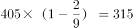英镑。

A项：定位表格，Reassair公司12月31日使用欧元按订单价为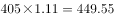欧元，9月1日现价支付为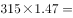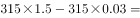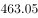欧元，则在12月31日按订单价更加经济，正确；

B项：与A项相反，错误；

C项：定位表格，Reassair公司9月1日使用日元按现价单价为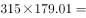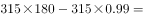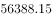日元，12月31日按订单价支付单价为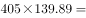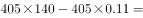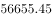日元，则9月1日按现价支付额比12月31日按订单价支付额低，错误；

D项：定位表格，Reassair公司12月31日使用美元按照订单价支付单价为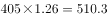美元，9月1日按现价单价为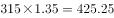美元，则在9月1日按现价支付更加经济，错误。

故正确答案为A。

### 给定材料

> [!note] 复核版本状态
> 原题可计分，答案为A；另提供编辑版，当前编辑版答案为A。
> 详细原题疑点、修订题面、解析和证据见下方独立复核记录。

<!-- CODEX-ANSWER-REVIEW:BEGIN -->
### 本次独立复核

**复核结论：** `resolved`（答案与解析已核定）

**原题计分状态：** 可计分；原题复核答案为 **A**。该题同时启用下述编辑版。

**原题疑点与处理：**

辽宁 2018 〔20-考点/资料分析/综合/汇率折算与跨期支付方案经济性比较〕 — 题干'下降了'之后的具体数值及官方解析中各空白处（9月1日现价、各外币折算金额）在转录中留空，无法直接复算核验；按官方解析四项结论反推，现价P须同时满足405×…

**当前计分版本：** 明确标注的编辑版；未列出的题干、材料或选项沿用固定题源。答案不回填为原题答案。

**计分答案：** A（可计分）

**复核解析：**

按原卷PDF及固定公式图恢复，降幅确为2/9，故现价315英镑/台。EUR：12月31日订单价每台405×1.11=449.55欧元，低于9月1日现价315×1.47=463.05欧元，1722台总支出分别为774125.10和797372.10欧元，因此12月31日更经济，A正确、B错误。JPY：12月31日订单价为56655.45日元/台，9月1日现价为56388.15日元/台，后者更低，C所称“更高”错误。USD：12月31日订单价510.30美元/台，9月1日现价425.25美元/台，9月1日更经济，D错误。

**修订题干：**

【编辑修复】2018年9月1日磨床的价格比订单价下降了2/9，则下列说法正确的是：

**修订材料：**

固定题图数据：Reassair磨床订单单价405英镑、数量1722台；汇率（每1英镑可兑换）：欧元9月1日1.47、12月31日1.11；日元9月1日179.01、12月31日139.89；美元9月1日1.35、12月31日1.26。固定公式图恢复降幅为2/9，因此9月1日现价为405×(1−2/9)=315英镑/台。

**相关信息：**

资料分析—汇率折算与跨期支付比较。把英镑单价乘对应日期汇率换到同币种后比较；订单数量相同，不影响高低判断。

**核对依据与来源边界：**

- 固定题源：[原题文件](https://github.com/Mentat-Uran/kaogongzhentizhengliu/blob/84ab93d4b64b61d897bece8a1c0a5bab06b4feb2/10-%E7%9C%9F%E9%A2%98/%E8%B5%84%E6%96%99%E5%88%86%E6%9E%90/%E7%BB%BC%E5%90%88/2307698%20%E6%B1%87%E7%8E%87%E6%8A%98%E7%AE%97%E4%B8%8E%E8%B7%A8%E6%9C%9F%E6%94%AF%E4%BB%98%E6%96%B9%E6%A1%88%E7%BB%8F%E6%B5%8E%E6%80%A7%E6%AF%94%E8%BE%83.md)；内容版本 `84ab93d4b64b61d897bece8a1c0a5bab06b4feb2`，源 Markdown blob `18a67c38aa79fe9054cc594726dac6f815b4e3c9`.
- **核心依据：** 原卷第113题明确印有2/9；固定源码中的公式PNG给出相同降幅，货币表与订单数量均按固定题图复算。
- 固定题图/公式图：`90-图片/公式图/formula-db85b078718caf5e.png`, `90-图片/公式图/formula-54dd760cc711c9b5.png`, `90-图片/公式图/formula-5a1850a3168d562b.png`, `90-图片/公式图/formula-d5a26f06143b27f5.png`, `90-图片/公式图/formula-5905172ab2432cbf.png`, `90-图片/公式图/formula-cbfdaf4238598c4a.png`, `90-图片/公式图/formula-c5dc289e4b4a4060.png`, `90-图片/公式图/formula-a4c8e789257a94de.png`, `90-图片/公式图/formula-d69619ad0a4b6647.png`, `90-图片/公式图/formula-e03c8e0fcc03d209.png`, `90-图片/公式图/formula-6e2d676d9d1fc3cc.png`, `90-图片/公式图/formula-47c3e9db39b0b90e.png`, `90-图片/公式图/formula-881cf134f5ee1206.png`, `90-图片/公式图/formula-51a8ac9b764a29a9.png`, `90-图片/题目图/170856a8c80b19a.png`.

<!-- CODEX-ANSWER-REVIEW:END -->
