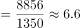
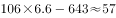
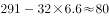
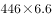
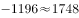
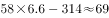

# 跨表差值比较（亿美元与亿元单位换算）

考点：[[20-考点/资料分析/综合/跨表差值比较（亿美元与亿元单位换算）|综合 / 跨表差值比较（亿美元与亿元单位换算）]]
材料：[[15-材料/资料分析/238899 2018年我国双向非金融类直接投资：|238899 2018年我国双向非金融类直接投资：]]

**问法模型**：题干问'对外投资额与外商在华投资额差值最大'的行业 → 先用材料折算关系统一币种，再对四个行业分别作差（取绝对值）比较大小

## 推理链
1. 第1步：从表1（外商在华，单位亿元）读出：批发和零售业643亿元、电力热力燃气及水291亿元、租赁和商务服务业1196亿元、交通运输仓储邮政314亿元
2. 第2步：从表2（对外投资，单位亿美元）读出对应行业：批发和零售业106亿美元、电力热力燃气及水32亿美元、租赁和商务服务业446亿美元、交通运输仓储邮政58亿美元
3. 第3步：两表币种不同，由文字段'8856亿元折1350亿美元'得1亿美元≈8856÷1350≈6.56亿元，将表2换算为亿元
4. 第4步：换算结果：批发零售106×6.56≈695亿元、电力32×6.56≈210亿元、租赁商务446×6.56≈2926亿元、交通运输58×6.56≈380亿元
5. 第5步：与表1同行数据作差取绝对值：批发零售|695−643|≈52亿元、电力|210−291|≈81亿元、租赁商务|2926−1196|≈1730亿元、交通运输|380−314|≈66亿元
6. 第6步：比较差值：1730＞81＞66＞52，租赁和商务服务业差值最大，对照选项选C

**最快解法**：⚡ 截位估算法+量级判断：只精算租赁商务——446×6.56≈2926亿元，与1196亿元差约1700亿元；其余三项只需确认差值远小于千亿量级（106×6.56≈695对643差约52、32×6.56≈210对291差约81、58×6.56≈380对314差约66，均不足百亿），直接锁定C

## 易错点
- ⚠ 币种混排陷阱：表1为亿元、表2为亿美元，若不换算直接相减，批发零售|106−643|=537会远超其他项，必错；必须先用8856亿元=1350亿美元（1亿美元≈6.56亿元）统一单位
- ⚠ 差值方向陷阱：题干未指明谁减谁，且换算后电力（210＜291）为在华大于对外，应取绝对值比较；但无论方向如何，C项量级优势明显，结论不变
- ⚠ 行业名单不对齐陷阱：表2独有采矿业、建筑业，表1独有居民服务业，两表为'其中'列举且分项之和小于总计，本题四个选项行业均为两表共有，但跨表取数时不可把分项相加当总量使用

## 母题抽象
> 🧩 当题干要求比较两张单位不同的统计表中同一行业指标的差值时，先用材料给出的总量折算关系（如8856亿元=1350亿美元）统一币种，再作差取绝对值比较大小

**同类特征**：差值最大、对外非金融类直接投资额、外商在华投资额、跨两表取数、亿元与亿美元混排需换算、行业限定四个选项

## 相关题
- [[10-真题/资料分析/倍数/4673207 现期平均数之比（跨表平均数倍数比较）|4673207]]（广东 2022，相关度1）

---

### 题干
下列行业中，2018年我国对外非金融类直接投资额与外商在华投资额差值最大的是：

### 选项
- A. 批发和零售业
- B. 电力、热力、燃气及水生产和供应业
- C. 租赁和商务服务业　✅
- D. 交通运输、仓储和邮政业

### 官方解析

定位统计表，分别计算四个选项的投资差值。由于单位不同，先进行单位换算，根据材料文字“外商直接在华投资金额8856亿元，折1350亿美元”，可知1美元元

A项：批发和零售业为亿元；

B项：电力、热力、燃气及水生产和供应业为亿元；

C项：租赁和商务服务业为亿元；

D项：交通运输、仓储和邮政业为亿元。

租赁和商务服务业的投资额差值最大。

故正确答案为C。

### 给定材料

        自改革开放以来，外商在华投资势头良好。今年两会期间，《中华人民共和国外商投资法（草案）》成为重要议题。2018年，外商直接在华投资（非金融类）新设立企业60533家。外商直接在华投资金额8856亿元，折1350亿美元。其中“一带一路”沿线国家对华直接投资新设立企业4479家，对华直接投资424亿元。全年高技术制造业实际使用外资（非金融类）898亿元，增长。

        2018年，我国对外非金融类直接投资7974亿元，同比下降，其中对“一带一路”沿线国家非金融类直接投资156亿美元，同比增长。

> [!warning] 疑点（官方解析可能有误，待人工复核）
> 官方解析文字存在乱码与数值缺失（如'1美元元'及各项差值数值空缺），但按1亿美元≈6.56亿元换算复算：批发零售约52亿元、电力约81亿元、租赁商务约1730亿元、交通运输约66亿元，C项差值最大，与官方答案C一致，无实质矛盾

<!-- CODEX-ANSWER-REVIEW:BEGIN -->
### 本次独立复核

**复核状态：** `resolved`（答案与解析已核定）

**计分答案：** C（可计分）

**复核解析：**

1. 第1步：从表1（外商在华，单位亿元）读出：批发和零售业643亿元、电力热力燃气及水291亿元、租赁和商务服务业1196亿元、交通运输仓储邮政314亿元
2. 第2步：从表2（对外投资，单位亿美元）读出对应行业：批发和零售业106亿美元、电力热力燃气及水32亿美元、租赁和商务服务业446亿美元、交通运输仓储邮政58亿美元
3. 第3步：两表币种不同，由文字段'8856亿元折1350亿美元'得1亿美元≈8856÷1350≈6.56亿元，将表2换算为亿元
4. 第4步：换算结果：批发零售106×6.56≈695亿元、电力32×6.56≈210亿元、租赁商务446×6.56≈2926亿元、交通运输58×6.56≈380亿元
5. 第5步：与表1同行数据作差取绝对值：批发零售|695−643|≈52亿元、电力|210−291|≈81亿元、租赁商务|2926−1196|≈1730亿元、交通运输|380−314|≈66亿元
6. 第6步：比较差值：1730＞81＞66＞52，租赁和商务服务业差值最大，对照选项选C

**最快解法**：⚡ 截位估算法+量级判断：只精算租赁商务——446×6.56≈2926亿元，与1196亿元差约1700亿元；其余三项只需确认差值远小于千亿量级（106×6.56≈695对643差约52、32×6.56≈210对291差约81、58×6.56≈380对314差约66，均不足百亿），直接锁定C

**相关信息：**

考點：跨表差值比较（亿美元与亿元单位换算）。來源：2019年湖北省选调生招录考试《综合知识和行政职业能力测验》题；2019年。> 🧩 当题干要求比较两张单位不同的统计表中同一行业指标的差值时，先用材料给出的总量折算关系（如8856亿元=1350亿美元）统一币种，再作差取绝对值比较大小

**同类特征**：差值最大、对外非金融类直接投资额、外商在华投资额、跨两表取数、亿元与亿美元混排需换算、行业限定四个选项

**题源依据：** [固定版本原题](https://github.com/Mentat-Uran/kaogongzhentizhengliu/blob/84ab93d4b64b61d897bece8a1c0a5bab06b4feb2/10-%E7%9C%9F%E9%A2%98/%E8%B5%84%E6%96%99%E5%88%86%E6%9E%90/%E7%BB%BC%E5%90%88/2366017%20%E8%B7%A8%E8%A1%A8%E5%B7%AE%E5%80%BC%E6%AF%94%E8%BE%83%EF%BC%88%E4%BA%BF%E7%BE%8E%E5%85%83%E4%B8%8E%E4%BA%BF%E5%85%83%E5%8D%95%E4%BD%8D%E6%8D%A2%E7%AE%97%EF%BC%89.md)；固定内容 commit `84ab93d4b64b61d897bece8a1c0a5bab06b4feb2`，Markdown blob `6770a8fe8ba846da1fc657e3c3ce5ba0418616e8`。
<!-- CODEX-ANSWER-REVIEW:END -->
