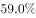
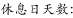
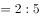
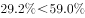
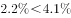
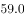
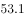
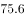
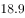
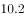

# 综合判断题（混合居中原理反推分组均值+两集合容斥下限+相关性验证）

考点：[[20-考点/资料分析/综合/综合判断题（混合居中原理反推分组均值+两集合容斥下限+相关性验证）|综合 / 综合判断题（混合居中原理反推分组均值+两集合容斥下限+相关性验证）]]
材料：[[15-材料/资料分析/238952 2018年国家统计局第二次全国时间利|238952 2018年国家统计局第二次全国时间利]]

**问法模型**：“从上述资料中能够推出的是”→逐项验证的综合判断题：A项用混合居中原理由总体与工作日均值反推休息日均值，B项用参与率混合居中，C项用两集合容斥下限，D项验证用时与参与率是否同向，排除错误项

## 推理链
1. 第1步：A项提取数据：无酬劳动总体平均用时2小时42分=162分钟，工作日2小时34分=154分钟，总体均值是工作日与休息日两组的加权混合
2. 第2步：混合居中原理（距离与量成反比）：一周中工作日:休息日=5:2，故(162-154):(x-162)=2:5，其中x为休息日无酬劳动均值
3. 第3步：解得x=162+8×5/2=182分钟=3小时2分钟>3小时，A项“休息日无酬劳动平均用时多于3小时”成立
4. 第4步：B项模型：无酬劳动总体参与率是男性、女性参与率的加权混合值，居中不正中（总体与男性的参与率数值在材料中空白，依原卷数值）
5. 第5步：由官方解析结论，受访女性居民无酬劳动参与率大于总体参与率，不落在B选项所给两值之间，B错误
6. 第6步：C项模型：两集合容斥，都参与占比=有酬参与率+无酬参与率-至少参与其一占比≥两参与率之和-100%（两项参与率数值在材料中空白，依原卷数值）
7. 第7步：当两者都不参与取最低值0时，都参与占比达到下限“两率之和-100%”，该下限与C选项所给数值不符，C错误
8. 第8步：D项验证：看病就医平均用时4分钟>公益活动3分钟，但对照原卷参与率数据两者并不同向，即并非用时越长参与率越高，D错误；故仅A能推出，选A

**最快解法**：⚡ 混合居中（十字交叉/距离与量成反比）：A项总体162分居中、工作日154分距差8分，按工作日:休息日=5:2权重得休息日=162+8×5/2=182分=3小时2分>3小时，直接锁定A；B/C/D排除：B女性参与率必大于总体值、C容斥下限=两参与率之和-100%、D用时4分>3分但参与率不同向

## 易错点
- ⚠ 只推出“休息日均值>总体162分钟”就下结论：162分=2小时42分<3小时，不足以跨过门槛，必须再用5:2权重算出182分钟=3小时2分才能判定A
- ⚠ 小时-分钟混写当小数：2小时34分≠2.34小时、2小时42分≠2.42小时，须先统一换算为154分钟、162分钟再运算
- ⚠ D项直觉陷阱：想当然认为用时越长的活动参与率越高；且“平均用时”是全体受访者口径，与参与率口径不同，正相关结论必须两组数据同向才成立
- ⚠ 材料中所有“参与率”数值均为空白，B/C/D的判定依赖原卷数值，解题时不得凭空补数；A项恰好不依赖任何缺失数值

## 母题抽象
> 🧩 当综合判断题出现“总体均值介于两个分组之间”时，用混合居中原理（距离与量成反比）反推未知分组值再与门槛比较；出现“都参与至少为”时用两集合容斥下限“两参与率之和-100%”；出现“正相关/同向变化”结论时须两组数据方向一致才可推出

**同类特征**：从上述资料中能够推出的是、综合判断逐项排除、工作日/休息日加权混合、混合居中不正中、两集合容斥都参与下限、平均用时与参与率的相关性

## 相关题
- [[10-真题/资料分析/综合/2367765 综合判断题——比重分界判断+倍数分界判断+基期差值方向判断+比值比较的混合逐项验证|2367765]]（江苏 2019，相关度1）
- [[10-真题/资料分析/综合/2376552 综合判断（顺差额比较+基期顺差计算+比重比较）|2376552]]（黑龙江 2019，相关度1）
- [[10-真题/资料分析/综合/5509777 综合判断（数据可推性验证+当月量与月均量比较）|5509777]]（甘肃 2023，相关度1）

---

### 题干
从上述资料中能够推出的是

### 选项
- A. 
受访居民休息日无酬劳动平均用时多于3小时
　✅
- B. 
受访女性居民无酬劳动的参与率介于和之间

- C. 
受访居民中，有酬劳动和无酬劳动都参与的占比至少为

- D. 
受访居民不同类型无酬劳动的平均用时和参与率呈正相关

### 官方解析

A项：定位材料第一段可得，“受访居民在一天的活动中，有酬劳动平均用时4小时24分钟。其中······工作日4小时50分钟，休息日3小时19分钟。······受访居民无酬劳动平均用时2小时42分钟。其中······工作日2小时34分钟”。根据“混合居中但不中，距离与量成反比”可知。，解得休息日无酬劳动时长为3小时2分钟3小时，正确；

B项：定位材料第一段可得，“受访居民无酬劳动的参与率为，其中男性”。根据“混合居中不正中”可知，受访女性居民无酬劳动参与率大于，错误；

C项：定位材料第一段可得“受访居民有酬劳动的参与率为，······无酬劳动的参与率为”，根据“两集合容斥原理”计算公式可知，。当两者都不参与取最低值0时，都参与的人数也为最低值，为全部人数的，错误；

D项：定位材料第二段可得，“看病就医平均用时4分钟，参与率为；公益活动平均用时3分钟，参与率为”。4分钟3分钟，，可知并非参与时间越长，参与率越高，错误。

故正确答案为A。

### 给定材料

        2018年国家统计局组织开展了第二次全国时间利用的随机抽样调查，共调查48580人。结果显示，受访居民在一天的活动中，有酬劳动平均用时4小时24分钟。其中，男性5小时15分钟，女性3小时35分钟；城镇居民3小时59分钟，农村居民5小时1分钟；工作日4小时50分钟，休息日3小时19分钟。受访居民有酬劳动的参与率为，其中城镇居民。受访居民无酬劳动平均用时2小时42分钟。其中，女性3小时48分钟；农村居民2小时39分钟；工作日2小时34分钟。受访居民无酬劳动的参与率为，其中男性。

        无酬劳动包括家务劳动、陪伴照料孩子生活、护送辅导孩子学习、陪伴照料成年家人、购买商品或服务、看病就医和公益活动。受访居民家务劳动平均用时1小时26分钟，参与率为。其中，女性2小时6分钟，参与率。受访居民陪伴照料孩子生活平均用时36分钟，参与率为；护送辅导孩子学习平均用时9分钟，参与率为；陪伴照料成年家人平均用时8分钟，参与率为；看病就医平均用时4分钟，参与率为；公益活动平均用时3分钟，参与率为。

> [!warning] 疑点（官方解析可能有误，待人工复核）
> B、C、D三选项的关键数值（参与率、区间端点、容斥下限值）在材料与选项中均以空白/图片形式缺失，官方解析依据原卷数值判定其错误，本笔记无法用现有材料独立复验；A项判定不依赖缺失数值，可独立成立

<!-- CODEX-ANSWER-REVIEW:BEGIN -->
### 本次独立复核

**复核状态：** `resolved`（答案与解析已核定）

**计分答案：** A（可计分）

**复核解析：**

1. A项：总体无酬劳动均值162分钟、工作日154分钟，工作日与休息日权重5:2。由加权平均关系，休息日均值=162+(162−154)×5/2=182分钟，即3小时2分钟，大于3小时。
2. B项：原图给出男性参与率55.3%、总体70.2%；女性参与率作为高于总体加权平均的另一组，必高于70.2%，不在选项所列55.3%—70.2%之间。
3. C项：有酬、无酬参与率分别为59.0%、70.2%，两者交集下限仅为59.0%+70.2%−100%=29.2%，不能推出至少59%。
4. D项：看病就医平均4分钟、参与率2.2%；公益活动平均3分钟、参与率4.1%。时间更长但参与率更低，不支持正相关。故只有A可推出。

**相关信息：**

考点：综合判断题（混合居中原理反推分组均值+两集合容斥下限+相关性验证）。来源：2019年江苏省公务员录用考试《行测》题（B类）（网友回忆版）；2019年。> 🧩 当综合判断题出现“总体均值介于两个分组之间”时，用混合居中原理（距离与量成反比）反推未知分组值再与门槛比较；出现“都参与至少为”时用两集合容斥下限“两参与率之和-100%”；出现“正相关/同向变化”结论时须两组数据方向一致才可推出

**同类特征**：从上述资料中能够推出的是、综合判断逐项排除、工作日/休息日加权混合、混合居中不正中、两集合容斥都参与下限、平均用时与参与率的相关性

**题源依据：** [固定版本原题](https://github.com/Mentat-Uran/kaogongzhentizhengliu/blob/84ab93d4b64b61d897bece8a1c0a5bab06b4feb2/10-%E7%9C%9F%E9%A2%98/%E8%B5%84%E6%96%99%E5%88%86%E6%9E%90/%E7%BB%BC%E5%90%88/2367772%20%E7%BB%BC%E5%90%88%E5%88%A4%E6%96%AD%E9%A2%98%EF%BC%88%E6%B7%B7%E5%90%88%E5%B1%85%E4%B8%AD%E5%8E%9F%E7%90%86%E5%8F%8D%E6%8E%A8%E5%88%86%E7%BB%84%E5%9D%87%E5%80%BC%2B%E4%B8%A4%E9%9B%86%E5%90%88%E5%AE%B9%E6%96%A5%E4%B8%8B%E9%99%90%2B%E7%9B%B8%E5%85%B3%E6%80%A7%E9%AA%8C%E8%AF%81%EF%BC%89.md)；固定内容 commit `84ab93d4b64b61d897bece8a1c0a5bab06b4feb2`，Markdown blob `434d3c62437974358da2237e1d42f56b09961541`。
<!-- CODEX-ANSWER-REVIEW:END -->
