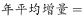
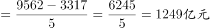
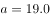

# 综合判断（年均增量计算+混合增长率+比值升降比较+分项穷尽性验证）

考点：[[20-考点/资料分析/综合/综合判断（年均增量计算+混合增长率+比值升降比较+分项穷尽性验证）|综合 / 综合判断（年均增量计算+混合增长率+比值升降比较+分项穷尽性验证）]]
材料：[[15-材料/资料分析/238953 2013—2018年全国互联网业务收|238953 2013—2018年全国互联网业务收]]

**问法模型**：题干为'从上述资料中能够推出的是'→综合判断题，逐项'三查'：可算项复算公式数值、缺数据项判无法推出、比值升降项用分子分母增速比较

## 推理链
1. 第1步：四个选项分别对应年均增量、混合增长率、两指标比值变化、分项增速最值，须逐项用文字与柱状图数据验证
2. 第2步：A项——柱状图读出2013年3317亿元、2018年9562亿元，2014—2018年共5个增长年，年平均增量=(9562−3317)/5=6245/5=1249亿元
3. 第3步：1249≠1067；且选项1067≈(9562−4229)/5≈1066.6，属'基期取2014年4229却除以5'的基期与年份差错配，A错误
4. 第4步：B项——文字仅给出广东、上海、北京三地互联网业务收入的增速（题面空格），未给出任何一地的收入规模，求三地总和的混合增长率必须有各部分现期（或基期）值作权重，数据缺失，B错误
5. 第5步：C项——比值为'研发投入490亿元/互联网业务收入9562亿元'，2018年该比值≈490/9562≈5.1%；比值升降只看分子分母增速：研发投入增速（文字原值）与全国互联网业务收入增速21.0%比较，研发投入增速<21.0%，分子增速小于分母增速，故2018年比值小于上年，C正确
6. 第6步：D项——信息服务收入8594亿元中'其中'只列出电商平台3667亿元、网络游戏1948亿元两类，其余类别及其增速材料未给出，'各类信息服务收入中增长最慢'的全集不完整，无从比较，D错误
7. 第7步：综上只有C能从材料推出，与官方答案C一致

**最快解法**：⚡ 综合排除法+分子分母增速比较：A用年均增量公式（9562−3317)/5=1249秒杀排除（并识破1067=(9562−4229)/5的错配陷阱）；B因'只有三地增速、无收入规模'、D因'其中分项非穷尽'直接判无法推出；C无需算比值本身，只需比较研发投入增速与全国收入增速21.0%的大小——分子增速<分母增速⇔比值下降，30秒锁定C

## 易错点
- ⚠ A项年均增量的基期—年份差错配：1067≈(9562−4229)/5，是'基期取2014年却除以5个增长年'的典型错误；正确口径是基期2013年3317亿元对应5个增长年（2014—2018），均值为1249亿元，基期与除数必须一一对应
- ⚠ B、D的'无中生有/非穷尽'陷阱：只有增速没有各部分收入值就不能求混合增长率；'其中'列出的电商平台、网络游戏只是信息服务8594亿元的部分分项，不代表全部类别，凡'最值/总和'判断先查数据是否完备
- ⚠ C项比值升降方向易反且口径勿混：分子（研发投入）增速低于分母（互联网业务收入21.0%）才使比值下降；注意研发投入490亿元与互联网业务收入9562亿元是互不包含的两个指标，不能当比重算，但作比值增速比较完全可行；分项增速须回文字原值，图中查不到的不得编造

## 母题抽象
> 🧩 当题干出现'能够推出的是/无法推出的是'时，按'算得出→查数据→判方向'逐项排雷：可算项直接套公式复算（如年均增量=(现期−基期)/增长年数，注意基期与除数匹配）；'总和/混合'项查部分规模是否齐全，缺则判错；'比值与上年比'项用分子增速vs分母增速定方向；'最值'项查分项是否穷尽（'其中'≠全集）

**同类特征**：能够推出的是（综合判断四选一）、年平均增量为1067亿元、三地收入总和比上年增长（混合增长率）、研发投入与互联网业务收入的比值小于上年、年增长最慢的是电子商务平台收入、文字+双轴柱折图，多处增速为空格须回文字取值

## 相关题
（暂无）

---

### 题干
从上述资料中能够推出的是

### 选项
- A. 
2014—2018年全国互联网业务收入年平均增量为1067亿元

- B. 
2018年广东、上海、北京的互联网业务收入总和比上年增长

- C. 
2018年全国互联网行业研发投入与互联网业务收入的比值小于上年
　✅
- D. 
2018年全国互联网企业各类信息服务收入年增长最慢的是电子商务平台收入

### 官方解析

A项：定位柱状图可得，2013年与2018年全国互联网业务收入分别为3317亿元、9562亿元，代入公式：，错误；

B项：定位文字材料可得，2018年广东、上海、北京互联网业务收入分别增长、和，但没有给出各市互联网业务收入数值，无法求出混合增长率，属于无中生有，错误；

C项：定位文字材料可得，2018年互联网行业研发投入与互联网业务收入增长率分别为、，，故比值低于上年，正确；

D项：定位文字材料可得，2018年互联网企业信息服务收入8594亿元，比上年增长。其中，电子商务平台收入3667亿元，增长；网络游戏业务收入1948亿元，增长。，可知材料没有给出互联网企业信息服务的全部类别，故无法判断年增长最慢的是否为电子商务平台收入，错误。

故正确答案为C。

### 给定材料

        2018年全国互联网业务收入9562亿元，比上年增长。其中，广东、上海、北京互联网业务收入分别增长、和。2018年互联网企业信息服务收入8594亿元，比上年增长。其中，电子商务平台收入3667亿元，增长；网络游戏业务收入1948亿元，增长。2018年互联网行业研发投入490亿元，比上年增长。

