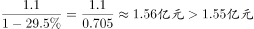
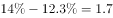
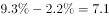

# 综合分析·选非题（增速读图比较+费用率定性判断+增速差计算）

考点：[[20-考点/资料分析/综合/综合分析·选非题（增速读图比较+费用率定性判断+增速差计算）|综合 / 综合分析·选非题（增速读图比较+费用率定性判断+增速差计算）]]
材料：[[15-材料/资料分析/238954 某市调查总队抽样调查：2017年全市|238954 某市调查总队抽样调查：2017年全市]]

**问法模型**：题干问'从上述资料中不能推出的是'→ 选非题，逐项回材料验证，能推出三项、找出唯一不能推出的一项；定性判断（方向、大小）优先读图秒杀

## 推理链
1. 第1步：定位统计图2017年数据点：销售总收入增速+3.1%（点状虚线，图中标签3.1），销售总费用增速-8.1%（三角虚线，全图唯一负值，落到0轴下方）
2. 第2步（A项）：销售费用率=销售总费用/销售总收入，2017年分子增速-8.1%（下降）、分母增速+3.1%（增长），分子降分母升，费用率必比上年下降，A可推出
3. 第3步（B项）：文字段给出2017年营业税金及附加1.1亿元且'比上年下降'，按基期值公式2016年值=1.1/(1+r)，由下降幅度回推2016年超过1.55亿元，B可推出
4. 第4步（C项）：'变动方向一致'要求五年逐年同增或同减，但2017年销售总收入+3.1%增长、销售总费用-8.1%下降，一增一降方向相反，C与材料矛盾，不能推出
5. 第5步（D项）：逐年求两线增速差：2013年|11.4-7.0|=4.4，2014年|14.0-12.3|=1.7，2015年|9.3-2.2|=7.1，2016年|18.8-10.5|=8.3，2017年|3.1-(-8.1)|=11.2个百分点，2017年最大，D可推出
6. 第6步：本题选'不能推出'项，C错误表述即答案，与官方答案一致

**最快解法**：⚡ 选非题找反例秒杀：只需一个反例即可推翻'五年方向一致'——直接读图2017年，销售总收入+3.1%增、销售总费用-8.1%降（唯一负值），一增一降，10秒锁定C，无需逐项精算B、D

## 易错点
- ⚠ 漏看'不能推出'四字，把三个正确表述误当答案；选非题须先圈出'不'字
- ⚠ 2017年图中标签4.2与3.1紧贴，3.1%属销售总收入（点状虚线），-8.1%属销售总费用（三角虚线、唯一落到0轴以下的负值），读错线型则C项判断反转
- ⚠ D项2017年增速差须用3.1-(-8.1)=11.2，负号漏处理会误认为2016年（8.3）最大；B项基期回推用1.1/(1+r)而非1.1×(1-r)，方向别搞反

## 母题抽象
> 🧩 当题干出现'不能推出/无法推出'时，逐项回材料验证：方向类结论（如'变动方向一致''比率升降'）只需找一个反例年份即可推翻，优先读图比对分子分母或两线增速的正负号；大小极值类（如'相差最大年份'）逐年做差取绝对值比较

**同类特征**：不能推出（选非）、综合分析四选一、变动方向一致、增速相差最大的年份、费用率比上年变化、基期值超过某具体数

## 相关题
- [[10-真题/资料分析/综合/2188892 综合分析推断题（无中生有排除+平均每机构场次验证）|2188892]]（甘肃 2018，相关度1）
- [[10-真题/资料分析/综合/2031178 综合分析题（逐项验证：增长量计算、基期量反推、比重阈值判断）|2031178]]（北京 2017，相关度1）
- [[10-真题/资料分析/综合/2051204 综合判断题（两期比重比较＋增速计数＋区间求和比较＋涨幅比较）|2051204]]（黑龙江 2017，相关度1）
- [[10-真题/资料分析/综合/13255455 综合分析题-逐项验证（基期量换算比较、增长率计算与比较）|13255455]]（选调 2023，相关度1）
- [[10-真题/资料分析/综合/1797646 综合分析（比重变化判断+月均数+读图增速比较+现期比重估算）|1797646]]（山东 2016，相关度1）

---

### 题干
从上述资料中不能推出的是

### 选项
- A. 2017年该市小微样本企业的销售费用率比上年有所下降
- B. 2016年该市小微样本企业营业税金及附加超过1.55亿元
- C. 2013-2017年该市小微样本企业销售总收入和销售总费用的变动方向一致　✅
- D. 2013-2017年该市小微样本企业销售总收入和总费用增速相差最大的年份是2017年

### 官方解析

A.根据，定位图形材料，2017年该市小微样本企业的销售总费用比2016年下降，销售总收入比2016年增长，，则2017年的销售费用率比上年有所下降，正确；

B.根据，定位文字材料“2017年······营业税金及附加1.1亿元，比上年下降”， 则2016年该市小微样本企业营业税金及附加，正确；

C. 根据图形材料，2017年该市小微样本企业的销售总费用比2016年下降，销售总收入比2016年增长，一个下降一个增长，变动方向不一致，错误；

D. 2013年该市小微样本企业销售总收入和总费用增速相差个百分点；

2014年该市小微样本企业销售总收入和总费用增速相差个百分点；

2015年该市小微样本企业销售总收入和总费用增速相差个百分点；

2016年该市小微样本企业销售总收入和总费用增速相差个百分点；

2017年该市小微样本企业销售总收入和总费用增速相差个百分点；

2013-2017年该市小微样本企业销售总收入和总费用增速相差最大的年份是2017年，正确。

本题为选非题，故正确答案为C。

### 给定材料

        2017年某市调查总队对全市服务业小微企业的抽样调查显示，2017年全市服务业小微样本企业总资产938.6亿元，销售总收入105.4亿元，销售总费用6.8亿元；人员薪酬19.3亿元，比上年增长；从业人员29028人，与上年持平；营业税金及附加1.1亿元，比上年下降；缴纳增值税2.3亿元，比上年增长。

> [!warning] 疑点（官方解析可能有误，待人工复核）
> 本版本材料文字中'营业税金及附加比上年下降'的降幅数值显示空缺，B项'超过1.55亿元'的完整数值验证依赖该空缺增速（需2016年=1.1/(1+r)>1.55，即降幅大于约29%）；本笔记按官方结论保留B为'可推出'，仅如实标注取数缺口，不改变答案C
