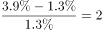

# 综合推断（'能够推出'判定——交集必然性-容斥思想）

考点：[[20-考点/资料分析/综合/综合推断（'能够推出'判定——交集必然性-容斥思想）|综合 / 综合推断（'能够推出'判定——交集必然性/容斥思想）]]
材料：[[15-材料/资料分析/238959 2018年11月中旬某市统计局对全市|238959 2018年11月中旬某市统计局对全市]]

**问法模型**：题干问'从上述资料中能够推出的是'→ 对四个选项逐一做必然性检验，其中'一定有人'类选项用交集下限公式 A%+B%−100%>0 判定

## 推理链
1. 第1步：图1读数——参与者中64.5%的网购原因是'优惠力度大'；图2读数——参与者中38.1%网购了护肤美容美发用品，两个占比基数相同（均为参与者）
2. 第2步：C项判定规则（交集下限/鸽笼原理）：同一基数下两群体交集占比 ≥ 64.5%＋38.1%−100%＝2.6%
3. 第3步：2.6%＞0，'因优惠力度大参与'与'购买护肤美容美发用品'两个集合必然相交，故C项'一定有人'成立
4. 第4步：A项检验——表中支出超0.4万元者占19.9%、图2食品饮料占51.3%，但支出档位与商品类别是两个独立维度，材料无交叉数据（51.3%＜80.1%，买食品饮料者可全部落在0.4以下档），无法推出
5. 第5步：B项检验——日用品65.8%＜'有实际购物需求'66.1%，两个多选集合数值接近但无必然包含关系，'都选择了'过于绝对，无法推出
6. 第6步：D项检验——0.8–1.2万元占3.9%、1.6–2.0万元占1.3%，3.9%÷1.3%＝3恰好多2倍，但表中另有2.5%'不确定'人群可能落入任一区间，倍数关系不确定，无法推出
7. 第7步：A、B、D均无法推出，仅C必然成立，对照选项选C

**最快解法**：⚡ 交集下限公式（容斥/鸽笼原理）：同一基数、'一定有人'⟺两占比之和＞100%；64.5%＋38.1%＝102.6%＞100%，交集至少2.6%，C项秒杀；A用'跨维度无交叉数据'排除，B用'占比接近≠集合包含'排除，D用'不确定档2.5%破坏倍数确定性'排除

## 易错点
- ⚠ C项论证方向易搞反：正确思路是假设最不利情形——所有不选'优惠力度大'的人（100%−64.5%=35.5%）全部买了护肤品，仍因38.1%＞35.5%而矛盾；若方向想反会误判C错
- ⚠ A项把两个独立维度的占比（食品饮料51.3%与支出超0.4万元的19.9%）误认为可交叉叠加推断，实际上材料未给出'品类×支出'交叉分布
- ⚠ B项被65.8%与66.1%的接近数值迷惑，误判为必然覆盖；D项漏看表中2.5%'不确定'档，忽略其可能落入任一支出区间而使'多2倍'不再确定

## 母题抽象
> 🧩 当题干出现'能够推出的是/一定有人'且两个占比来自同一基数的不同多选集合时，用交集下限公式 A%＋B%−100%＞0 判定必然相交；对'都/一定'类绝对化表述用最不利情形（100%−A% 与 B% 比大小）验证，并警惕跨维度数据不可交叉、存在'不确定'档时倍数关系失效的排除项

**同类特征**：能够推出的是、一定有人、都选择了、多2倍、同一基数下两个多选占比（64.5%与38.1%）、表中含'不确定'档

## 相关题
- [[10-真题/资料分析/其他/2172295 容斥原理-抽屉原理——两集合占比和＞100%必有交集的必然性判断|2172295]]（江苏 2018，相关度1）
- [[10-真题/资料分析/综合/2452588 综合分析判断（现期加总比较+增长量判定+两期比重变化+年均增长量倍数）|2452588]]（江苏 2020，相关度1）
- [[10-真题/资料分析/比重/2452647 两项目交集必然存在判定（占比之和-100%的容斥-最不利模型）|2452647]]（江苏 2020，相关度1）
- [[10-真题/资料分析/综合/2452651 综合推断（占比差×总人数求人数差 + 容斥交集下限判定）|2452651]]（江苏 2020，相关度1）

---

### 题干
从上述资料中能够推出的是

### 选项
- A. 参与“双11”网购的受访者中有人网购食品饮料的支出超过0.4万元
- B. “双11”网购日用品的受访者都选择了“有实际购物需求”的网购原因
- C. 因优惠力度大而参与“双11”网购的受访者中一定有人网购了护肤美容美发用品　✅
- D. “双11”网购支出0.8—1.2万元的受访者人数比网购支出1.6—2.0万元的多2倍

### 官方解析

A项：根据资料，有参与2018年“双11”网购支出超过0.4万元的受访者占比，也有参与2018年“双11”网购食品饮料的受访者占比，但是无法得出有人网购饮料的支出超过0.4万元，无法推出。

B项：定位统计图1和2，“双11”网购日用品的受访者并不一定都选择了“有实际购物需求”的网购原因，无法推出。

C项：定位统计图1和2，某市参与2018年“双11”网购的受访者中有的人网购原因为优惠力度大，有的人购买了护肤美容美发用品，若所有不因为优惠力度大而网购的人全部购买了护肤美容美发用品，则有，因此必然有因为优惠力度大而网购的受访者购买了护肤美容美发用品，可以推出。

D项：定位统计表，“双11”网购支出0.8-1.2万元的受访者占比为，网购支出1.6-2.0万元的受访者占比为。前者人数比后者人数多倍，但是统计表中显示有的人不确定自己支出为多少，这部分人如果有存在于上述两个区间的话，那么就无法确定前者是否比后者多2倍，无法推出。

故正确答案为C。

### 给定材料

        2018年11月中旬，某市统计局对全市2000名18-65周岁的常住居民进行了有关“双11”网购情况的电话调查。调查结果显示，的受访者参与了2018年“双11”的网购，其中的男性和的女性表示“有实际购物需求”是其参与“双11”网购的原因之一。

