# 综合分析·选非题（增长率计算＋日均换算＋基期还原比较＋直接读数）

考点：[[20-考点/资料分析/综合/综合分析·选非题（增长率计算＋日均换算＋基期还原比较＋直接读数）|综合 / 综合分析·选非题（增长率计算＋日均换算＋基期还原比较＋直接读数）]]
材料：[[15-材料/资料分析/239237 A省2015—2018年市场主体情况|239237 A省2015—2018年市场主体情况]]

**问法模型**：'以下说法不正确的是'→三真一假逐项判定模型：能查数直接比、能除就直除（日均=年总量÷365）、基期=现期÷(1+增速)，锁定唯一错误项。

## 推理链
1. 第1步：B项涉及2017年日均：表格给2017年新登记市场主体195.00万户，文字给2018年日均6294户且'同比增长'（增速为正但数值缺省）。
2. 第2步：用公式'日均=年总量÷365'并做勾稽验证：2018年229.74万户÷365≈6294户，与文字一致；2017年日均=195.00万户÷365≈5342户。
3. 第3步：5342户明显大于4000户，故'2017年日均少于4000户'不成立，B错误（也可由6294÷(1+正增速)远高于4000判断）。
4. 第4步：A项：2018年新登记企业97.80万户、2015年61.10万户，增长率=97.80÷61.10−1≈60.1%（61.10×1.6=97.76<97.80），'增长超60%'成立，正确。
5. 第5步：C项：用2018年三大行业36.14/15.19/9.25万户分别除以(1+各自同比增速)还原2017年基期值，批发和零售业仍居首；再用2017年新登记企业合计90.41万户减去三大行业基期值，其余行业无法超过批发和零售业，正确。
6. 第6步：D项：直接查表，2015年农民专业合作社0.55万户＞第一产业新登记企业0.48万户，正确。
7. 第7步：本题为选非题，唯一错误项为B，与官方答案一致。

**最快解法**：⚡ 先攻B项（唯一需换算项）：直除法，2017年总量195.00万户÷365≈5342户＞4000户，B即错，选非题可提前收卷；A项用61.1×1.6=97.76<97.80验证'超60%'，C、D直接查表/查数排除。

## 易错点
- ⚠ 单位陷阱：文字'日均6294户'是'户'，表格单位是'万户'，相差1万倍，须用229.74万户÷365≈6294户勾稽核对，勿拿万户直接与4000户比较。
- ⚠ 数据缺省陷阱：文字中'同比增长'的百分数缺省，B项勿因增速缺失而卡死，应转用表格2017年总量195.00万户独立求日均。
- ⚠ 选非题设问陷阱：要找'不正确'项；D项0.55与0.48均为小量级且数值接近，且表中2016、2017年第一产业（0.59）、第二产业（14.42）数值完全相同，逐行读数易串行。

## 母题抽象
> 🧩 当综合分析题出现'以下说法不正确的是'时，优先做可用表内数据独立闭环验证的选项（如日均=年总量÷365），文字增速缺省时改走表格口径换算，避免被缺失数据卡死。

**同类特征**：说法不正确的是（选非题）、日均新登记市场主体…户、2015—2018年新登记企业数增长超…%、新登记企业最集中的行业（跨期行业比较）、多于/少于（量级直接比较）、农民专业合作社与第一产业新登记企业

## 相关题
（暂无）

---

### 题干
根据材料，以下说法不正确的是（    ）。

### 选项
- A. 
2015—2018年，A省新登记企业数增长超

- B. 
2017年，A省日均新登记市场主体少于4000户
　✅
- C. 
2017年，A省新登记企业最集中的行业是批发和零售业

- D. 
2015年，A省新登记农民专业合作社多于第一产业新登记企业

### 官方解析

A项：定位表格材料可得： 2018年A省新登记企业数为97.8万户，2015年A省新登记企业数为61.1万户；故2015—2018年A省新登记企业数增长率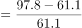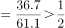，正确；

B项：定位文字材料第一段可得：“2018年，A省日均新登记市场主体6294户，同比增长”，故2017年，A省日均新登记市场主体数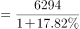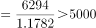户，并非少于4000户，错误；

C项：定位文字材料第二段可得：“2018年，全省新登记企业最集中的三个行业分别是批发和零售业、租赁和商务服务业、制造业，新登记企业数分别为36.14万户、15.19万户、9.25万户，分别同比增长、增长、下降”，故2017年批发和零售业新登记企业数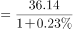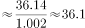万户，租赁和商务服务业新登记企业数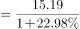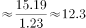万户，制造业新登记企业数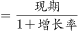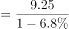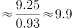万户，根据表格材料2017年新登记企业数90.41万户，则其他所有行业新登记企业数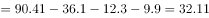万户，显然2017年，A省批发和零售业新登记企业数最多，即2017年，A省新登记企业最集中的行业是批发和零售业，正确；

D项：定位表格可得：2015年A省新登记农民专业合作社数为0.55万户，第一产业新登记企业数为0.48万户；故2015年A省新登记农民专业合作社多于第一产业新登记企业，正确。

本题为选非题，故正确答案为B。

### 给定材料

        近年来，A省新登记市场主体保持较快增长势头。全省实有各类市场主体从2015年的775.95万户增长到2018年的1146.13万户。2018年，全省新登记市场主体229.74万户，日均新登记市场主体6294户，同比增长。

        2018年，全省新登记企业最集中的三个行业分别是批发和零售业、租赁和商务服务业、制造业，新登记企业数分别为36.14万户、15.19万户、9.25万户，分别同比增长、增长、下降。

> [!warning] 疑点（官方解析可能有误，待人工复核）
> 给定材料快照中所有'同比/增长/下降'后的百分数均缺省，官方解析B、C项中还原出的具体数值（2017年日均、2017年批发零售业基期值）无法从给定材料直接复现；但B项结论可用表格独立验证（195.00万户÷365≈5342户>4000户），与官方答案一致，不影响判定。

<!-- CODEX-ANSWER-REVIEW:BEGIN -->
### 本次独立复核

**复核状态：** `resolved`（答案与解析已核定）

**计分答案：** B（可计分）

**复核解析：**

A：97.8/61.1−1≈60.1%，超过题图阈值50%，正确。B：用2018年日均6294户及17.8%同比增速反推，2017年日均=6294/1.178≈5343户，不少于4000，因此B为题目所问的不正确项。C：反推2017年批发零售36.14/1.0023≈36.06万、租赁商务15.19/1.2298≈12.35万、制造业9.25/0.932≈9.92万；其他行业合计90.41−36.06−12.35−9.92≈32.08万，批发零售仍最多，成立。D：0.55>0.48，成立。唯一错误项B。

**修订材料：**

从固定题图、公式图及2019年广东县级卷回忆版恢复数据：2018年新登记市场主体229.74万户、日均6294户、同比增长17.8%；2018年企业97.8万户，2015年61.1万户；2018年批发零售36.14万户（同比+0.23%）、租赁商务15.19万户（+22.98%）、制造业9.25万户（−6.8%），2017年企业总数90.41万户；2015年合作社0.55万户、第一产业企业0.48万户。

**相关信息：**

资料分析—增长率、日均值基期还原和分行业基期量比较。整体行业总量减去已列行业时，各部分需统一还原至同一年度。

**题源依据：** [固定版本原题](https://github.com/Mentat-Uran/kaogongzhentizhengliu/blob/84ab93d4b64b61d897bece8a1c0a5bab06b4feb2/10-%E7%9C%9F%E9%A2%98/%E8%B5%84%E6%96%99%E5%88%86%E6%9E%90/%E7%BB%BC%E5%90%88/2374729%20%E7%BB%BC%E5%90%88%E5%88%86%E6%9E%90%C2%B7%E9%80%89%E9%9D%9E%E9%A2%98%EF%BC%88%E5%A2%9E%E9%95%BF%E7%8E%87%E8%AE%A1%E7%AE%97%EF%BC%8B%E6%97%A5%E5%9D%87%E6%8D%A2%E7%AE%97%EF%BC%8B%E5%9F%BA%E6%9C%9F%E8%BF%98%E5%8E%9F%E6%AF%94%E8%BE%83%EF%BC%8B%E7%9B%B4%E6%8E%A5%E8%AF%BB%E6%95%B0%EF%BC%89.md)；固定内容 commit `84ab93d4b64b61d897bece8a1c0a5bab06b4feb2`，Markdown blob `6e25119faef501cb3ba47126ea4b8a28b289d296`。
<!-- CODEX-ANSWER-REVIEW:END -->
