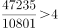
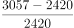
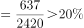
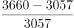
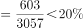
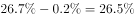
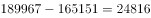
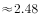

# 综合分析选非题（隔两年增长量+单位换算、倍数判定、两年增速'均超过'验证、基期比重逆推）

考点：[[20-考点/资料分析/综合/综合分析选非题（隔两年增长量+单位换算、倍数判定、两年增速'均超过'验证、基期比重逆推）|综合 / 综合分析选非题（隔两年增长量+单位换算、倍数判定、两年增速'均超过'验证、基期比重逆推）]]
材料：[[15-材料/资料分析/239235 2018年我国全社会用电量（分三次产|239235 2018年我国全社会用电量（分三次产]]

**问法模型**：题干为'下列说法不正确的是'的选非型综合分析 → 对A/B/C/D四个分属不同考点（倍数、增速、比重、增长量）的说法逐项验证，锁定唯一错误项

## 推理链
1. 第1步：A项从文字段提取2018年第二产业用电量47235亿千瓦时、第三产业10801亿千瓦时，47235÷10801≈4.37倍，落在4~5倍之间，'4倍多'成立，A正确
2. 第2步：B项从表格提取风电发电量：2016年2420、2017年3057、2018年3660亿千瓦时
3. 第3步：B项分别算两年增速：2017年增速=3057÷2420−1≈26.3%，2018年增速=3660÷3057−1≈19.7%，2018年增速约19.7%未达到选项所述阈值，'均超过'不成立，B错误
4. 第4步：C项利用文字段'2018年可再生能源发电量占全年发电总量比重同比上升0.2个百分点'，逆推2017年比重=2018年比重−0.2个百分点，与选项数值一致（比重具体数值以原卷补全数据为准），C正确
5. 第5步：D项计算189967−165151=24816万千瓦，按1亿千瓦=100000万千瓦换算，24816万千瓦=2.4816亿千瓦≈2.48亿千瓦，D正确
6. 第6步：本题选非题，四项中仅B说法不正确，故选B

**最快解法**：⚡ 选非题'先易后难'逐项排除：D项纯减法189967−165151=24816万千瓦≈2.48亿千瓦（万千瓦→亿千瓦÷10000）排除；A项截位直除47235/10801≈4.37为4倍多排除；C项由'同比上升0.2个百分点'直接逆推2017年比重=2018年比重−0.2pct排除；B项对风电两年分别截位直除：3057/2420≈1.26、3660/3057≈1.20，即2017年≈26.3%、2018年≈19.7%，2018年增速未超阈值，'均超过'不成立，选B

## 易错点
- ⚠ 选非题思维定势：误把'不正确'当'正确'来选；且B项'均超过'须两年增速逐一验证，只算2017年（26.3%超阈值）而漏算2018年（约19.7%未超）会误判B为正确说法
- ⚠ D项单位换算陷阱：24816万千瓦→亿千瓦需÷10000得2.4816亿千瓦，易错成24.8亿或0.248亿千瓦；且'万千瓦'是装机（功率）单位，勿与电量单位'亿千瓦时'混淆
- ⚠ A项倍数口径：'是……的4倍多'指4~5倍之间（47235/10801≈4.37），勿与'比……多4倍'（即5倍）混淆
- ⚠ C项时间口径：材料给的是2018年比重及'同比上升0.2个百分点'，求2017年须做减法逆推（2017年=2018年−0.2pct），且比重具体数值在所给材料中空缺，须以原卷补全数据验证，勿凭空编造

## 母题抽象
> 🧩 当题干出现'下列说法不正确的是'且四选项分属倍数/增速/比重/增长量不同考点时，先做计算量最小的纯减法+单位换算项和简单倍数项排除，再对'均超过''连续两年'类说法逐年分别验证增速，最后用基期比重逆推收尾，锁定唯一错误项

**同类特征**：下列说法不正确的是（选非）、四个选项分属倍数、增长率、比重、增长量不同考点、同比增幅均超过（须逐年分别验证）、同比上升0.2个百分点（基期比重减法逆推）、较2016年增加约2.48亿千瓦（跨两年增长量+万千瓦→亿千瓦换算）、第二产业是第三产业的4倍多（现期倍数直除）

## 相关题
- [[10-真题/资料分析/综合/2047848 综合分析选非题（基期平均数可推性判断＋增长量比较'大大则大'＋户均负债计算）|2047848]]（广东 2017，相关度1）

---

### 题干
根据以上材料，下列说法不正确的是（    ）。

### 选项
- A. 
2018年，我国第二产业用电量是第三产业用电量的4倍多

- B. 
2017年和2018年，我国风电发电量同比增幅均超过
　✅
- C. 
2017年，我国可再生能源发电量占全年发电总量的

- D. 
2018年，我国全口径发电设备容量较2016年增加约2.48亿千瓦

### 官方解析

A项：定位文字材料第一段可知，“（2018年）第二产业用电量47235亿千瓦时，第三产业用电量10801亿千瓦时”。，正确；

B项：定位表格可知，2016年我国风电发电量为2420亿千瓦时，2017年为3057亿千瓦时，2018年为3660亿千瓦时。2017年同比增速为，2018年同比增速为，错误；

C项：定位文字材料第二段可知，“（2018年）可再生能源发电量占全年发电总量比重为，同比上升0.2个百分点”。则2017年，我国可再生能源发电量占全年发电总量的比重为，正确；

D项：定位表格可知，2018年我国全口径发电设备容量为189967万千瓦，2016年为165151万千瓦。万千瓦亿千瓦，正确。

本题为选非题，故正确答案为B。

### 给定材料

        2018年，我国全社会用电量68449亿千瓦时，同比增长，增幅同比提高1.9个百分点。具体来看，第一产业用电量728亿千瓦时，同比增长；第二产业用电量47235亿千瓦时，同比增长；第三产业用电量10801亿千瓦时，同比增长；城乡居民生活用电量9685亿千瓦时，同比增长。

        2018年，我国可再生能源发电量达1.87万亿千瓦时，同比增长约1700亿千瓦时；可再生能源发电量占全年发电总量比重为，同比上升0.2个百分点。

> [!warning] 疑点（官方解析可能有误，待人工复核）
> 所给材料文字段中2018年'占全年发电总量比重'数值空缺，且B项选项中的增速阈值与C项选项中的比重数值均为图片公式无法读取、官方解析中对应数值亦空缺；由官方结论'B错误'可反推选项阈值应高于2018年风电增速3660/3057−1≈19.7%（如20%量级），C项'2017年比重'须以原卷补全的2018年比重减0.2个百分点验证，本题按官方结论B为唯一不正确说法处理

<!-- CODEX-ANSWER-REVIEW:BEGIN -->
### 本次独立复核

**复核状态：** `confirmed`（独立复算确认答案）

**计分答案：** B（可计分）

**复核解析：**

图表风电发电量2017年增幅=(3057−2420)/2420=26.32%，2018年=(3660−3057)/3057=19.72%，所以“两个年份均超过20%”不成立，选B。

**相关信息：**

独立复核：按题干定义逐项检验，关键基数、比值、增速与图表读数写明以便复算。

**题源依据：** [固定版本原题](https://github.com/Mentat-Uran/kaogongzhentizhengliu/blob/84ab93d4b64b61d897bece8a1c0a5bab06b4feb2/10-%E7%9C%9F%E9%A2%98/%E8%B5%84%E6%96%99%E5%88%86%E6%9E%90/%E7%BB%BC%E5%90%88/2374740%20%E7%BB%BC%E5%90%88%E5%88%86%E6%9E%90%E9%80%89%E9%9D%9E%E9%A2%98%EF%BC%88%E9%9A%94%E4%B8%A4%E5%B9%B4%E5%A2%9E%E9%95%BF%E9%87%8F%2B%E5%8D%95%E4%BD%8D%E6%8D%A2%E7%AE%97%E3%80%81%E5%80%8D%E6%95%B0%E5%88%A4%E5%AE%9A%E3%80%81%E4%B8%A4%E5%B9%B4%E5%A2%9E%E9%80%9F'%E5%9D%87%E8%B6%85%E8%BF%87'%E9%AA%8C%E8%AF%81%E3%80%81%E5%9F%BA%E6%9C%9F%E6%AF%94%E9%87%8D%E9%80%86%E6%8E%A8%EF%BC%89.md)；固定内容 commit `84ab93d4b64b61d897bece8a1c0a5bab06b4feb2`，Markdown blob `0c25a01c4a670a95b8bb3a659bee1108eec80547`。
<!-- CODEX-ANSWER-REVIEW:END -->
