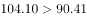
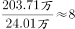

# 综合分析题（数列趋势判断＋逐年两数比较＋日均换算＋倍数计算）

考点：[[20-考点/资料分析/综合/综合分析题（数列趋势判断＋逐年两数比较＋日均换算＋倍数计算）|综合 / 综合分析题（数列趋势判断＋逐年两数比较＋日均换算＋倍数计算）]]
材料：[[15-材料/资料分析/239248 B省2015-2018年市场主体发展|239248 B省2015-2018年市场主体发展]]

**问法模型**：题干为'下列说法正确的是'的典型综合分析问法 → 采用逐项定位验证＋排除法模型：趋势看数列方向、比较逐年对数、日均=年总量÷365、倍数=分子÷分母直除，排除三项锁定唯一正确项

## 推理链
1. 第1步：A项定位表格'新登记农民专业合作社'行：2015-2018年依次为0.55、0.49、0.49、0.38万户，数列逐年下降（且2016与2017年持平），与'逐年增加'矛盾，A错误
2. 第2步：B项定位表格，逐年比较'新登记个体工商户'与'新登记企业'：2015年77.11＞61.10，2016年82.04＞79.05，2017年104.10＞90.41，2018年131.56＞97.80，四年全部成立，B正确
3. 第3步：C项取表中2017年新登记市场主体195万户＝1950000户，日均＝1950000÷365≈5342户，大于4000户，'少于4000户'不成立，C错误
4. 第4步：D项取文字第二段数据：第三产业新登记203.71万户、第二产业24.01万户（同为'新登记'流量口径），203.71÷24.01≈8.48倍，不是10倍，D错误
5. 第5步：四个选项中仅B正确，与官方答案一致

**最快解法**：⚡ 综合分析排除法：A项看数列方向一眼排除（0.55→0.38递减）；B项四组数字直接比大小全部成立可先锁定；再用C（195万÷365≈5342户/日，截位直除）、D（203.71÷24.01≈8.5倍）快速验证排除，确认选B

## 易错点
- ⚠ A项方向陷阱：农民专业合作社实为逐年减少（0.55→0.49→0.49→0.38），且2016与2017年持平（0.49=0.49）本身也非'增加'，若审题看反方向易误选
- ⚠ C项单位量级陷阱：195万户须先换算为1950000户再除以365天，若漏掉'万户→户'换算会得出约0.53而误判'少于4000户'；与文字中'日均6294户'同属'户'口径
- ⚠ D项口径与倍数陷阱：分子分母必须同用'新登记'流量数据（203.71与24.01），若误用'实有'存量（978.92/157.38≈6.2倍）则口径错误，且8.48倍勿粗看近似成10倍

## 母题抽象
> 🧩 当题干出现'下列说法正确的是'且选项分别涉及趋势判断、逐年比较、日均换算、倍数计算时，逐项定位数据验证：趋势看数列单调性、比较逐年对数、日均＝年总量÷365（万户须×10000化成户）、倍数＝分子÷分母直除，排除三项锁定唯一正确项

**同类特征**：下列说法正确的是、综合分析逐项判断、逐年增加（趋势判断）、均多于（逐年两数比较）、日均…户（万户化户换算）、是…的10倍（倍数直除）

## 相关题
- [[10-真题/资料分析/综合/10204448 综合分析-逐项判断（历史极值确认、两期比重比较、多期累计求和、基期比重）|10204448]]（广东 2024，相关度2）
- [[10-真题/资料分析/综合/2136492 综合分析判断（同比方向+倍数估算+产量大小比较+平均数同比变化）|2136492]]（河南 2017，相关度2）
- [[10-真题/资料分析/综合/2195856 综合判断题·增长倍数口径下的基期反推与定性表述可推性验证|2195856]]（黑龙江 2018，相关度1）
- [[10-真题/资料分析/综合/1772378 综合分析判断题（多选项直接查找与数据比较）|1772378]]（深圳市考 2016，相关度1）
- [[10-真题/资料分析/综合/2033342 综合分析题（增速逐年比较＋两期比重比较＋库存流量平衡式混合判断）|2033342]]（河南 2016，相关度1）

---

### 题干
下列说法正确的是（    ）。

### 选项
- A. 2015-2018年，B省新登记农民专业合作社数量逐年增加
- B. 2015-2018年，B省新登记个体工商户均多于新登记企业数　✅
- C. 2017年，B省日均新登记市场主体少于4000户
- D. 2018年，B省第三产业新登记市场主体数量是第二产业的10倍

### 官方解析

A项：定位表格数据，2015-2018年新登记农民专业合作社数量分别为0.55、0.49、0.49、0.38，并非逐年增加，错误；

B项：定位表格数据，比较2015-2018年，每年登记个体工商户数量和新登记企业数，2015年，，2016年，，2017年，，2018年，，因此新登记个体工商户均多于新登记企业数，正确；

C项：定位表格数据，2017年新登记市场主体数量为195万户，则日均为：，大于4000户，错误；

D项：定位文字材料第二段“2018年，全省三大产业新登记市场主体分别为第一产业2.02万户，第二产业24.01万户，第三产业203.71万户”，则倍数关系应为，错误。

故正确答案为B。

### 给定材料

        近年来，B省营商环境不断优化，市场活力不断增强，新登记市场主体都保持较快增长势头。2018年，全省新登记市场主体229.74万户，日均新登记市场主体6294户，同比增长。

        全省产业结构也进一步调整优化，新登记市场主体主要集中在第三产业。2018年，全省三大产业新登记市场主体分别为第一产业2.02万户，第二产业24.01万户，第三产业203.71万户。截止2018年12月末，全省三大产业的实有各类市场主体户数分别为9.83万户，157.38万户，978.92万户。

        2018年，全省新登记企业最集中的三个行业分别是批发和零售业、租赁和商务服务业、制造业，新登记企业数分别为36.14万户、15.19万户、9.25万户，分别同比增长、增长、下降。

