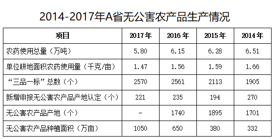

# 综合分析选非题（基期倒推+倍数判断+趋势比较+平均亩产估算）

考点：[[20-考点/资料分析/综合/综合分析选非题（基期倒推+倍数判断+趋势比较+平均亩产估算）|综合 / 综合分析选非题（基期倒推+倍数判断+趋势比较+平均亩产估算）]]
材料：[[15-材料/资料分析/239250 A省2014-2017年绿色无公害农|239250 A省2014-2017年绿色无公害农]]

**问法模型**：题干'下列说法不正确的是'→逐项定位文字段与统计表独立验证A/B/C/D四个说法，找出错误的一项

## 推理链
1. 第1步：选项A——文字段给出2017年绿色食品745个（期末存量）、当年新增绿色食品33个（流量），倒推2016年绿色食品=745-33=712个，A说法正确
2. 第2步：选项B——查表得2017年无公害农产品种植面积1050万亩、2014年332万亩，1050÷332≈3.16倍，'是2014年的3倍多'成立，B正确
3. 第3步：选项C——表中单位耕地面积农药使用量按年份正序为2014年1.66→2015年1.59→2016年1.56→2017年1.47千克/亩，逐年下降，C正确
4. 第4步：选项D——2017年平均亩产=生产总量÷种植面积=970多万吨÷1050万亩，万吨/万亩=吨/亩，970÷1050≈0.92吨/亩<1吨，'超1吨'不成立，D错误
5. 第5步：本题为选非题，说法不正确的是D，与官方答案一致

**最快解法**：⚡ 放缩估判秒杀D项：970万吨÷1050万亩，分子970<分母1050，比值必小于1（约0.92吨/亩），无需精算直接锁定D为错误说法；其余快速核验——A用745-33=712心算，B用332×3=996<1050证'3倍多'，C按年份正序1.66→1.59→1.56→1.47看趋势

## 易错点
- ⚠ D项单位与量级：万吨÷万亩=吨/亩，970'多'万吨即便放宽估成1000万吨，1000÷1050≈0.95吨/亩仍不足1吨，勿因'970多'或忽略换算误判为'超1吨'
- ⚠ C项表格列序陷阱：表中列按2017→2014排列，从左到右数值1.47→1.66是递增，必须按年份正序1.66→1.47判断'逐年下降'，时间方向读反即得出相反结论
- ⚠ A项存量与流量口径：745个是2017年期末存量、新增33个是当年流量，2016年=745-33=712；勿误用'三品一标'总数2570或忘记减去新增33个

## 母题抽象
> 🧩 当题干出现'下列说法不正确/正确的是'时，对四个选项逐项定位文字与表格独立验证：'超N/不足N'型结论用分子分母放缩秒判（970<1050⇒亩产<1吨），'是N倍'型用基期×N与大数比对，趋势判断须先把表中倒序年份读成正序

**同类特征**：不正确的是（选非题）、文字+表格跨段混查、基期倒推：现期存量-当年新增流量、倍数表述'是…的3倍多'、平均亩产=总产量÷总面积、万吨/万亩=吨/亩的单位换算

## 相关题
（暂无）

---

### 题干
下列说法不正确的是（    ）。

### 选项
- A. 2016年，A省有绿色食品712个
- B. 2017年，A省无公害农产品种植面积是2014年的3倍多
- C. 2014-2017年，A省单位耕地面积农药使用量逐年下降
- D. 2017年，A省无公害农产品平均亩产超1吨　✅

### 官方解析
A项：定位文字材料第二段可知，“（2017年）新增绿色食品33个，全省‘三品一标’总数达2570个，其中：······，绿色食品745个”。，则2016年A省有绿色食品712个，正确；
B项：定位表格可知，2017年A省无公害农产品种植面积1050万亩，2014年为332万亩。，正确；
C项：定位表格可知，2014-2017年，A省单位耕地面积农药使用量（千克/亩）分别为1.66、1.59、1.56、1.47。使用量逐年下降，正确；
D项：定位文字材料第二段可知，“（2017年）无公害农产品种植面积总计达1050万亩，生产总量970多万吨”。则2017年，A省无公害农产品平均亩产为，错误。
本题为选非题，故正确答案为D。

### 给定材料

        近年来，A省大力发展绿色无公害农业。2017年，A省农药使用总量5.80万吨，与2016年相比减少；单位耕地面积农药使用量为1.47千克/亩。

        全省新增申报无公害农产品产地认定221个，产品362个，新增绿色食品33个，认证有机食品60个。全省“三品一标”总数达2570个，其中：无公害农产品1710个，绿色食品745个，有机农产品87个，农产品地理标志28个，无公害农产品种植面积总计达1050万亩，生产总量970多万吨。

 

