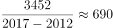
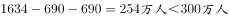
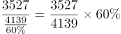
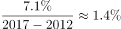
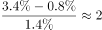

# 选非型综合判断（核心验证项：减贫规模占全国减贫总规模的比重）

考点：[[20-考点/资料分析/综合/选非型综合判断（核心验证项：减贫规模占全国减贫总规模的比重）|综合 / 选非型综合判断（核心验证项：减贫规模占全国减贫总规模的比重）]]
材料：[[15-材料/资料分析/239333 党的十八大以来（2012—2017年|239333 党的十八大以来（2012—2017年]]

**问法模型**：“无法由以上材料推出的是”→ 选非型综合判断：对四个选项分别套用年均减少量线性外推、比重=部分÷总体、下降幅度=减少量÷基期存量、发生率下降速率插值四个模型逐一验证，计算结果与选项数值矛盾（或算不出）的项即答案

## 推理链
1. 第1步：本题为选非题，逐项验证。A项提取数据：西部地区2012年末5086万人→2017年末1634万人，五年累计减少3452万人。
2. 第2步：A项用年均量外推模型：年均减少量=3452÷5=690.4万人/年；2019年末=1634−2×690.4=253.2万人<300万人，A可推出。
3. 第3步：B项提取数据：集中连片特困地区减贫3527万人；全国减贫总规模须跨段拼合=东1067+中2334+西3452=6853万人（亦可用“贫困地区减贫4139万人占六成”反推：4139÷0.6≈6898万人，量级一致）。
4. 第4步：B项用比重模型：3527÷6853≈51.5%（或3527÷6898≈51.1%），远非选项所称的34%，B项表述与材料计算结果矛盾，无法推出。
5. 第5步：C项用下降幅度模型：东部降幅=1067÷(300+1067)=1067÷1367≈78.1%；民族八省区降幅=2089÷(1032+2089)=2089÷3121≈66.9%；78.1%>66.9%，C可推出。
6. 第6步：D项用速率插值模型：中部发生率年均下降=7.1÷5=1.42个百分点/年；按官方口径，中部2017年末与东部2017年末发生率之差约2.9个百分点（原文两处起止%数值在所给文本中空缺），还需2.9÷1.42≈2年，D可推出。
7. 第7步：四项中仅B项的实际比重（约51.5%）与选项数值（34%）不符，故无法推出的是B。

**最快解法**：⚡ 锚定量优先：先拼全国减贫总规模6853万人（1067+2334+3452），对B项截位直除 3527÷6853≈51.5%≠34%，一步锁定选非答案B；其余三项代入验证即可（A：1634−2×690.4=253万<300；C：78.1%>66.9%；D：1.42×2≈2.9个百分点≈2年）。

## 易错点
- ⚠ 比重分母错配：选项B的34%恰为3527÷(6853+3527)=3527÷10380≈34%，即误把连片特困地区自身减贫规模加进分母；分母只能是全国减贫总规模6853万人。
- ⚠ 口径交叉陷阱：贫困地区（六成）、民族八省区（三成）、连片特困地区三个区域口径相互重叠，六成+三成≠全国，不能用区域数据相加或用‘六成’直接换算连片特困地区占比；全国总量只能由东+中+西拼合。
- ⚠ 选非方向与概念混淆：本题选“无法推出”项，勿反向错选“能推出”的项；“减贫规模”（减少量，万人）、“贫困人口存量”、“六成/三成”（减少量占比）三者不可互换；A项“按……计算”属假设性线性外推（材料为年末时点数，外推至2019年超出数据区间），官方认可其可推出。

## 母题抽象
> 🧩 当题干出现“无法由材料推出”的选非综合判断时，优先计算涉及“部分占总体比重”的选项：用同口径拼合出的全国总量作分母直接除出实际比重并与选项数值对照，数值矛盾者即答案；其余选项按年均外推、降幅比较（减少量÷2012年末存量）、速率插值逐一验证。

**同类特征**：无法推出（选非型综合判断）、减贫规模占全国减贫总规模的比重、集中连片特困地区3527万人、年均农村贫困人口减少量外推2019年末、下降幅度比较（东部 vs 民族八省区）、贫困发生率下降速率“还需约几年”

## 相关题
（暂无）

---

### 题干
关于农村贫困人口数据，无法由以上材料推出的是：

### 选项
- A. 
按2012年末至2017年末西部年均农村贫困人口减少量计算，2019年末我国西部地区农村贫困人口将少于300万人

- B. 
2012年末至2017年末，集中连片特困地区减贫规模占全国农村减贫总规模的
　✅
- C. 
2012年末至2017年末，农村减贫幅度东部地区要大于民族八省区

- D. 
按照中部地区农村贫困发生率下降速率计算，中部地区要达到2017年末东部地区农村贫困发生率水平还需要约2年时间

### 官方解析

A项：定位文字材料第二段“西部地区农村贫困人口由2012年末的5086万人减少到2017年末的1634万人，累计减少3452万人”，可得2012年末至2017年末西部年均农村贫困人口减少量为万人，按此计算，2019年西部地区农村贫困人口约为，正确；

B项：定位文字材料第三段可知：贫困地区2017年末农村贫困人口比2012年末减少4139万人，减贫规模占全国农村减贫总规模的六成，集中连片特困地区2017年末农村贫困人口比2012年末减少3527万人。则2012年末至2017年末，集中连片特困地区减贫规模占全国农村减贫总规模的比重为，并非34%，错误；

C项：定位文字材料第二段可知：东部地区农村贫困人口五年累计下降，定位文字材料第三段可知：民族八大省农村贫困人口下降幅度为，则农村减贫幅度东部地区要大于民族八大省，正确；

D项：定位文字材料第二段可知：2017年末东部地区农村贫困发生率为，中部地区农村贫困发生率由2012年的下降到2017年的，下降7.1个百分点。则中部地区农村贫困发生率下降速率为，按此计算，中部地区要达到2017年末东部地区农村贫困发生率，还需要年，正确。

本题为选非题，故正确答案为B。

### 给定材料

根据以下资料，回答下列问题。 

        党的十八大以来，党中央，国务院实施精准扶贫、精准脱贫基本方略，深入实施东西部扶贫协作，区域性整体贫困明显缓解，为实现到2020年现行标准下农村贫困人口脱贫，贫困县全部摘帽，解决区域性整体贫困打下了坚实基础。

        从地区看，东部地区已率先基本脱贫，中西部地区贫困人口数量全面下降，2017年末，东部地区农村贫困人口300万人，比2012年末减少1067万人，五年累计下降；农村贫困发生率由2012年末的下降到，下降3.1个百分点，已率先基本实现脱贫。中部地区农村贫困人口由2012年末的3446万人减少到2017年末的1112万人，累计减少2334万人，下降幅度为。农村贫困发生率由下降到，下降7.1个百分点。西部地区农村贫困人口由2012年末的5086万人减少到2017年末的1634万人，累计减少3452万人，下降幅度为；农村贫困发生率由2012年末的下降到2017年末的，下降12.0个百分点。

        从贫困区域看，贫困地区、集中连片特困地区，民族八省区减贫成效更加突出，区域性整体贫困明显缓解。贫困地区2017年末农村贫困人口1900万人，比2012年末减少4139万人，减贫规模占全国农村减贫总规模的六成；农村贫困发生率从2012年末的下降至2017年末的，五年累计下降16.0个百分点，年均下降3.2个百分点。集中连片特困地区2017年末农村贫困人口1540万人，比2012年末减少3527万人，下降幅度为；农村贫困发生率从2012年末的下降至2017年末的，累计下降17.0个百分点，年均下降3.4个百分点。内蒙古、广西、贵州、云南、西藏、青海、宁夏、新疆等民族八省区2017年末农村贫困人口1032万人，比2012年末减少2089万人，下降幅度为，减贫规模占全国农村减贫规模的三成；农村贫困发生率从2012年末的下降至2017年末的，累计下降14.2个百分点，年均下降2.8个百分点。

