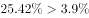

# 比值型指数升降的定性归因（分子分母增长率比较）

考点：[[20-考点/资料分析/综合/比值型指数升降的定性归因（分子分母增长率比较）|综合 / 比值型指数升降的定性归因（分子分母增长率比较）]]
材料：[[15-材料/资料分析/239373 2018年中国就业市场CIER景气指|239373 2018年中国就业市场CIER景气指]]

**问法模型**：题干问'CIER指数第四季度比第三季度上升的原因表述正确的是'→ 将指数视为'招聘需求人数/求职申请人数'的比值，用分数性质做定性判断：比值上升且分子分母同增⇔分子增幅大于分母增幅

## 推理链
1. 第1步：从文字材料提取条件：2018年第三季度CIER指数为1.97，第四季度为2.38，第四季度比第三季度上升0.41个指数点，即'需求/申请'这一比值变大
2. 第2步：所用规则：CIER指数为招聘需求人数与求职申请人数之比（比值型指数），分子分母同向增加时，比值上升⇔分子增长率＞分母增长率
3. 第3步：核对变化方向：文字明确'第四季度招聘需求人数环比增加，求职申请人数环比增加'，即分子分母均为增加，可先排除以'求职申请人数减少比率'为表述的C、D两项
4. 第4步：由比值上升0.41个指数点且两者双增，推知招聘需求人数的增加比率必然大于求职申请人数的增加比率，对照选项，A符合、B相反，故选A

**最快解法**：⚡ 分数性质定性判断（免算具体百分数）：先由'第四季度需求、申请双增'排除C/D；再由指数1.97→2.38上升知比值变大，分子分母同增下必有分子（需求）增幅＞分母（申请）增幅，直接锁定A

## 易错点
- ⚠ C、D两项偷换方向：把文字中'求职申请人数环比增加'偷换成'减少'，若只盯'指数上升'而不核对分子分母变化方向，就会在C/D与A/B之间摇摆出错
- ⚠ 材料中环比百分数留空，本题走定性逻辑即可，切勿试图凭空补数或硬算具体比率；也不可把指数上升的0.41个指数点当成增长比率使用
- ⚠ '增加比率'是相对第三季度的环比口径，勿误作同比；两张表（行业/职业）数据与本题无关，跳入表格读数即浪费时间

## 母题抽象
> 🧩 当题干出现'某比值型指数上升/下降，原因或说法正确的是'且分子分母同向变化时，用分数性质：比值上升⇔分子增长率＞分母增长率（下降则反之），先核对分子分母变化方向排除偷换方向的选项，再比较增速大小

**同类特征**：CIER指数比第三季度上升、原因表述正确、招聘需求人数、求职申请人数、环比增加（分子分母双增）、增加比率大小比较

## 相关题
（暂无）

---

### 题干
2018年第四季度的CIER指数比第三季度有所上升，对其原因表述正确的是：

### 选项
- A. 招聘需求人数增加比率大于求职申请人数增加比率　✅
- B. 招聘需求人数增加比率小于求职申请人数增加比率
- C. 招聘需求人数增加比率大于求职申请人数减少比率
- D. 招聘需求人数增加比率小于求职申请人数减少比率

### 官方解析

定位文字材料，“”，及“第四季度招聘需求人数环比增加，求职申请人数环比增加”，，可知招聘需求人数增加比率大于求职申请人数增加比率。

故正确答案为A。

### 给定材料

根据以下资料，回答下列问题。

        CIER指数用来反映就业市场景气程度，其计算方法是：。根据有关机构发布的数据，2018年第一季度CIER指数为1.91，第二季度为1.88，第三季度为1.97，第四季度为2.38。2018年第三季度，招聘需求人数环比下降，求职申请人数环比下降；第四季度招聘需求人数环比增加，求职申请人数环比增加。

