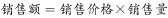
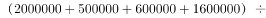
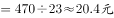

# 综合判断题——两期平均单价（总销售额÷总销售量）比较与逐项排除

考点：[[20-考点/资料分析/综合/综合判断题——两期平均单价（总销售额÷总销售量）比较与逐项排除|综合 / 综合判断题——两期平均单价（总销售额÷总销售量）比较与逐项排除]]
材料：[[15-材料/资料分析/239407 某水产公司甲、乙、丙、丁四种鱼类产品|239407 某水产公司甲、乙、丙、丁四种鱼类产品]]

**问法模型**：'下列说法正确的是'综合判断题 → 对四个选项逐一验证：正确项用'总销售额÷总销售量'派生两期平均单价比方向，错误项用数据可得性（因果/利润）和找反例（丁也降价）排除

## 推理链
1. 第1步：从表中提取两期汇总数据：第一季度总销售额=200+50+60+160=470万元、总销售量=100000+40000+40000+50000=230000公斤；第二季度总销售额=235+60+70+120=485万元、总销售量=80000+60000+35000+48000=223000公斤
2. 第2步：单位公斤价格=总销售额÷总销售量，万元/公斤换算为元/公斤需×10000
3. 第3步：第一季度单价=470万÷230000公斤≈20.4元/公斤；第二季度单价=485万÷223000公斤≈21.7元/公斤，第二季度单价上涨，A项正确
4. 第4步：B项——甲销售额200→235万元上升而销售量100000→80000公斤下降，依'销售额=价格×销量'只能推出价格必涨，但'价格涨是否为销量下滑的主要原因'材料无法判断，B错
5. 第5步：C项——乙单价50万/40000=12.5元/公斤→60万/60000=10元/公斤确实下降，但丁单价160万/50000=32元/公斤→120万/48000=25元/公斤同样下降，乙并非唯一降价产品，C错
6. 第6步：D项——材料只给销售额和销售量，无利润数据，无法判断利润是否提高，D错；故正确答案为A

**最快解法**：⚡ 先加总后相除+分子分母同向比较：A项只需比较485/223000与470/230000——第二季度分子变大（470→485）而分母变小（230000→223000），分数必然变大，单价必涨，无需算出具体数值即可锁定A；再快速排除：B'主要原因'、D'利润'均为材料外信息直接判错；C用找反例法验证丁（32→25元/公斤）也降价即推翻

## 易错点
- ⚠ 单位换算陷阱：销售额（万元）÷销售量（公斤）得到万元/公斤，与'元/公斤'差10000倍，比较涨跌方向不受影响，但写出具体数值必须×10000（如470万÷230000公斤≈20.4元/公斤而非0.00204）
- ⚠ 平均单价必须'先加总再相除'（总销售额÷总销售量），不能把四种产品各自单价简单算术平均，也不能拿总销售额涨幅（485/470≈3.2%）冒充单价涨幅
- ⚠ 因果与数据边界陷阱：B项量价反向只能推出'价格必涨'这一必然结论，'主要原因'属因果判断材料给不出；D项利润材料未给；C项需逐项核对四产品，漏看丁降价（32→25元/公斤）会误选C

## 母题抽象
> 🧩 当题干出现'说法正确的是'且正确项涉及'单位价格/平均价格环比变化'时，用'两期总额÷两期总量'派生平均数并比较方向（分子分母一升一降可直接定涨跌），其余选项优先用'材料数据可得性'（因果、利润等无法判断）和'找反例'排除

**同类特征**：说法正确的是、单位公斤价格、较上季度上涨、销售额=销售价格×销售量、量价反向变动、综合判断排除法

## 相关题
- [[10-真题/判断推理/定义判断/19283906 多定义辨析-并列定义（薪酬水平策略vs薪酬结构策略）|19283906]]（国考 2025，相关度1）
- [[10-真题/判断推理/定义判断/10204592 单定义-要件对应（数学命题的逆命题-否命题-逆否命题变形规则）|10204592]]（黑龙江 2024，相关度1）
- [[10-真题/判断推理/科学推理/2261911 化学-水的净化（过滤与吸附原理及装置层序）|2261911]]（广东 2019，相关度1）

---

### 题干
根据上述资料，下列说法正确的是：

### 选项
- A. 第二季度水产公司鱼类产品单位公斤价格较上季度上涨　✅
- B. 甲销量下滑的主要原因是其价格上涨
- C. 乙是四类鱼产品中唯一降价的产品
- D. 水产公司的鱼类产品利润提高

### 官方解析

A项：定位表格材料数据，根据可知：第一季度水产公司鱼产品单位公斤价格为；第二季度水产公司鱼产品单位公斤价格为，故第二季度水产公司鱼产品单位公斤价格较上季度上涨，正确；

B项：定位表格材料数据，根据销售额=销售价格×销售量可知：甲产品第二季度销售额上涨，但销售量有所减少，则其销售价格一定上涨。但是价格上涨是不是甲销量下滑的主要原因，根据材料无法得知，错误；

C项：定位表格材料数据，根据销售额=销售价格×销售量可知：甲、丙两产品第二季度销售额上涨，但销售量有所减少，则其销售价格一定上涨；第一季度丁产品销售价格为元；第二季度丁产品销售价格为元，所以第二季度丁产品销售价格下降，乙并不是四类鱼产品中唯一降价的产品，错误；

D项：题目中只给出鱼类的销售额和销售量，未给出利润相关数据。所以无法判断，错误。

故正确答案为A。

### 给定材料

根据所给资料，回答下列问题。

        某水产公司共销售甲、乙、丙、丁四种鱼类产品。其在两个季度的销售额和销售量情况如下：

