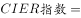
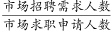
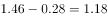

# 综合判断（选非题）：指数升降推需求量+基期反推（现期−变化量）找最低

考点：[[20-考点/资料分析/综合/综合判断（选非题）：指数升降推需求量+基期反推（现期−变化量）找最低|综合 / 综合判断（选非题）：指数升降推需求量+基期反推（现期−变化量）找最低]]
材料：[[15-材料/资料分析/239373 2018年中国就业市场CIER景气指|239373 2018年中国就业市场CIER景气指]]

**问法模型**：'下列说法错误的是'选非模型→逐项验证：A比排名与变化量、B由指数升降判断需求量（比值升降不可锁定分子）、C由指数<1判断供大于求、D用'第四季度指数−比上一季度变化'反推第三季度指数找最低

## 推理链
1. 第1步：题干为选非题，逐项验证；提取表2数据：技工/操作工Q4指数25.67、变化0.82；教育/培训16.24、变化8.51；信托/担保/拍卖/典当1.46、变化0.28；表1：航空航天研究与制造指数0.58
2. 第2步：A项验证：表2中技工/操作工指数25.67居较好职业榜首，变化量0.82远小于教育/培训8.51、社区服务4.78、烹饪3.5等，波动较小，说法与材料相符
3. 第3步：B项验证：教育/培训Q4指数16.24，反推Q3=16.24−8.51=7.73，指数确有上升；但CIER指数=招聘需求/求职申请之比，比值上升既可能因需求增大、也可能因申请人数减少，仅凭指数变化无法判断'需求量增大'，该说法于材料无据
4. 第4步：C项验证：航空航天研究与制造指数0.58<1，说明招聘需求人数<求职申请人数，供大于求、人才不稀缺，说法正确
5. 第5步：D项验证：按'基期=现期−变化量'反推较差职业栏Q3指数：高级管理1.07−(−0.32)=1.39、公关/媒介1.36−0.17=1.19、信托/担保/拍卖/典当1.46−0.28=1.18、IT管理1.55−(−0.1)=1.65、汽车制造1.8−(−0.49)=2.29等，最低为信托/担保的1.18；较好栏反推后均≥6以上（如翻译7.67−1.58=6.09），故已列职业中Q3景气最差确为信托/担保/拍卖/典当，说法正确
6. 第6步：A、C、D均正确，B错误，本题选错误项，答案为B

**最快解法**：⚡ 选非题逐项排错：B项用'比值性质'秒杀——指数上升（8.51）只是需求/申请之比变大，分子分母方向不定，'需求量增大'无法判定，直接锁定；D项用'基期=现期−增长量'截位心算反推较差栏（负变化量要加回：1.07+0.32=1.39），最低1.18即信托/担保，验证D正确

## 易错点
- ⚠ B项是典型'比值升降≠分子变化'陷阱：把'CIER指数由7.73升至16.24'误读为'需求量增大'；指数上升也可能由求职申请人数下降造成，材料中环比百分数留空，无据断定需求量
- ⚠ D项反推符号易错：'比上一季度变化'为负（高级管理−0.32、IT管理−0.1、汽车制造−0.49）时，基期=现期−(负值)=现期+|变化|，符号弄反会错判第三季度最低值（如误认为IT管理1.65最低）
- ⚠ 口径陷阱：'已列职业'须较好+较差两栏拼接统计，且'教育/培训'是职业、'教育培训院校'是行业，跨表混用即错；变化量是指数点增量而非增长率，不能用'现期÷(1+变化率)'处理

## 母题抽象
> 🧩 当综合判断题出现'比值型指标（指数/比重/平均数）上升/下降'的表述时，警惕'比值变化无法唯一确定分子（需求量）变化'，据此可秒判'由指数升降推需求增减'类说法错误；涉及'基期最值'时统一用'现期−变化量'反推并注意负增量加回

**同类特征**：说法错误的是（选非题）、第三、第四季度综合判断、CIER指数及比上一季度变化、由指数升降推需求量变化、反推第三季度指数比大小、景气较好/较差两栏拼接

## 相关题
- [[10-真题/资料分析/综合/5509930 综合分析选非题（自然增长率做差趋势+抚养比趋势直读+劳动人口负担比临界值判断）|5509930]]（内蒙古 2023，相关度1）
- [[10-真题/资料分析/综合/3018827 综合分析选非题（基期比重定界+月均比较+假设法求季度增速+基期量可计算性判断）|3018827]]（广东 2021，相关度1）

---

### 题干
下列关于2018年第三、第四季度的相关信息说法错误的是：

### 选项
- A. 在第四季度，技工/操作工位于就业景气较好职业榜首，且与其它职位相比，其就业市场景气程度季度波动较小
- B. 在第四季度，市场对教育/培训类人才需求量增大　✅
- C. 航空/航天研究与制造位居第四季度就业景气较差行业榜首，说明该行业人才并不稀缺
- D. 在第三季度，已列职业中，就业景气最差的是信托/担保/拍卖/典当

### 官方解析

A项：定位表2，2018年第四季度技工/操作工CIER指数最高，且与上一季度相比变化较小，即波动较小，正确；

B项：定位表2，可知第四季度教育/培训类人才CIER指数大于第三季度，但只知道指数变化，无法得知人才需求量的变化，错误；

C项：根据文字材料第一段，CIER指数用来反映就业市场的景气程度，，定位表1，航空/航天研究与制造CIER指数小于1，说明该行业市场招聘需求人数小于市场求职申请人数，即市场求职申请人数相对于招聘需求人数较饱和（供大于求），故该行业人才并不稀缺，正确；

 D项：定位表2，2018年第三季度，信托/担保/拍卖/典当，是已列职业中指数最低的，反映就业景气最差，正确；

本题为选非题，故正确答案为B。

### 给定材料

根据以下资料，回答下列问题。

        CIER指数用来反映就业市场景气程度，其计算方法是：。根据有关机构发布的数据，2018年第一季度CIER指数为1.91，第二季度为1.88，第三季度为1.97，第四季度为2.38。2018年第三季度，招聘需求人数环比下降，求职申请人数环比下降；第四季度招聘需求人数环比增加，求职申请人数环比增加。

