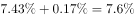
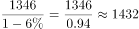
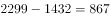
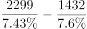
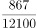
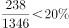

# 综合判断（两期比重环比变化＋基期反推＋比重求整体＋现期占比）

考点：[[20-考点/资料分析/综合/综合判断（两期比重环比变化＋基期反推＋比重求整体＋现期占比）|综合 / 综合判断（两期比重环比变化＋基期反推＋比重求整体＋现期占比）]]
材料：[[15-材料/资料分析/239409 全国互联网保险收入（总量及财产险、人|239409 全国互联网保险收入（总量及财产险、人]]

**问法模型**：题干为'能够从上述资料中推出的是'的综合判断问法 → 对四选项逐项建模验证：缺基期数据的判'推不出'，现期占比用部分÷整体直除，比重求整体用部分÷占比，两期比重变化用'百分点回推＋基期反推'拼出中间期再比大小。

## 推理链
1. 第1步：提取数据：2016全年互联网保费2299亿元（同比增加、占全国总保费比重记为a%，较2016上半年占比减少d个百分点）；2017上半年互联网保费1346亿元（同比减少r%、占全国总保费比重记为b%）；其中互联网财产险238亿元。文中各百分数均空缺，仅以占位符表述、不得臆补，验证结论依官方解析。
2. 第2步：D项不需空缺数据即可验算：现期占比＝238÷1346，截位直除≈17.7%＜两成（20%），'高于两成'不成立，D错误。
3. 第3步：A项：材料只给互联网保费的同比增速，全国总保费的2015年数值与同比均未给出，无法比较2016年与2015年总保费水平，属'推不出'，A错误。
4. 第4步：B项按'部分÷比重求整体'：2016全国财产险保费＝502÷财产险占比，2016全国人身险保费＝1797÷人身险占比（分母分别为全国财产险保费/全国人身险保费）；官方代入原题占比计算，财产险保费小于人身险保费的一半，'超过一半'不成立，B错误。
5. 第5步：C项回推2016上半年：上半年互联网占总保费比重＝a%＋d个百分点（'较上半年占比减少'须按百分点加法回加）；上半年互联网保费＝1346÷(1−r%)（由2017上半年同比减少率作基期反推）。
6. 第6步：C项拼2016下半年并比大小：下半年互联网保费＝2299−上半年互联网保费；全年总保费＝2299÷a%，上半年总保费＝上半年互联网保费÷(a%＋d)，下半年总保费＝全年−上半年；下半年占比＝下半年互联网保费÷下半年总保费；官方按原题数值验证：下半年占比＜上半年占比，且2017上半年占比b%＜下半年占比，两期均环比下降，C正确。
7. 第7步：综上，A推不出、B与D均不成立，唯一能推出的是C，与官方答案一致。

**最快解法**：⚡ 综合判断排除法，优先做不依赖空缺百分数的选项：D项238/1346截位直除首两位17.x＜20%（两成）秒排；A项总保费无2015年数据直接排除；再验C——用'全年占比＋减少的百分点'回加出2016上半年占比、'1346÷(1−r)'反推上半年保费、'2299−上半年'与'全年总保费−上半年总保费'拼出下半年，三期比重逐期下降（官方数值下成立）即锁定C。

## 易错点
- ⚠ 百分点与百分比混淆：'较2016上半年占比减少d个百分点'是百分点差，回推上半年占比必须用加法（全年占比＋d），误当百分数参与乘除必错。
- ⚠ 三套分母口径不能混：财产险占比分母是全国财产险保费、人身险是全国人身险保费、总量是全国总保费；B项须分别用各自分母反推整体，切勿用总保费比重或互联网内部结构占比替代。
- ⚠ '推不出'与'环比'口径：A项材料未给全国总保费的2015年数据或同比，属无法推出（勿脑补总保费同比）；C项'环比'指下半年对上半年、2017上半年对2016下半年的半年环比，2016下半年比重须由'全年−上半年反推值'拼出，直接拿2017上半年占比与2016全年占比比较会误判。

## 母题抽象
> 🧩 当综合判断题问'能够从上述资料中推出的是'且选项混有占比、基期比较时：先扫可计算性——缺上年数据（无同比或基期值）的判'推不出'，纯现期占比用截位直除对照'两成/一半'等整数门槛秒杀，两期比重变化用'百分点加减回推基期占比＋现期÷(1±r)反推基期额'拼中间期再比大小验证。

**同类特征**：能够从上述资料中推出的是（综合判断四选项）、低于上年水平（缺基期数据的推不出型选项）、超过……的一半（部分÷比重求整体后作倍数比较）、均环比下降（两期比重逐期变化，需拼中间期）、高于两成（现期占比对照20%整数门槛）、下半年＝全年−上半年反推值的跨段拼合

## 相关题
（暂无）

---

### 题干
能够从上述资料中推出的是：

### 选项
- A. 2016全国总保费收入低于2015年水平
- B. 2016年全国财产险保费收入超过人身险保费收入的一半
- C. 2016年下半年及2017年上半年互联网保费占总保费收入比重均环比下降　✅
- D. 2017年上半年互联网财产险收入在同期互联网保险收入中的占比高于两成

### 官方解析

A项：定位文字材料第一段“2016年全年全国互联网保险收入为2299亿元，同比增加，占全国总保费收入的，较2016年上半年占比减少”，没有2015年全国总保费相关的数据，故无法推出，错误；

B项：定位文字材料第一段可知：2016年全年互联网财产险收入为502亿元，占全国财产险保费收入的，互联网人身险收入为1797亿元，同比增加，占全国人身险保费收入。可则2016年全国财产险保费收入为亿元，2016年全国人身险保费收入为亿元，故财产险保费收入小于人身险保费收入的一半，错误；

C项：定位文字材料第一段“2016年全年全国互联网保险收入为2299亿元，同比增加，占全国总保费收入的，较2016年上半年占比减少”，定位文字材料第二段“2017年上半年全国互联网保险收入为1346亿元，同比减少，占全国总保费收入的”。则2016年上半年互联网保费占总保费的比重为。根据基期公式：，可知2016年上半年互联网保险收入为亿元，则2016年下半年互联网保险收入为亿元，2016年下半年总保费为，故2016年下半年互联网保险收入占保费的比重为。所以2016年下半年的比重比上半年有所下降，2017年上半年的比重比2016年下半年有所下降，正确；

 D项：定位文字材料第二段“2017年上半年全国互联网保险收入为1346亿元，······互联网财产险收入为238亿元”，故2017年上半年互联网财产险收入在同期互联网保险收入中占比为，错误。

故正确答案为C。

### 给定材料

根据以下资料，回答下列问题。

        2016年全年全国互联网保险收入为2299亿元，同比增加，占全国总保费收入的，较2016年上半年占比减少。其中互联网财产险收入为502亿元，同比减少，占全国财产险保费收入的，较2016年上半年占比减少；互联网人身险收入为1797亿元，同比增加，占全国人身险保费收入的，较2016年上半年占比增加。

        2017年上半年全国互联网保险收入为1346亿元，同比减少，占全国总保费收入的。其中互联网财产险收入为238亿元，同比减少，占全国财产险保费收入的；互联网人身险收入为1108亿元，同比减少，占全国人身险保费收入的。

