# 综合判断题（定基增速与环比增速逐年验证，跨图表比重换算）

考点：[[20-考点/资料分析/综合/综合判断题（定基增速与环比增速逐年验证，跨图表比重换算）|综合 / 综合判断题（定基增速与环比增速逐年验证，跨图表比重换算）]]
材料：[[15-材料/资料分析/239412 2014-2018年我国软件行业收入|239412 2014-2018年我国软件行业收入]]

**问法模型**：题干给出四个'每年…增速高于/低于…'类说法，问'下列说法正确的是' → 综合判断题，先辨口径（'较2014年的年度同比增速'=以2014为基期的定基增速，'年度环比增速'=逐年环比），再用'收入比值=合计比值×占比比值'消去共因子逐项验证，找一年反例即可排除

## 推理链
1. 第1步：A项为定基增速（基期2014）：中部2015年1978/1658-1≈19.3%高于东部32917/28086-1≈17.2%，2016年2303/1658-1≈38.9%高于38119/28086-1≈35.7%，但2017年2497/1658-1≈50.6%低于东部43575/28086-1≈55.2%，A错误
2. 第2步：B项为环比增速：2016年西部5288/4410-1≈19.9%明显高于全国48511/43248-1≈12.2%，'每年都低于'不成立，B错误（2015年西部4410/3782-1≈16.6%与全国43248/37088-1≈16.6%几乎持平，此处需精算勿粗判）
3. 第3步：C项信息技术服务收入=合计×占比，其定基增速比值=(合计_t/合计_2014)×(占比_t/占比_2014)，其中合计比值与全国定基增速比值完全相同，可消去，只需比较占比
4. 第4步：2014年信息技术服务占比50.40%，2015-2018年占比为51.30%/51.80%/53.30%/55.10%，逐年均大于50.40%，故每年信息技术服务定基增速>全国定基增速，C正确
5. 第5步：D项环比增速比值=(合计_t/合计_{t-1})×(占比_t/占比_{t-1})，合计因子相同只比占比比值：2015年软件产品32.30/32.50≈0.994>嵌入式16.40/17.10≈0.959（对应环比15.9%>11.8%），满足
6. 第6步：2016年软件产品31.70/32.30≈0.981<嵌入式16.50/16.40≈1.006（对应环比10.1%<12.8%，嵌入式占比回升），'每年都高于'被2016年打破，D错误
7. 第7步：综上只有C项四个年份全部成立，对照选项确定答案为C

**最快解法**：⚡ 共因子消去（比值拆分）+反例排除法：子行业收入=合计×占比，定基/环比增速比值中合计因子与全国一致可直接消去，只比占比比值；C项一眼验证'2015-2018占比51.3/51.8/53.3/55.1是否都>2014年50.4'即判正确；A、B、D各找一年反例快速排除（A看2017年东部55.2%>中部50.6%，B看2016年西部19.9%>全国12.2%，D看2016年嵌入式占比16.40%→16.50%回升而软件产品32.30%→31.70%下降）

## 易错点
- ⚠ 口径混淆：'较2014年的年度同比增速'实为以2014为固定基期的定基增速，'年度环比增速'为逐年环比，A/C用定基、B/D用环比，两套口径混用必错
- ⚠ 图2只给占比不给绝对值，比较子行业增速必须先'合计×占比'还原或用共因子消去，直接拿占比大小当增速比较是最大陷阱
- ⚠ 占比下降≠增速下降：软件产品占比逐年降但收入仍正增长；2016年嵌入式占比16.40%→16.50%回升直接导致D失效；B项2015年西部与全国环比增速同为约16.6%几乎持平，粗略估算易在该年误判

## 母题抽象
> 🧩 当综合判断题出现'每年……增速都高于/低于……'特征时，先辨口径（'较某年'=定基、'环比'=逐年），写出'增速比值=总量比值×占比比值'，共因子相同则只比占比比值，找任意一年反例即可排除该项，全部年份成立的才选

**同类特征**：下列说法中正确的是、每年……增速高于/低于、较2014年的年度同比增速（实为定基）、年度环比增速、占比×合计还原子行业收入、跨图表（表1+图2）综合验证

## 相关题
- [[10-真题/资料分析/综合/2051728 综合判断题（两列加总计数+占比口径核对+合计差值方向逐项验证）|2051728]]（陕西 2017，相关度1）

---

### 题干
根据以上资料，下列说法中正确的是（  ）

### 选项
- A. 2015-2018年，每年我国中部地区软件行业总收入较2014年的年度同比增速高于同期东部地区软件行业总收入较2014年的年度同比增速
- B. 2015-2018年，每年我国西部地区软件行业总收入的年度环比增速低于同期全国软件行业总收入的年度环比增速
- C. 2015-2018年，每年我国信息技术服务的总收入较2014年的年度同比增速都高于同期全国软件行业总收入较2014年的年度同比增速　✅
- D. 2015-2018年，每年我国软件产品总收入的年度环比增速都高于同期嵌入式产品总收入的年度环比增速

### 官方解析

A项：定位统计表，15年中部地区的增长率为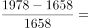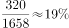，东部地区增长率为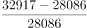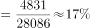，满足；16年中部地区的增长率为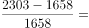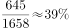，东部地区增长率为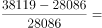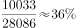，满足；17年中部地区的增长率为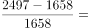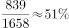，东部地区的增长率为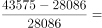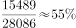，可以发现17年东部地区增长率大于中部地区，错误；

B项：定位统计表，15年西部地区的增长率为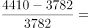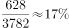，全国的增长率为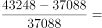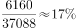；16年西部地区增长率为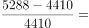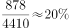，全国的增长率为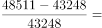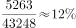，由此可以发现16年西部地区增速明显高于全国，错误； 

C项：定位图形和表格，现期值、基期值已知，，故只需要比较即可。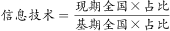，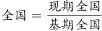，则只需要比较信息技术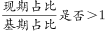即可。因为基期不变，都是14年，14年占比为，15-18年占比均大于，所以15-18年每年信息技术增速大于全国增速，正确；

D项：与C项同理，增长率比较，软件产品、嵌入式产品总体相同，只需要比较占比即可。15年，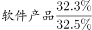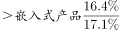，满足；16年，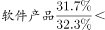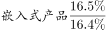，不满足，错误。

故正确答案为C。

### 给定材料

 根据以下资料，回答下列问题 

