# 综合分析——四选项逐项判断（增长项数清点+减少量比较+自定义口径合计+增幅高低比较）

考点：[[20-考点/资料分析/综合/综合分析——四选项逐项判断（增长项数清点+减少量比较+自定义口径合计+增幅高低比较）|综合 / 综合分析——四选项逐项判断（增长项数清点+减少量比较+自定义口径合计+增幅高低比较）]]
材料：[[15-材料/资料分析/239413 2008年与2018年我国居民一天主|239413 2008年与2018年我国居民一天主]]

**问法模型**：“下列说法正确的是”综合判断题 → 先验证数据表述最具体、可与表格行列直接对照的选项，逐项套用增长率（差值÷基期）、减少量（分钟差）、合计加总三个模型排除

## 推理链
1. 第1步：A项锁定“男”列逐项清点2018-2008为正的活动：睡觉休息+16、个人卫生护理+2、就业工作+38、陪伴照料家人+17、健身锻炼+8、听广播或音乐+5、休闲娱乐+28、社会交往+5、学习培训+2，共9项≠8项，A排除
2. 第2步：B项锁定“女”列比减少量：家庭生产经营活动76-109=-33分钟，而交通活动33-67=-34分钟，减少最多的是交通活动而非家庭生产经营活动，B排除
3. 第3步：C项锁定“城镇”列按题干自定义口径加总：工作和劳动2018=197+42+79=318、2008=195+111+101=407，318-407=-89分钟，前半句“减少”成立
4. 第4步：休闲活动2018=41+6+98+12+69=226、2008=36+1+133+18+48=236，226-236=-10分钟，实为减少而非“增加”，C排除
5. 第5步：D项算农村vs全国增幅——睡觉休息：农村(563-545)/545=18/545≈3.3%＞全国(559-542)/542=17/542≈3.1%（18×542=9756＞17×545=9265），满足
6. 第6步：个人卫生护理：农村(47-42)/42=5/42≈11.9%＞全国(50-46)/46=4/46≈8.7%；就业工作：农村(145-98)/98=47/98≈48.0%＞全国(177-149)/149=28/149≈18.8%，均满足
7. 第7步：休闲娱乐：农村(58-22)/22=36/22≈163.6%＞全国(65-35)/35=30/35≈85.7%；四项增幅全部高于全国平均水平，D正确

**最快解法**：⚡ 综合题“先验具体项”策略+截位直除/倍数速判：D项四组增幅量级差距明显——就业工作47/98≈48%约为28/149≈19%的2.5倍，休闲娱乐36/22＞100%而30/35＜100%（倍增vs非倍增），个人卫生护理5/42≈12%对4/46≈9%，仅睡觉休息18/545与17/542接近需交叉相乘判定；A/B/C各找一个反例速杀（A数项数=9、B比较-34与-33、C加总226＜236），考场可直接先验D

## 易错点
- ⚠ A项双重陷阱：男性时间增加的是9项而非8项；且即便按增速比较，听广播或音乐(1→6，+500%)也远高于陪伴照料家人(13→30，约+131%)，数项数、比增速两个角度都会判错
- ⚠ B项近值陷阱：女性家庭生产经营-33与交通活动-34仅差1分钟，漏看交通活动行即误判“减少最多”；而“陪伴照料家人增长最多”(75-33=+42)这半句本身是对的，易被整体打包误判为对
- ⚠ C项需按题干自定义口径现场加总（3项/5项分项），加错任一分项即错；城镇休闲2018合计226＜2008合计236，实为减少10分钟，与选项“增加”表述相反
- ⚠ 综合题四个选项口径列各不相同（男/女/城镇/农村），必须先锁定题干口径列再取数，防横向串列（如误用全国177代替城镇197）

## 母题抽象
> 🧩 当题干出现“下列说法正确的是”综合判断时，先验证数据表述最具体、可直接与表格行列对照的选项；“增幅均高于”类逐项用(现期-基期)/基期比较、量级悬殊时截位即可；“合计数”类按题干给定活动清单现场加总后再比较增减方向

**同类特征**：下列说法正确的是（综合判断）、男性增加活动项数与最高增速、女性减少最多/增长最多、城镇工作劳动合计与休闲合计、农村四项增幅均高于全国水平、2008与2018两时点多口径对比

## 相关题
- [[10-真题/资料分析/综合/2385119 综合判断题（进出口总额加总+增长量计算+趋势-倍数-增速逐项验证）|2385119]]（深圳市考 2019，相关度1）
- [[10-真题/资料分析/综合/2443054 综合判断题（混合增长率方向判断为主，辅以隔年基期两步折算、图表缺项可求性、无据归因排查）|2443054]]（辽宁 2019，相关度1）
- [[10-真题/资料分析/综合/1752634 综合判断题（混合比重居中定单月比重+折线图累计增速读图比较）|1752634]]（北京 2016，相关度1）
- [[10-真题/资料分析/综合/2187804 综合判断题（基期差值＋增长率比较＋部分差值＋混合居中多模型混合验证）|2187804]]（黑龙江 2018，相关度1）
- [[10-真题/资料分析/综合/2166222 综合判断题·倍数关系验证与顺逆差符号辨析|2166222]]（深圳市考 2018，相关度1）

---

### 题干
根据以上资料，下列说法正确的是（  ）。

### 选项
- A. 与2008年相比，2018年我国男性居民花费在8项活动上的平均时间有所增加，其中花费在陪伴家人上的平均时间的增速最高
- B. 与2008年相比，2018年我国女性居民花费在家庭生产经营活动上的平均时间减少最多，而陪伴照料家人的时间增长最多
- C. 与2008年相比，2018年我国城镇居民花费在工作和劳动上（就业工作、家庭生产经营活动、家务劳动的合计数）的平均时间减少了，花费在休闲活动上（健身锻炼、听广播和音乐、看电视、阅读书报期刊、休闲娱乐的合计数）的平均时间增加了
- D. 与2008年相比，2018年我国农村居民花费在休息睡觉、个人卫生护理、就业工作和休闲娱乐这四项活动上的平均时间的增幅均高于同期同类活动的全国居民平均水平的增幅　✅

### 官方解析

A项： 2018年我国男性居民花费平均时间增加的有睡觉休息、个人卫生护理、就业工作、陪伴照料家人、健身锻炼、听广播或音乐、休闲娱乐、社会交往、教育培训共9项活动，不是8项，错误；

B项：2018年我国女性居民花费在家庭生产经营活动上的平均时间减少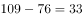分钟，而交通活动时间减少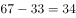，交通活动时间减少更多，错误；

C项：定位表格可知，2018年我国城镇居民花费在工作和劳动上的平均时间为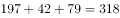,2008年为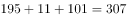，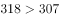，故平均时间增加，错误；

D项：定位表格可知，与2008年相比，2018年我国农村居民花费在休息睡觉活动上的平均时间的增幅为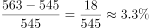；同期休息睡觉活动全国居民平均水平的增幅为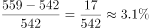，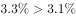，满足要求；2018年我国农村居民花费在个人卫生护理的平均时间的增幅为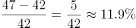；同期个人卫生护理活动全国居民平均水平的增幅为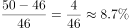，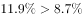，满足要求；

2018年我国农村居民花费在就业工作的平均时间的增幅为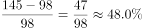；同期就业工作活动全国居民平均水平的增幅为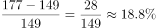，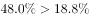，满足要求；

2018年我国农村居民花费在休闲娱乐的平均时间的增幅为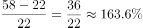；同期休闲娱乐全国居民平均水平的增幅为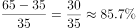，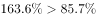，满足要求。

故正确答案为D。

### 给定材料

根据以下资料，回答下列问题

        2008与2018年我国居民一天主要活动平均时间   单位：分钟

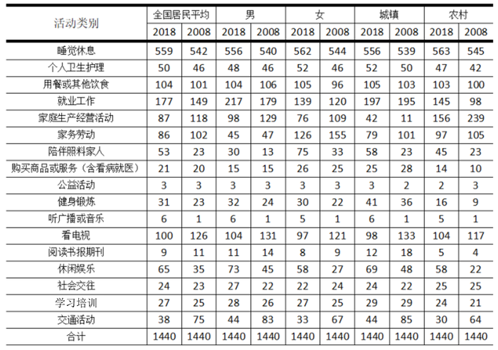

注：1.部分数据因四舍五入的原因，存在总计与分项合计不等的情况；

2.2008年数据根据2018年统计口径有所合并和调整。

> [!warning] 疑点（官方解析可能有误，待人工复核）
> 官方解析因排版缺失多处关键数值（B项“减少分钟”缺-33、交通“减少”缺-34；C项缺318/407与休闲226/236；D项增幅数值全缺），按表格补全后结论与官方一致：女性交通-34＜家庭生产经营-33故B错；城镇休闲226-236=-10为减少故C的“休闲增加”错（C前半句“工作劳动减少89分钟”实际成立）；另官方对A项仅以“9项≠8项”判错，未指出比增速时听广播或音乐(500%)也高于陪伴照料家人(约131%)，属解析不完整但不影响D为唯一正确答案
