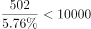
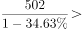
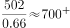
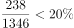

# 综合判断题（基期反推＋比重求整体＋占比门槛比较＋数据可推性甄别）

考点：[[20-考点/资料分析/综合/综合判断题（基期反推＋比重求整体＋占比门槛比较＋数据可推性甄别）|综合 / 综合判断题（基期反推＋比重求整体＋占比门槛比较＋数据可推性甄别）]]
材料：[[15-材料/资料分析/239409 全国互联网保险收入（总量及财产险、人|239409 全国互联网保险收入（总量及财产险、人]]

**问法模型**：'能够从上述资料中推出的是'→四个选项分别套用四个模型逐项验证：基期值＝现期÷(1−减少率)、整体＝部分÷比重、比重＝部分÷整体，并甄别材料根本未给数据的'不可推'选项。

## 推理链
1. 第1步：提取条件——2016年全年互联网财产险收入502亿元且'同比减少'（第一段）；2017年上半年互联网财产险238亿元、互联网保险总收入1346亿元（第二段）；2016年互联网人身险1797亿元、各量均配有占对应全国保费的比重。
2. 第2步：A项需判断'2016年全国总保费是否低于2015年'，而材料只能由'部分÷比重'（2299÷占全国总保费比重）得到2016年总保费，2015年全国总保费无任何数据来源。
3. 第3步：B项用'整体＝部分÷比重'且分母各自配对：全国财产险保费＝502÷占全国财产险保费比重，全国人身险保费＝1797÷占全国人身险保费比重，官方代入后判定财产险保费不足人身险的一半，B错。
4. 第4步：C项用基期公式：2015年互联网财产险＝502÷(1−同比减少率)，除数小于1故结果高于502；等价判据是只要减少率＞502/700−1≈28.3%，结果即超700亿元，官方按材料数值代入确认超过700亿元，C对。
5. 第5步：D项用'比重＝部分÷整体'：238÷1346，与'两成'门槛比较只需比238与1346÷5＝269.2，238＜269.2，占比≈17.7%＜20%，D错。
6. 第6步：与选项对照：A缺数据不可推、B算出小于一半、D低于两成，只有C成立，正确答案为C。

**最快解法**：⚡ 综合判断'逐项套模型＋门槛快比'：①先秒杀D——238与1346÷5＝269.2比较，238偏小即占比低于两成，排除；②A项材料完全未给2015年全国总保费，直接排除；③C项基期公式502÷(1−减少率)，与700比较（等价于判断减少率是否超过约28.3%），官方代入确认成立，锁定答案；④B项部分÷比重配对计算排除。

## 易错点
- ⚠ 基期反推方向混淆（C项核心）：2016年财产险是'同比减少'，基期值＝502÷(1−r)＞502；误写成502×(1−r)或当成'同比增加'用÷(1+r)，都会错判700亿元门槛。
- ⚠ 三套分母必须与分子配对（B项）：全国财产险保费＝502÷占财产险保费比重、全国人身险保费＝1797÷占人身险保费比重，不能用互联网保险内部占比（502/1797）或总保费比重替代，否则B项误判。
- ⚠ D项'两成'＝20%门槛且分子分母勿倒：238/1346≈17.7%＜20%，误将1346当分子或心算失误会误判D对；A项勿把'互联网保险收入同比增加'误当成可推'全国总保费'变化——2015年总保费材料完全未给，属于不可推项。

## 母题抽象
> 🧩 当题干出现'能够从上述资料中推出的是'且四选项分别落在不同年份、不同口径时，用'基期＝现期÷(1±r)、整体＝部分÷比重、比重＝部分÷整体'三模型逐项套用：先秒杀单数据可直算的占比门槛项（如238/1346对20%），再排除材料缺数据的不可推项，最后对基期反推项做数值门槛验证（如502÷(1−r)是否大于700）。

**同类特征**：'能够从上述资料中推出的是'综合判断问法、四选项跨年份跨口径（基期反推/比重求整体/占比门槛/缺数据项）、'超过700亿元'的基期数值门槛判断、'高于两成'即与20%比较、'低于/超过/高于'等比较词逐项核验、现期÷(1−减少率)反推上一期

## 相关题
（暂无）

---

### 题干
能够从上述资料中推出的是：

### 选项
- A. 2016年全国总保费收入低于2015年水平
- B. 2016年全国财产险保费收入超过人身险保费收入的一半
- C. 2015年全国互联网财产险收入超过700亿元　✅
- D. 2017年上半年互联网财产险收入在同期互联网保险收入中的占比高于两成

### 官方解析

A项：定位文字材料第一段“2016年全年全国互联网保险收入为2299亿元，同比增加，占全国总保费收入的，较2016年上半年占比减少”，没有2015年全国总保费相关的数据，故无法推出，错误；

B项：定位文字材料第一段可知：2016年全年互联网财产险收入为502亿元，占全国财产险保费收入的，互联网人身险收入为1797亿元，同比增加，占全国人身险保费收入。则2016年全国财产险保费收入为亿元，2016年全国人身险保费收入为亿元，故财产险保费收入小于人身险保费收入的一半，错误；

C项：定位文字材料第一段“2016年全年······互联网财产险收入为502亿元，同比减少”，根据基期公式：，可得2015年全国互联网财产险收入为亿元，正确；

 D项：定位文字材料第二段“2017年上半年全国互联网保险收入为1346亿元，······互联网财产险收入为238亿元”，故2017年上半年互联网财产险收入在同期互联网保险收入中占比为，错误。

故正确答案选C。

### 给定材料

根据以下资料，回答下列问题。

        2016年全年全国互联网保险收入为2299亿元，同比增加，占全国总保费收入的，较2016年上半年占比减少。其中互联网财产险收入为502亿元，同比减少，占全国财产险保费收入的，较2016年上半年占比减少；互联网人身险收入为1797亿元，同比增加，占全国人身险保费收入的，较2016年上半年占比增加。

        2017年上半年全国互联网保险收入为1346亿元，同比减少，占全国总保费收入的。其中互联网财产险收入为238亿元，同比减少，占全国财产险保费收入的；互联网人身险收入为1108亿元，同比减少，占全国人身险保费收入的。

> [!warning] 疑点（官方解析可能有误，待人工复核）
> 材料原文及官方解析中所有百分比数值（同比增减率、占比、占比变化幅度）均呈空缺，解析B、C、D项代入的具体计算值亦被略去，B项'小于一半'与C项'超过700亿元'的具体代入数值无法独立复核，仅能按官方结论记录；不影响答案C的判定。
