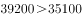
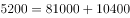
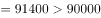
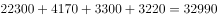

# 综合判断（倍数表述辨析+逐年差值比较+增速不变外推预测+区域加总核验）

考点：[[20-考点/资料分析/综合/综合判断（倍数表述辨析+逐年差值比较+增速不变外推预测+区域加总核验）|综合 / 综合判断（倍数表述辨析+逐年差值比较+增速不变外推预测+区域加总核验）]]
材料：[[15-材料/资料分析/239832 广东省分区域（珠三角-东翼-西翼-粤|239832 广东省分区域（珠三角-东翼-西翼-粤]]

**问法模型**：'下列说法正确的是'四选一综合判断 → 对A/B/C/D分别套用倍数换算、逐年作差、增长量下限外推、分区域加总四个模型逐项排除

## 推理链
1. 第1步：A项——从表1取2016年珠三角地方一般公共预算收入6923.98亿元，粤东西北=东翼285.92+西翼292.35+粤北山区412.47=990.74亿元
2. 第2步：A项套'多几倍=(大−小)/小'：(6923.98−990.74)/990.74≈5.99，即'多约6倍'（6923.98/990.74≈7，是约7倍），与'多7.0倍'不符，A错误
3. 第3步：B项——用表2逐年作差：2012年47824.18−12650.41≈35174，2013年53307.67−14149.40≈39158，…2018年81048.50−19977.45≈61071，差距逐年扩大而非缩小，B错误
4. 第4步：C项——2018年同比增量=81048.50−75809.75=5238.75亿元，同比增速≈5238.75/75809.75≈6.9%
5. 第5步：C项——增速不变则增长量与现期量成正比、逐年增大，2020年值=81048.50+2019年增量+2020年增量＞81048.50+2×5238.75≈91500亿元＞90000亿元，即突破9万亿元，C正确
6. 第6步：D项——广东省固定资产投资=珠三角22321.24+东翼4172.14+西翼3298.27+粤北3217.21=33008.86亿元，选项给30008.86，属'3→0'数字换位陷阱，D错误
7. 第7步：四项核验完毕，仅C正确，与官方答案一致

**最快解法**：⚡ 先攻数字最简的C项（增长量保底法/下限估计）：2018年增量=81048.50−75809.75≈5200亿元；即使增量不再增大，2020年≥81048.50+2×5200≈91400亿元＞90000亿元，何况增速不变时增量逐年变大，必破9万亿，直接锁定C；再加总秒验D：22321.24+4172.14+3298.27+3217.21≈33000（尾数08.86）≠30008.86

## 易错点
- ⚠ '是几倍'与'多几倍'混淆：6923.98/990.74≈7倍是'是7倍'，'多'应为6倍，A项正是利用这一表述陷阱；多7倍对应应是8倍即约7925.92亿元
- ⚠ 增速不变时增长量逐年变大而非恒定，考生易用2018年增量做简单线性外推而低估；但本题只需下限即可判定，不影响结论
- ⚠ D项加总陷阱：全省=珠三角+粤东西北三区，33008.86与30008.86首两位'33/30'换位；另表1中进出口总额单位为亿美元，不能与亿元指标混加

## 母题抽象
> 🧩 当综合判断题出现'按某年同比增速预计N年后将突破X'时，用'增长量保底法'：现期值+(N−现期年份)×最近一期增量做下限，若下限已越过阈值即可锁定正确；当选项出现'多几倍'时，必用(大−小)/小验证而非大/小

**同类特征**：下列说法正确的是（四选一综合判断）、多几倍表述、差距逐年缩小（需逐年作差）、按同比增速预计N年后（增速不变外推）、全省=各区域加总口径、表1横截面+表2时间序列双表联查

## 相关题
- [[10-真题/资料分析/综合/2730994 综合判断题（趋势一致性比对+逐年增长率比较+平均票房合成+五年年均值计数）|2730994]]（深圳市考 2020，相关度1）

---

### 题干
根据上表，下列说法正确的是（    ）。

### 选项
- A. 2016年，珠三角地方一般公共预算收入比粤东西北地区多7.0倍
- B. 2012-2018年，珠三角与粤东西北地区生产总值的差距逐年缩小
- C. 按2018年珠三角地区生产总值的同比增速，预计2020年珠三角地区生产总值将突破9万亿元　✅
- D. 2016年，广东省固定资产投资30008.86亿元

### 官方解析

A项：定位表1可得，2016年珠三角地方一般公共预算收入为6923.98亿元，粤东西北地区为亿元。多7倍代表是8倍，倍8倍，错误；

B项：定位表2可得，2012年珠三角与粤东西北地区生产总值分别为47824.18、12650.41亿元，亿元。2013年珠三角与粤东西北地区生产总值分别为53307.67、14149.40亿元，亿元。，可知差距并非逐年缩小，错误；

C项：定位表2可得，2018年珠三角地区生产总值为81048.50亿元，2017年为75809.75亿元。2018年珠三角地区生产总值同比增量亿元。根据增长量与现期量成正比，保持增长率不变，则2020年的增长量2019年的增长量2018年的增长量，则2020年珠三角地区生产总值2018年珠三角地区生产总值2018年的增长量亿元，正确；

D项：定位表1可得，2016年，广东省固定资产投资为亿元，错误。

故正确答案为C。

### 给定材料

> [!warning] 疑点（官方解析可能有误，待人工复核）
> 官方解析A、B项原文多处数值缺失（如'粤东西北地区为亿元'后数字漏印），按表1/表2补齐：粤东西北预算收入990.74亿元、2012与2013年差值约35174与39158亿元，补齐后A、B仍为错误，不影响C的正确判定

<!-- CODEX-ANSWER-REVIEW:BEGIN -->
### 本次独立复核

**复核状态：** `resolved`（答案与解析已核定）

**计分答案：** C（可计分）

**复核解析：**

1. 第1步：A项——从表1取2016年珠三角地方一般公共预算收入6923.98亿元，粤东西北=东翼285.92+西翼292.35+粤北山区412.47=990.74亿元
2. 第2步：A项套'多几倍=(大−小)/小'：(6923.98−990.74)/990.74≈5.99，即'多约6倍'（6923.98/990.74≈7，是约7倍），与'多7.0倍'不符，A错误
3. 第3步：B项——用表2逐年作差：2012年47824.18−12650.41≈35174，2013年53307.67−14149.40≈39158，…2018年81048.50−19977.45≈61071，差距逐年扩大而非缩小，B错误
4. 第4步：C项——2018年同比增量=81048.50−75809.75=5238.75亿元，同比增速≈5238.75/75809.75≈6.9%
5. 第5步：C项——增速不变则增长量与现期量成正比、逐年增大，2020年值=81048.50+2019年增量+2020年增量＞81048.50+2×5238.75≈91500亿元＞90000亿元，即突破9万亿元，C正确
6. 第6步：D项——广东省固定资产投资=珠三角22321.24+东翼4172.14+西翼3298.27+粤北3217.21=33008.86亿元，选项给30008.86，属'3→0'数字换位陷阱，D错误
7. 第7步：四项核验完毕，仅C正确，与官方答案一致

**最快解法**：⚡ 先攻数字最简的C项（增长量保底法/下限估计）：2018年增量=81048.50−75809.75≈5200亿元；即使增量不再增大，2020年≥81048.50+2×5200≈91400亿元＞90000亿元，何况增速不变时增量逐年变大，必破9万亿，直接锁定C；再加总秒验D：22321.24+4172.14+3298.27+3217.21≈33000（尾数08.86）≠30008.86

**相关信息：**

考點：综合判断（倍数表述辨析+逐年差值比较+增速不变外推预测+区域加总核验）。來源：2019深圳市公务员录用考试《行测》题（网友回忆版）；2019年。> 🧩 当综合判断题出现'按某年同比增速预计N年后将突破X'时，用'增长量保底法'：现期值+(N−现期年份)×最近一期增量做下限，若下限已越过阈值即可锁定正确；当选项出现'多几倍'时，必用(大−小)/小验证而非大/小

**同类特征**：下列说法正确的是（四选一综合判断）、多几倍表述、差距逐年缩小（需逐年作差）、按同比增速预计N年后（增速不变外推）、全省=各区域加总口径、表1横截面+表2时间序列双表联查

**题源依据：** [固定版本原题](https://github.com/Mentat-Uran/kaogongzhentizhengliu/blob/84ab93d4b64b61d897bece8a1c0a5bab06b4feb2/10-%E7%9C%9F%E9%A2%98/%E8%B5%84%E6%96%99%E5%88%86%E6%9E%90/%E7%BB%BC%E5%90%88/2385099%20%E7%BB%BC%E5%90%88%E5%88%A4%E6%96%AD%EF%BC%88%E5%80%8D%E6%95%B0%E8%A1%A8%E8%BF%B0%E8%BE%A8%E6%9E%90%2B%E9%80%90%E5%B9%B4%E5%B7%AE%E5%80%BC%E6%AF%94%E8%BE%83%2B%E5%A2%9E%E9%80%9F%E4%B8%8D%E5%8F%98%E5%A4%96%E6%8E%A8%E9%A2%84%E6%B5%8B%2B%E5%8C%BA%E5%9F%9F%E5%8A%A0%E6%80%BB%E6%A0%B8%E9%AA%8C%EF%BC%89.md)；固定内容 commit `84ab93d4b64b61d897bece8a1c0a5bab06b4feb2`，Markdown blob `8e5f2a2301e94ec49d459b4bb96c6201dfb7a7cb`。
<!-- CODEX-ANSWER-REVIEW:END -->
