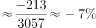

# 综合判断题（进出口总额加总+增长量计算+趋势-倍数-增速逐项验证）

考点：[[20-考点/资料分析/综合/综合判断题（进出口总额加总+增长量计算+趋势-倍数-增速逐项验证）|综合 / 综合判断题（进出口总额加总+增长量计算+趋势/倍数/增速逐项验证）]]
材料：[[15-材料/资料分析/239833 2012—2017年深圳市进出口情况|239833 2012—2017年深圳市进出口情况]]

**问法模型**：「下列说法正确的是」综合判断题→逐项验证法：先加总'出口+进口'构造进出口总额公共中间量，再对趋势、倍数、增速比较、增长量逐项核算排除。

## 推理链
1. 第1步：图中只给出口与进口总额，先加总得进出口总额：2016年=2375.47+1608.92=3984.39亿美元，2017年=2443.58+1697.85=4141.43亿美元（本卷第1、3、5题的公共中间量）。
2. 第2步：验A——2013-2017年总额依次约5374.74→4877.41→4424.59→3984.39→4141.43亿美元，折线2017年增速+3.9%为正即总额回升，趋势为'先降后升'而非'先升后降'，A错。
3. 第3步：验B——2013年出口3057.02÷2017年进口1697.85≈1.80倍，不足2倍，B错。
4. 第4步：验C——折线增速是总额增速，2014年总额增速-9.3%，而出口增速=2843.62÷3057.02-1≈-7.0%，总额增速低于出口增速，C错。
5. 第5步：验D——2017年进出口总额同比增加4141.43-3984.39≈157亿美元（分项作差68.11+88.93），与D项157.07亿美元量级吻合，D对。
6. 第6步：故正确答案为D。

**最快解法**：⚡ 逐项验证+分项作差：D项口算'出口差+进口差'=(2443.58-2375.47)+(1697.85-1608.92)=68.11+88.93≈157亿美元，秒锁D；A项看折线2017年+3.9%为正即排除；B项截位直除3057.02/1697.85≈1.8<2排除。

## 易错点
- ⚠ 折线增速是'进出口总额（出口+进口加总）'的同比增速，不是出口或进口单独的增速，判A、C必须先加总，直接拿柱子高低对折线会全错
- ⚠ A项趋势：2014-2016连续三年下降（-9.3%、-9.3%、-9.9%）易让人忽略2017年+3.9%转升，实际是'先降后升'；且2014与2015标签同为-9.3%需精算区分
- ⚠ C项需逐年代入计算出口增速与总额增速比较（2014年出口约-7.0% vs 总额-9.3%），左右双轴量纲（亿美元与%）不同，柱高与折线数值不可直接比大小

## 母题抽象
> 🧩 当题干出现'下列说法正确的是'且材料为复合柱线图时，先用'出口+进口'加总出进出口总额作公共中间量，再逐项验证：趋势看折线正负定拐点、倍数用直除、增速比较逐年代入、增长量用分项作差。

**同类特征**：下列说法正确的是（综合判断）、进出口总额=出口+进口需自行加总、复合柱线图左右双轴、同比增速折线为总额增速、先升后降趋势判断、出口总额是进口总额的几倍、同比增加XX亿美元（增长量）

## 相关题
- [[10-真题/资料分析/综合/2443054 综合判断题（混合增长率方向判断为主，辅以隔年基期两步折算、图表缺项可求性、无据归因排查）|2443054]]（辽宁 2019，相关度1）
- [[10-真题/资料分析/综合/1752634 综合判断题（混合比重居中定单月比重+折线图累计增速读图比较）|1752634]]（北京 2016，相关度1）
- [[10-真题/资料分析/综合/2187804 综合判断题（基期差值＋增长率比较＋部分差值＋混合居中多模型混合验证）|2187804]]（黑龙江 2018，相关度1）
- [[10-真题/资料分析/综合/2166222 综合判断题·倍数关系验证与顺逆差符号辨析|2166222]]（深圳市考 2018，相关度1）
- [[10-真题/资料分析/综合/2188508 综合分析-说法正确判断（现期比重+增长量比较+净资产生成增速+净资产计算）|2188508]]（黑龙江 2018，相关度1）

---

### 题干
根据上图，下列说法正确的是（    ）。

### 选项
- A. 2013-2017年，深圳市进出口总额呈先升后降的趋势
- B. 2013年深圳市出口总额是2017年进口总额的2倍多
- C. 2013-2017年，深圳市进出口总额的同比增速均高于本年出口总额的同比增速
- D. 2017年，深圳市进出口总额同比增加157.07亿美元　✅

### 官方解析

A项：观察折线图可知，2017年进出口总额同比增长，即2017年进出口总额高于2016年，并不是下降。错误；

B项：由材料可知，2013年深圳市出口额为3057.02亿美元，2017年深圳市进口额为1697.88亿美元，，不足2倍。错误；

C项：由折线图可知2014年深圳市进出口总额增速为，出口额增速为，即2014深圳市进出口总额的同比增速低于本年出口总额的同比增速。错误；

D项：2017年深圳市进出口总额同比增长亿美元。正确。

故正确答案为D。

### 给定材料

> [!warning] 疑点（官方解析可能有误，待人工复核）
> 按图中数据精算2017年同比增量为157.04亿美元（4141.43-3984.39），与D项157.07相差0.03，应为图面数值四舍五入所致，不影响D为唯一正确选项；另官方解析B项将2017年进口额写作1697.88（图中为1697.85），属笔误，不影响'不足2倍'的结论。

<!-- CODEX-ANSWER-REVIEW:BEGIN -->
### 本次独立复核

**复核状态：** `confirmed`（独立复算确认答案）

**计分答案：** D（可计分）

**复核解析：**

1. 2016年进出口总额=2375.47+1608.92=3984.39亿美元；2017年=2443.58+1697.88=4141.46亿美元。
2. A：2013—2017年总额依次为5374.74、4877.41、4424.59、3984.39、4141.46亿美元，趋势为先降后升，不是先升后降。
3. B：2013年出口额3057.02/2017年进口额1697.88≈1.80，小于2。
4. C：2014年进出口总额增速约−9.3%，出口增速=(2843.62/3057.02−1)≈−6.98%，前者低于后者。
5. D：2017年总额同比增加4141.46−3984.39=157.07亿美元，也等于出口增加68.11加进口增加88.96。故只有D正确。

**相关信息：**

独立复核：按题干定义逐项检验，关键基数、比值、增速与图表读数写明以便复算。

**题源依据：** [固定版本原题](https://github.com/Mentat-Uran/kaogongzhentizhengliu/blob/84ab93d4b64b61d897bece8a1c0a5bab06b4feb2/10-%E7%9C%9F%E9%A2%98/%E8%B5%84%E6%96%99%E5%88%86%E6%9E%90/%E7%BB%BC%E5%90%88/2385119%20%E7%BB%BC%E5%90%88%E5%88%A4%E6%96%AD%E9%A2%98%EF%BC%88%E8%BF%9B%E5%87%BA%E5%8F%A3%E6%80%BB%E9%A2%9D%E5%8A%A0%E6%80%BB%2B%E5%A2%9E%E9%95%BF%E9%87%8F%E8%AE%A1%E7%AE%97%2B%E8%B6%8B%E5%8A%BF-%E5%80%8D%E6%95%B0-%E5%A2%9E%E9%80%9F%E9%80%90%E9%A1%B9%E9%AA%8C%E8%AF%81%EF%BC%89.md)；固定内容 commit `84ab93d4b64b61d897bece8a1c0a5bab06b4feb2`，Markdown blob `64bbf5a9f0b87bdbb17c4bdf687afe47510dd961`。
<!-- CODEX-ANSWER-REVIEW:END -->
